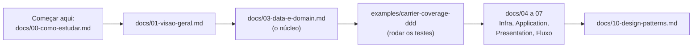
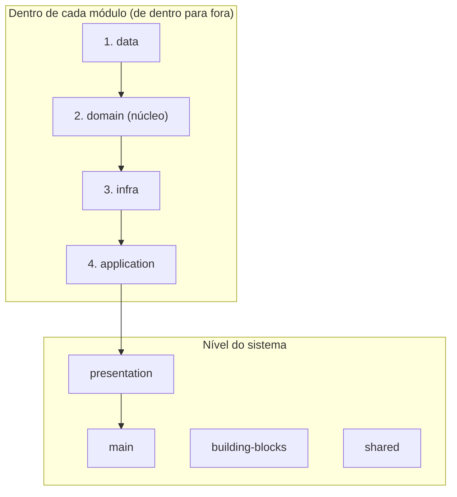

# Design Study — Arquitetura em camadas e Design Patterns

Projeto de estudo que reúne, explica e ilustra o conteúdo de dois repositórios de **Jefferson William**:

- [`design-architecture`](https://github.com/jefferson-william/design-architecture): a *Super Architecture* (DDD, Clean, Onion, Hexagonal e Vertical Slices), CQRS e Event Sourcing.
- [`design-patterns`](https://github.com/jefferson-william/design-patterns): os 23 padrões do GoF.

Quem pegar este repositório para estudar encontra, em ordem: **o que é cada coisa**, **onde ela mora**, **como se liga às outras**, **como testar** e **um exemplo que roda**.

> **Fonte da verdade:** a pasta [`sources/`](sources) tem os arquivos originais, sem alteração. Os guias em [`docs/`](docs) explicam e conectam. Se houver conflito, vale `sources/`. Os erros das próprias fontes estão em [`docs/13-erratas-das-fontes.md`](docs/13-erratas-das-fontes.md).

## Por onde começar

## A arquitetura em uma imagem

| Camada | Em uma frase |
|---|---|
| **data** | Tipos, enums, constantes, schemas e contratos. Nada de processamento |
| **domain** | Regras de negócio puras: Value Object, Entity, Aggregate, Domain Service, Factory, Mapper |
| **infra** | Repository, Query, Mutation e Adapter: fala com o mundo externo |
| **application** | Usecase, Service, Orchestrator, Controller e Handler: orquestra |
| **presentation** | Rotas HTTP e consumers de mensageria |
| **main** | Sobe tudo e liga as peças |

## Conteúdo

### Guias (`docs/`)

| # | Guia | Tema |
|---|---|---|
| 00 | [Como estudar](docs/00-como-estudar.md) | Trilha, tempo estimado, convenção de confiança |
| 01 | [Visão geral](docs/01-visao-geral.md) | Camadas, benefícios, riscos |
| 02 | [Estrutura de pastas](docs/02-estrutura-de-pastas.md) | Árvore completa e exemplos de caminho |
| 03 | [**Data e Domain**](docs/03-data-e-domain.md) | O núcleo, com código e checklist "onde coloco isto?" |
| 04 | [Infra](docs/04-infra.md) | Repository, Query, Mutation, Adapter |
| 05 | [Application](docs/05-application.md) | Usecase, Service, Orchestrator, Controller, Handler |
| 06 | [Presentation, Main, Building blocks](docs/06-presentation-main-building-blocks.md) | Entrada no sistema |
| 07 | [Fluxo de uma requisição](docs/07-fluxo-de-requisicao.md) | Diagramas de sequência HTTP e mensageria |
| 08 | [Dependências e nomenclatura](docs/08-dependencias-e-nomenclatura.md) | Quem importa quem; como nomear |
| 09 | [Testes](docs/09-testes.md) | O que testar em cada peça |
| 10 | [Design Patterns](docs/10-design-patterns.md) | Catálogo dos 23 padrões e onde aparecem |
| 11 | [CQRS e Event Sourcing](docs/11-cqrs-e-event-sourcing.md) | Leitura x escrita; eventos |
| 12 | [Glossário](docs/12-glossario.md) | Todos os termos |
| 13 | [Erratas das fontes](docs/13-erratas-das-fontes.md) | Erros e contradições encontrados |

### Exemplo executável (`examples/`)

[`carrier-coverage-ddd`](examples/carrier-coverage-ddd): Postcode (Value Object), CoverageRange (Entity), CarrierCoverage (Aggregate Root), Mapper, Factory e Domain Service, com testes.

### Fontes originais (`sources/`)

| Pasta | Conteúdo |
|---|---|
| [`sources/design-architecture/ddd`](sources/design-architecture/ddd) | 37 documentos da arquitetura, camada por camada |
| [`sources/design-architecture/cqrs`](sources/design-architecture/cqrs) | README e código de CQRS |
| [`sources/design-architecture/event-sourcing`](sources/design-architecture/event-sourcing) | Código de Event Sourcing |
| [`sources/design-patterns/docs`](sources/design-patterns/docs) | Um documento por padrão de projeto |
| [`sources/design-patterns/behavioral`](sources/design-patterns/behavioral) | Código de Command, Mediator, Observer, State, Strategy e Template Method |

## Mapa rápido: "onde coloco isto?"

| Tenho... | Vai em... | Guia |
|---|---|---|
| Um tipo, enum, constante ou schema | `data` | [03](docs/03-data-e-domain.md) |
| Um valor sem identidade que se auto-valida (CEP, e-mail) | `domain/value-objects` | [03](docs/03-data-e-domain.md) |
| Um objeto com identidade e regras próprias | `domain/entities` | [03](docs/03-data-e-domain.md) |
| Uma regra que envolve várias entities | aggregate root em `domain/entities` | [03](docs/03-data-e-domain.md) |
| Um cálculo de negócio sem persistência | `domain/services` | [03](docs/03-data-e-domain.md) |
| Uma conversão de formato | `domain/mappers` | [03](docs/03-data-e-domain.md) |
| Acesso a banco | `infra/repositories`, `queries`, `mutations` | [04](docs/04-infra.md) |
| Um fluxo de negócio completo | `application/usecases` | [05](docs/05-application.md) |
| Uma sequência de services reutilizável | `application/orchestrators` | [05](docs/05-application.md) |
| Receber HTTP | `application/controllers` + `presentation/http` | [05](docs/05-application.md), [06](docs/06-presentation-main-building-blocks.md) |
| Receber mensagem de fila | `application/handlers` + `presentation/messaging` | [05](docs/05-application.md), [06](docs/06-presentation-main-building-blocks.md) |
| Uma integração técnica reutilizável (HTTP, Kafka) | `building-blocks` | [06](docs/06-presentation-main-building-blocks.md) |

## Status e limites

- Os guias de **arquitetura** (01 a 09, 11) foram escritos lendo por inteiro os documentos de `ddd/`, `cqrs/` e `event-sourcing/`.
- Os docs de **Design Patterns** (um por padrão, `sources/design-patterns/docs`) foram lidos só nos **títulos de seção, na introdução de cada família e nas seções "Aplicabilidade"**. Por isso [`docs/10-design-patterns.md`](docs/10-design-patterns.md) é um catálogo com resumo e link, e não uma reexplicação de cada padrão. Leia o doc original de cada um.
- A explicação do Jefferson sobre "o que testar, sempre o nível acima, o handle" **não está nas fontes**. Está marcada como **PENDENTE** em [`docs/09-testes.md`](docs/09-testes.md).
- O exemplo em `examples/` **ainda não foi executado**. Rode `bun test`.
- O código dentro de `sources/` usa Jest e Node 14 (versões antigas). Para rodá-lo, use o `package.json` do repositório original.

## Créditos

Veja [`NOTICE.md`](NOTICE.md).
