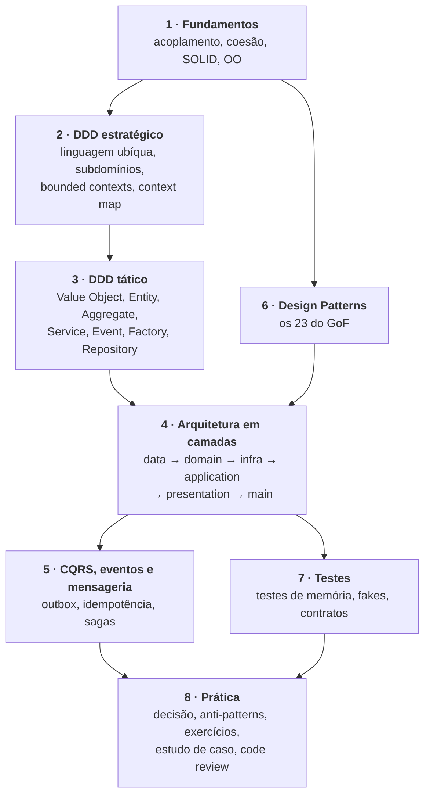
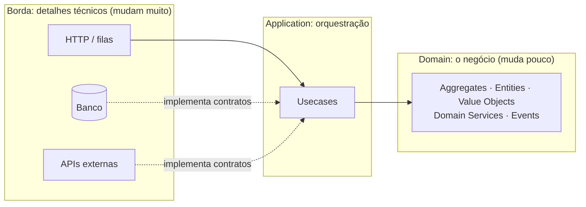

# Design Study

### Um curso completo de DDD, arquitetura em camadas e Design Patterns

> Do "por que estruturar código" até desenhar um sistema com bounded contexts, aggregates, camadas, CQRS, mensageria e os 23 padrões do GoF, com diagramas, código em TypeScript, exercícios e templates.

---

## Para quem é

Para quem já programa e quer aprender a **desenhar** software: separar regra de negócio de detalhe técnico, decidir onde cada código mora, usar padrões com critério e justificar decisões como um arquiteto.

## O mapa

**Comece por [`curso/00-mapa-e-metodo.md`](curso/00-mapa-e-metodo.md).**

## Conteúdo

### Módulo 1 · Fundamentos
| | |
|---|---|
| [1.1 Complexidade, acoplamento e coesão](curso/modulo-01-fundamentos/01-complexidade-acoplamento-coesao.md) | [1.2 SOLID e outros princípios](curso/modulo-01-fundamentos/02-solid.md) |
| [1.3 OO essencial para patterns](curso/modulo-01-fundamentos/03-oo-essencial-para-patterns.md) | [1.4 Linha do tempo](curso/modulo-01-fundamentos/04-linha-do-tempo.md) |

### Módulo 2 · DDD estratégico
| | |
|---|---|
| [2.1 O que é DDD](curso/modulo-02-ddd-estrategico/01-o-que-e-ddd.md) | [2.2 Linguagem ubíqua](curso/modulo-02-ddd-estrategico/02-linguagem-ubiqua.md) |
| [2.3 Domínio e subdomínios](curso/modulo-02-ddd-estrategico/03-dominios-e-subdominios.md) | [2.4 Bounded Context](curso/modulo-02-ddd-estrategico/04-bounded-contexts.md) |
| [2.5 Context Mapping](curso/modulo-02-ddd-estrategico/05-context-mapping.md) | [2.6 Event Storming](curso/modulo-02-ddd-estrategico/06-event-storming.md) |

### Módulo 3 · DDD tático
| | |
|---|---|
| [3.1 Visão geral dos blocos](curso/modulo-03-ddd-tatico/01-visao-geral.md) | [3.2 Value Object](curso/modulo-03-ddd-tatico/02-value-object.md) |
| [3.3 Entity](curso/modulo-03-ddd-tatico/03-entity.md) | [3.4 Aggregate](curso/modulo-03-ddd-tatico/04-aggregate.md) |
| [3.5 Domain Service](curso/modulo-03-ddd-tatico/05-domain-service.md) | [3.6 Domain Event](curso/modulo-03-ddd-tatico/06-domain-event.md) |
| [3.7 Factory](curso/modulo-03-ddd-tatico/07-factory.md) | [3.8 Repository](curso/modulo-03-ddd-tatico/08-repository.md) |
| [3.9 Mapper, DTO e Helper](curso/modulo-03-ddd-tatico/09-mapper-dto-helper.md) | [3.10 Modelo rico x anêmico](curso/modulo-03-ddd-tatico/10-modelo-rico-vs-anemico.md) |
| [3.11 Invariantes e validação](curso/modulo-03-ddd-tatico/11-invariantes-e-validacao.md) | |

### Módulo 4 · Arquitetura em camadas
| | |
|---|---|
| [4.1 Estilos arquiteturais](curso/modulo-04-arquitetura/01-estilos-arquiteturais.md) | [4.2 O modelo em camadas](curso/modulo-04-arquitetura/02-modelo-em-camadas.md) |
| [4.3 A regra de dependência](curso/modulo-04-arquitetura/03-regra-de-dependencia.md) | [4.4 Camada Application](curso/modulo-04-arquitetura/04-camada-application.md) |
| [4.5 Camada Infra](curso/modulo-04-arquitetura/05-camada-infra.md) | [4.6 Presentation e Main](curso/modulo-04-arquitetura/06-presentation-e-main.md) |
| [4.7 Building blocks e Shared](curso/modulo-04-arquitetura/07-building-blocks-e-shared.md) | [4.8 Estrutura de pastas](curso/modulo-04-arquitetura/08-estrutura-de-pastas.md) |
| [4.9 Fluxo ponta a ponta](curso/modulo-04-arquitetura/09-fluxo-ponta-a-ponta.md) | [4.10 Nomenclatura](curso/modulo-04-arquitetura/10-nomenclatura.md) |
| [4.11 Decisões e trade-offs](curso/modulo-04-arquitetura/11-decisoes-e-tradeoffs.md) | |

### Módulo 5 · CQRS, eventos e mensageria
| | |
|---|---|
| [5.1 CQS e CQRS](curso/modulo-05-cqrs-eventos-mensageria/01-cqs-e-cqrs.md) | [5.2 Event Sourcing](curso/modulo-05-cqrs-eventos-mensageria/02-event-sourcing.md) |
| [5.3 Mensageria](curso/modulo-05-cqrs-eventos-mensageria/03-mensageria.md) | [5.4 Consistência eventual e Sagas](curso/modulo-05-cqrs-eventos-mensageria/04-consistencia-eventual-e-sagas.md) |

### Módulo 6 · Design Patterns
[Como estudar](curso/modulo-06-design-patterns/00-como-estudar-patterns.md) · [Padrões na arquitetura](curso/modulo-06-design-patterns/99-padroes-na-arquitetura.md)

| Criacionais | Estruturais | Comportamentais |
|---|---|---|
| [Factory Method](curso/modulo-06-design-patterns/criacionais/factory-method.md) | [Adapter](curso/modulo-06-design-patterns/estruturais/adapter.md) | [Chain of Responsibility](curso/modulo-06-design-patterns/comportamentais/chain-of-responsibility.md) |
| [Abstract Factory](curso/modulo-06-design-patterns/criacionais/abstract-factory.md) | [Bridge](curso/modulo-06-design-patterns/estruturais/bridge.md) | [Command](curso/modulo-06-design-patterns/comportamentais/command.md) |
| [Builder](curso/modulo-06-design-patterns/criacionais/builder.md) | [Composite](curso/modulo-06-design-patterns/estruturais/composite.md) | [Interpreter](curso/modulo-06-design-patterns/comportamentais/interpreter.md) |
| [Prototype](curso/modulo-06-design-patterns/criacionais/prototype.md) | [Decorator](curso/modulo-06-design-patterns/estruturais/decorator.md) | [Iterator](curso/modulo-06-design-patterns/comportamentais/iterator.md) |
| [Singleton](curso/modulo-06-design-patterns/criacionais/singleton.md) | [Facade](curso/modulo-06-design-patterns/estruturais/facade.md) | [Mediator](curso/modulo-06-design-patterns/comportamentais/mediator.md) |
| | [Flyweight](curso/modulo-06-design-patterns/estruturais/flyweight.md) | [Memento](curso/modulo-06-design-patterns/comportamentais/memento.md) |
| | [Proxy](curso/modulo-06-design-patterns/estruturais/proxy.md) | [Observer](curso/modulo-06-design-patterns/comportamentais/observer.md) |
| | | [State](curso/modulo-06-design-patterns/comportamentais/state.md) |
| | | [Strategy](curso/modulo-06-design-patterns/comportamentais/strategy.md) |
| | | [Template Method](curso/modulo-06-design-patterns/comportamentais/template-method.md) |
| | | [Visitor](curso/modulo-06-design-patterns/comportamentais/visitor.md) |

### Módulo 7 · Testes
[7.1 Estratégia](curso/modulo-07-testes/01-estrategia.md) · [7.2 Testando cada bloco](curso/modulo-07-testes/02-testando-cada-bloco.md)

### Módulo 8 · Prática
[8.1 Onde coloco isto?](curso/modulo-08-pratica/01-onde-coloco-isto.md) · [8.2 Anti-patterns](curso/modulo-08-pratica/02-anti-patterns.md) · [8.3 Exercícios](curso/modulo-08-pratica/03-exercicios.md) · [8.4 Estudo de caso](curso/modulo-08-pratica/04-estudo-de-caso.md) · [8.5 Checklist de code review](curso/modulo-08-pratica/05-checklist-de-code-review.md)

### Apoio
- [**Templates**](templates): esqueletos de Value Object, Aggregate, Event, Repository em memória, Usecase, Controller, Handler, Factories, teste e ADR.
- [**Glossário**](GLOSSARIO.md): todos os termos, com link para a explicação.
- [**Referências e créditos**](REFERENCIAS.md).

## A ideia em uma imagem

> **O que é importante para o negócio fica no centro. O que é detalhe técnico fica na borda. As dependências apontam para o centro.**

## Como usar este repositório

1. Siga a trilha na ordem dos módulos (o 6 pode ir em paralelo com o 2 e o 3).
2. Em cada página, leia, **reescreva o código de memória** e responda o "Para fixar".
3. Faça os [exercícios](curso/modulo-08-pratica/03-exercicios.md) e o desafio de projeto.
4. Use o [guia de decisão](curso/modulo-08-pratica/01-onde-coloco-isto.md) e o [checklist](curso/modulo-08-pratica/05-checklist-de-code-review.md) no trabalho do dia a dia.

Os trechos de código são em **TypeScript** e priorizam clareza. São exemplos didáticos, não uma biblioteca: adapte imports e nomes ao seu projeto.

## Créditos

Construído a partir do estudo dos repositórios [design-architecture](https://github.com/jefferson-william/design-architecture) e [design-patterns](https://github.com/jefferson-william/design-patterns), de Jefferson William Machado, e da literatura listada em [REFERENCIAS.md](REFERENCIAS.md).
