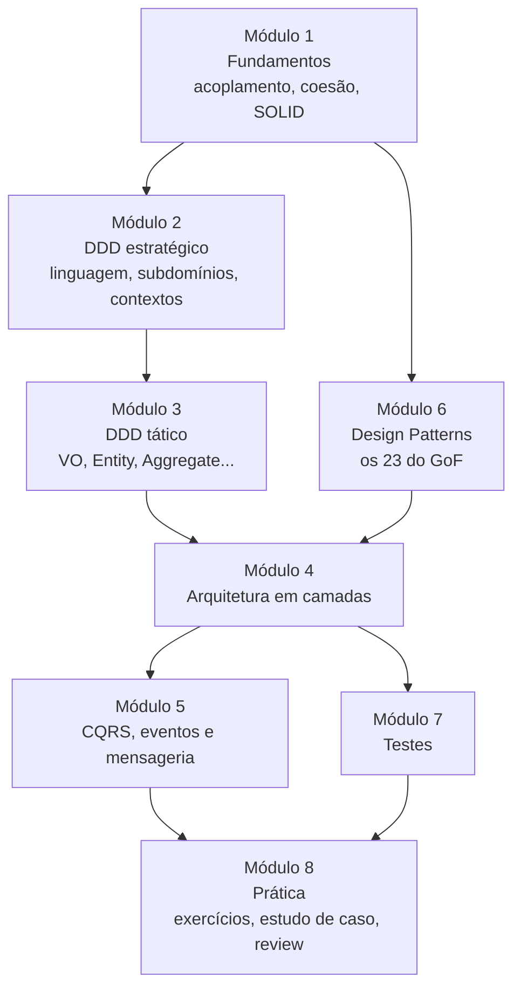

# 00 · Mapa do curso e método de estudo

## Para quem é

Para quem já programa (TypeScript, Java, C#, Go, PHP... a linguagem pouco importa) e quer aprender a **desenhar** software: separar regras de negócio de detalhes técnicos, escolher onde cada código mora e usar padrões de projeto com critério, sem decorar.

Pré-requisitos: classes, interfaces, herança e composição. Os exemplos são em TypeScript.

## O que você vai saber fazer no fim

1. Explicar **por que** uma arquitetura existe, em termos de custo de mudança.
2. Conversar com o negócio e transformar a conversa em **modelo de domínio** (DDD estratégico).
3. Implementar o modelo com **Value Objects, Entities, Aggregates, Domain Services, Events, Factories e Repositories** (DDD tático).
4. Organizar um backend em **camadas**, com dependências apontando para dentro.
5. Separar **leitura de escrita** (CQRS), trabalhar com **eventos** e **mensageria** com segurança.
6. Reconhecer e aplicar os **23 padrões do GoF** e saber quando **não** aplicar.
7. Testar cada peça no nível certo, rápido e sem banco.
8. Justificar decisões como um arquiteto: **trade-offs** explícitos.

## A trilha



O Módulo 6 (patterns) pode ser estudado **em paralelo** com os Módulos 2 e 3. Ele é usado de verdade no Módulo 4.

| Módulo | Tema | Pergunta central | Tempo |
|---|---|---|---|
| [1](modulo-01-fundamentos) | Fundamentos | "O que torna um código caro de mudar?" | 2 h |
| [2](modulo-02-ddd-estrategico) | DDD estratégico | "Qual problema estamos resolvendo, e onde ficam as fronteiras?" | 3 h |
| [3](modulo-03-ddd-tatico) | DDD tático | "Como o código expressa e protege as regras?" | 5 h |
| [4](modulo-04-arquitetura) | Arquitetura em camadas | "Onde cada coisa mora e quem pode depender de quem?" | 5 h |
| [5](modulo-05-cqrs-eventos-mensageria) | CQRS, eventos, mensageria | "Como escalar leitura, escrita e integração?" | 3 h |
| [6](modulo-06-design-patterns) | Design Patterns | "Que solução conhecida existe para este problema recorrente?" | 8 h |
| [7](modulo-07-testes) | Testes | "Como provo que funciona, rápido e sem fragilidade?" | 2 h |
| [8](modulo-08-pratica) | Prática | "Consigo desenhar sozinho?" | 4 h+ |

## Método: como estudar cada tópico

Cada página segue o mesmo roteiro, para você saber o que esperar:

1. **Problema:** a dor que o conceito resolve. Sem dor, não há motivo para usar.
2. **Ideia:** a solução em uma ou duas frases.
3. **Diagrama:** a estrutura vista de cima.
4. **Código:** o mínimo para entender, em TypeScript.
5. **Quando usar / quando não usar:** o critério.
6. **Erros comuns.**
7. **Para fixar:** perguntas curtas. As respostas estão em blocos recolhidos.

Sugestão de rotina:

- **Leia** a página inteira uma vez sem parar.
- **Reescreva** o código de memória, em um projeto vazio.
- **Responda** o "Para fixar" antes de abrir as respostas.
- **Explique** o conceito em voz alta em 1 minuto. Se não conseguir, releia o "Problema".

## Legenda

| Marca | Significado |
|---|---|
| 💡 | Ideia-chave: se lembrar de uma coisa, lembre desta |
| ⚠️ | Armadilha comum |
| 🏛️ | Visão de arquiteto: trade-off, custo, decisão |
| 📌 | Regra adotada neste curso (pode variar em outros times) |

## Ferramentas

Nenhuma é obrigatória. Para rodar os trechos:

```bash
npm create vite@latest sandbox -- --template vanilla-ts
```

Ou, com Bun instalado:

```bash
bun init
```

Os testes usam a sintaxe `describe/test/expect`, compatível com Jest, Vitest e `bun test`.
