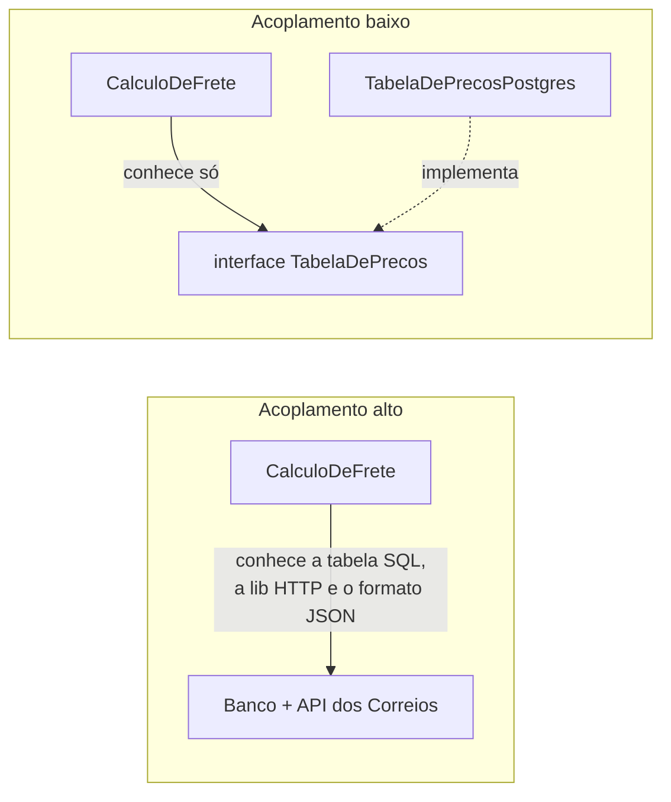

# 1.1 · Complexidade, acoplamento e coesão

## Problema

Todo sistema começa simples. Com o tempo, cada mudança fica mais lenta e mais arriscada: mexe-se em um lugar e quebra outro. Isso não acontece por falta de talento, mas por **falta de estrutura**.

> 💡 Arquitetura de software é o conjunto de decisões que **tornam mudanças baratas** no lugar onde o negócio mais muda.

## Dois tipos de complexidade

| Tipo | O que é | Exemplo | Dá para remover? |
|---|---|---|---|
| **Essencial** | Vem do problema em si | Regras fiscais, cálculo de frete, estados de um pedido | Não. Só organizar |
| **Acidental** | Vem das nossas escolhas | Regra duplicada em 3 controllers, SQL dentro do cálculo de preço | Sim |

O objetivo de DDD e de uma boa arquitetura é **isolar a complexidade essencial** e **eliminar a acidental**.

## Acoplamento

Acoplamento é **o quanto um módulo precisa saber sobre outro** para funcionar.



Formas de acoplamento, da pior para a mais aceitável:

| Tipo | Sintoma |
|---|---|
| **De conteúdo** | Um módulo altera o estado interno de outro (`pedido.itens.push(...)` de fora) |
| **Global** | Vários módulos leem e escrevem a mesma variável global |
| **De controle** | Passar uma flag que diz ao outro módulo o que fazer (`calcular(valor, true, false)`) |
| **De estrutura** | Passar um objeto inteiro quando só um campo é usado |
| **De dados** | Passar só os dados necessários, por parâmetro |
| **Por contrato** | Depender de uma **interface**, e não de uma implementação |

## Coesão

Coesão é **o quanto as partes de um módulo pertencem juntas**. Alta coesão significa que tudo ali muda pelo mesmo motivo.

```ts
// Baixa coesão: três motivos diferentes para mudar
class PedidoService {
  calcularTotal() {}       // regra de negócio
  salvarNoBanco() {}       // persistência
  enviarEmail() {}         // notificação
}

// Alta coesão: cada classe muda por um motivo
class Pedido { calcularTotal() {} }
class PedidoRepository { salvar() {} }
class NotificadorDePedido { enviar() {} }
```

> 💡 **Busque baixo acoplamento entre módulos e alta coesão dentro de cada um.** Quase todo padrão e toda arquitetura deste curso são formas diferentes de chegar nisso.

## Custo de mudança ao longo do tempo

Custo relativo de entregar **uma** nova funcionalidade (ilustrativo):

| Momento do projeto | Sem estrutura | Com estrutura |
|---|:-:|:-:|
| Mês 1 | 1 | 2 |
| Mês 3 | 2 | 2 |
| Mês 6 | 4 | 2,5 |
| Mês 12 | 7 | 3 |
| Mês 24 | 10 | 3,5 |

O código sem estrutura é barato no começo e caro depois. O código estruturado custa um pouco mais no início, e o custo quase não cresce. Os números são ilustrativos; o formato da curva é o que importa.

> 🏛️ **Visão de arquiteto:** estrutura custa no início. Num protótipo descartável, pode não valer a pena. Num sistema que vai viver anos e tem regra de negócio rica, quase sempre vale. **Arquitetura é uma aposta sobre o futuro do sistema: diga explicitamente qual é a aposta.**

## Lei de Conway

> "Organizações que desenham sistemas produzem desenhos que copiam suas estruturas de comunicação." — Melvin Conway, 1968

Na prática: se dois times não conversam, os módulos deles ficarão mal integrados. DDD usa isso a favor, alinhando **fronteiras de código** com **fronteiras de time e de negócio** (Módulo 2).

## Erros comuns

- ⚠️ Confundir **"organizado em pastas"** com **"desacoplado"**. Pastas bonitas com imports cruzados continuam acopladas.
- ⚠️ Criar abstração para tudo "por via das dúvidas". Abstração sem segunda implementação provável é custo sem retorno (veja YAGNI em [1.2](02-solid.md)).

## Para fixar

1. Dê um exemplo de complexidade essencial e um de acidental do seu trabalho.
2. Por que passar `calcular(valor, true, false)` é um acoplamento ruim?
3. Qual o sinal de que uma classe tem baixa coesão?

<details>
<summary>Respostas</summary>

1. Essencial: as regras de cálculo de imposto. Acidental: a mesma regra copiada em dois lugares.
2. É acoplamento de controle: quem chama precisa saber o que cada flag faz dentro da função. Melhor ter funções com nomes claros ou um objeto de opções nomeado.
3. Ela muda por motivos diferentes (regra, banco, e-mail), e os métodos usam conjuntos de campos que não se cruzam.

</details>
