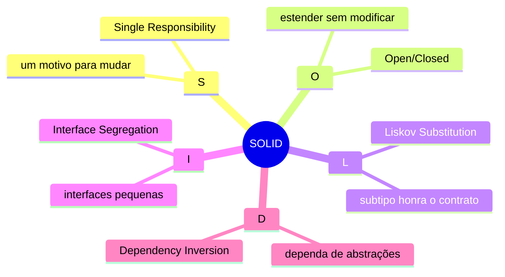
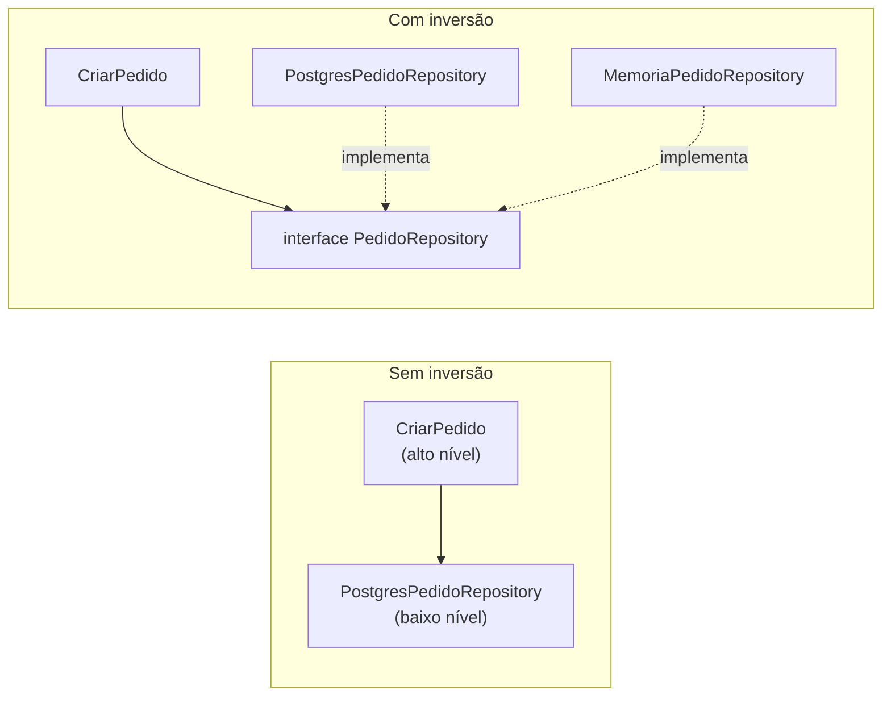

# 1.2 · SOLID e outros princípios

SOLID são cinco princípios de design orientado a objetos reunidos por Robert C. Martin (Uncle Bob). Eles são a base dos padrões de projeto e das arquiteturas deste curso.



---

## S · Single Responsibility Principle (SRP)

> Uma classe deve ter **um, e apenas um, motivo para mudar**.

"Motivo para mudar" significa **um ator**, uma fonte de pedidos de mudança: o financeiro, o time de logística, o DBA.

```ts
// ❌ Muda quando o financeiro muda a regra E quando o DBA muda o banco
class Fatura {
  calcularTotal(): number { /* ... */ return 0 }
  salvar(): void { /* SQL aqui */ }
}

// ✅ Cada uma responde a um ator
class Fatura {
  calcularTotal(): number { /* ... */ return 0 }
}
class FaturaRepository {
  salvar(fatura: Fatura): void { /* SQL aqui */ }
}
```

**No curso:** a separação entre domínio (regra) e infra (persistência) é o SRP aplicado à arquitetura inteira.

---

## O · Open/Closed Principle (OCP)

> Aberto para **extensão**, fechado para **modificação**.

Adicionar um comportamento novo não deve exigir editar código que já funciona.

```ts
// ❌ Cada novo tipo de frete exige editar este switch
function calcularFrete(tipo: string, peso: number) {
  switch (tipo) {
    case 'comum': return peso * 5
    case 'expresso': return peso * 10
    // novo tipo = editar aqui
  }
  throw new Error('tipo inválido')
}

// ✅ Novo tipo = nova classe. Nada existente muda.
interface Frete {
  calcular(peso: number): number
}
class FreteComum implements Frete {
  calcular(peso: number) { return peso * 5 }
}
class FreteExpresso implements Frete {
  calcular(peso: number) { return peso * 10 }
}
```

**No curso:** é o coração dos padrões **Strategy**, **Decorator**, **Chain of Responsibility** e **State**.

---

## L · Liskov Substitution Principle (LSP)

> Se `S` é subtipo de `T`, objetos `T` podem ser substituídos por `S` **sem quebrar o programa**.

O subtipo precisa honrar o contrato: não pode exigir mais nem entregar menos.

```ts
// ❌ Clássico: Quadrado herdando de Retângulo
class Retangulo {
  constructor(protected largura: number, protected altura: number) {}
  setLargura(l: number) { this.largura = l }
  setAltura(a: number) { this.altura = a }
  area() { return this.largura * this.altura }
}
class Quadrado extends Retangulo {
  setLargura(l: number) { this.largura = l; this.altura = l }
  setAltura(a: number) { this.largura = a; this.altura = a }
}

function dobrarLargura(r: Retangulo) {
  r.setLargura(4)
  r.setAltura(5)
  return r.area() // espera 20; com Quadrado retorna 25
}
```

Sinais de violação: subclasse que lança `Error('não suportado')` em método herdado, ou `if (x instanceof Subtipo)` no código cliente.

⚠️ O padrão **Composite** e o exemplo de pedidos de móveis no **Strategy** (Módulo 6) mostram exatamente essa tensão.

---

## I · Interface Segregation Principle (ISP)

> Nenhum cliente deve ser forçado a depender de métodos que não usa.

```ts
// ❌ Interface "gorda"
interface Repositorio<T> {
  buscar(id: string): Promise<T | null>
  listar(): Promise<T[]>
  salvar(item: T): Promise<void>
  remover(id: string): Promise<void>
  relatorioMensal(): Promise<Buffer>
}

// ✅ Interfaces pequenas, por necessidade
interface BuscaPorId<T> { buscar(id: string): Promise<T | null> }
interface Gravacao<T> { salvar(item: T): Promise<void> }
```

**No curso:** é a motivação de **Query** e **Mutation** com um único método `execute` (Módulo 4).

---

## D · Dependency Inversion Principle (DIP)

> Módulos de alto nível não dependem de módulos de baixo nível. **Ambos dependem de abstrações.**



```ts
interface PedidoRepository {
  salvar(pedido: Pedido): Promise<void>
}

class CriarPedido {
  // Recebe a abstração. Não sabe se é Postgres, Mongo ou memória.
  constructor(private readonly pedidos: PedidoRepository) {}

  async execute(input: CriarPedidoInput) {
    const pedido = Pedido.criar(input)
    await this.pedidos.salvar(pedido)
    return pedido
  }
}
```

> 💡 O DIP é o princípio mais importante para arquitetura. **Ele permite testar regra de negócio sem banco** e trocar tecnologia sem mexer no domínio.

⚠️ **DIP não é o mesmo que injeção de dependência.** DIP é sobre **para onde as setas apontam**. Injeção de dependência (passar no construtor) é **uma técnica** para aplicar o DIP.

---

## Outros princípios que você vai ver

| Princípio | Ideia | Cuidado |
|---|---|---|
| **DRY** (Don't Repeat Yourself) | Cada **conhecimento** tem uma única representação | Não é "nunca repetir código". Dois trechos iguais que mudam por motivos diferentes **não** são duplicação |
| **KISS** (Keep It Simple) | A solução mais simples que funciona | "Simples" não é "fácil de escrever agora" |
| **YAGNI** (You Aren't Gonna Need It) | Não construa o que ainda não precisa | Não vale para segurança, nem para decisões caras de reverter |
| **Composição sobre herança** | Prefira "tem um" a "é um" | Herança ainda serve para hierarquias realmente estáveis (veja Template Method) |
| **Lei de Demeter** | Fale só com seus vizinhos: evite `a.getB().getC().fazer()` | É um indicador de acoplamento, não uma lei absoluta |
| **Tell, Don't Ask** | Mande o objeto fazer, em vez de pedir os dados e decidir fora | É a base do **modelo rico** (Módulo 3) |
| **CQS** (Command Query Separation) | Um método **ou** altera estado **ou** retorna dado | É a semente do CQRS (Módulo 5) |

### Tell, Don't Ask em código

```ts
// ❌ Ask: a regra mora fora do objeto
if (conta.getSaldo() >= valor) {
  conta.setSaldo(conta.getSaldo() - valor)
}

// ✅ Tell: a regra mora dentro do objeto
conta.debitar(valor) // lança erro se o saldo for insuficiente
```

## Para fixar

1. Qual princípio é violado por uma subclasse que lança "operação não suportada"?
2. Qual a diferença entre DIP e injeção de dependência?
3. Duas funções com o mesmo código, uma do financeiro e outra da logística: é violação de DRY?

<details>
<summary>Respostas</summary>

1. LSP (Liskov). O subtipo não honra o contrato do tipo base.
2. DIP diz que as duas camadas dependem de uma abstração. Injeção de dependência é a técnica de entregar a implementação de fora (pelo construtor, por exemplo).
3. Provavelmente não. Se mudam por motivos (atores) diferentes, unificá-las cria acoplamento acidental.

</details>
