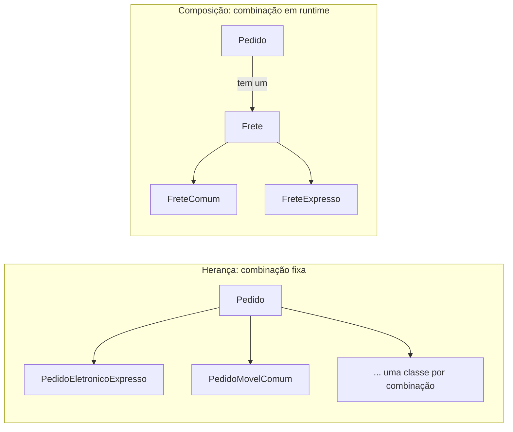

# 1.3 · Orientação a objetos essencial para patterns

Os padrões de projeto são combinações de poucas ferramentas de OO. Dominar estas cinco deixa o Módulo 6 muito mais fácil.

## 1. Interface (contrato)

Define **o que** um objeto faz, sem dizer **como**.

```ts
interface Notificador {
  enviar(destino: string, mensagem: string): Promise<void>
}
```

## 2. Polimorfismo

O mesmo código chama implementações diferentes sem saber qual é.

```ts
class EmailNotificador implements Notificador {
  async enviar(destino: string, mensagem: string) { /* SMTP */ }
}
class SmsNotificador implements Notificador {
  async enviar(destino: string, mensagem: string) { /* API de SMS */ }
}

async function avisar(n: Notificador) {
  await n.enviar('cliente', 'Seu pedido saiu para entrega') // não sabe qual é
}
```

> 💡 **Polimorfismo substitui `if/switch` por tipo.** É o truque por trás de Strategy, State, Command, Visitor e Chain of Responsibility.

## 3. Herança ("é um")

A subclasse reaproveita e especializa a classe base.

```ts
abstract class Pagamento {
  constructor(protected readonly valor: number) {}
  abstract taxa(): number
  total() { return this.valor + this.taxa() } // passo fixo
}
class PagamentoCredito extends Pagamento {
  taxa() { return this.valor * 0.05 }
}
```

Problemas da herança:
- **Acoplamento forte:** a subclasse depende de detalhes da base.
- **Rigidez:** a combinação é decidida em tempo de compilação.
- **Explosão de classes:** cada combinação vira uma subclasse (`PizzaQueijoBordaIntegral`...).

## 4. Composição ("tem um")

O objeto **delega** parte do trabalho a outro objeto que ele recebe.

```ts
class Pedido {
  constructor(private readonly valor: number, private frete: Frete) {}
  trocarFrete(frete: Frete) { this.frete = frete }
  total() { return this.valor + this.frete.calcular(this.valor) }
}
```



> 🏛️ **Regra prática:** comece com composição. Use herança quando existe uma relação "é um" **estável** e um algoritmo com **passos fixos** (Template Method).

## 5. Encapsulamento

O objeto **protege o próprio estado**. Ninguém de fora o deixa inválido.

```ts
class Conta {
  #saldo = 0                       // privado de verdade (runtime)

  depositar(valor: number) {
    if (valor <= 0) throw new Error('Valor deve ser positivo')
    this.#saldo += valor
  }

  get saldo() { return this.#saldo } // leitura sim, escrita não
}
```

TypeScript tem dois tipos de privado:

| Sintaxe | Proteção | Quando usar |
|---|---|---|
| `private saldo` | Só em tempo de compilação | Código interno, simples |
| `#saldo` | Também em runtime | Domínio, quando a invariante importa |

## Como os padrões combinam essas ferramentas

| Padrão | Ferramenta principal |
|---|---|
| Strategy, State, Bridge | Composição + polimorfismo |
| Template Method | Herança |
| Decorator, Proxy, Composite | Composição + a mesma interface do objeto embrulhado |
| Adapter | Composição (de objeto) ou herança (de classe) |
| Factory, Builder | Encapsular a criação |
| Observer, Mediator | Composição + inversão de quem chama quem |

## Para fixar

1. Por que polimorfismo é dito "substituto de `switch`"?
2. Qual o problema de criar uma subclasse para cada combinação de características?
3. Qual a diferença entre `private x` e `#x` em TypeScript?

<details>
<summary>Respostas</summary>

1. Em vez de perguntar o tipo e decidir (`switch (tipo)`), o código chama o método e cada implementação faz a sua parte.
2. O número de classes cresce de forma multiplicativa, e a combinação fica fixa em tempo de compilação.
3. `private` some depois da compilação (dá para acessar em runtime). `#x` é privado de verdade, também em runtime.

</details>
