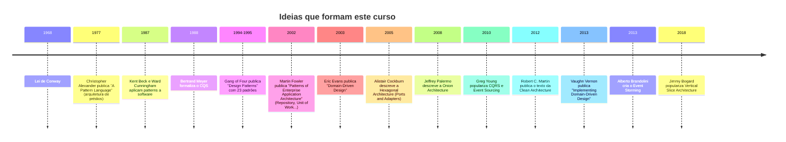

# 1.4 · Linha do tempo: de onde vêm essas ideias

Saber a origem ajuda a entender o **porquê** de cada conceito, e a não tratá-los como dogma.

## Quem é quem

| Pessoa | Contribuição | Onde aparece no curso |
|---|---|---|
| **Christopher Alexander** | Arquiteto de prédios. Definiu "padrão" como solução recorrente para problema recorrente num contexto | Módulo 6 |
| **Kent Beck & Ward Cunningham** | Levaram os patterns para software. Beck também criou o TDD e o XP | Módulos 6 e 7 |
| **Gang of Four** (Gamma, Helm, Johnson, Vlissides) | Catalogaram 23 padrões em criacionais, estruturais e comportamentais | Módulo 6 |
| **Bertrand Meyer** | CQS: um método altera estado **ou** retorna dado | Módulo 5 |
| **Martin Fowler** | Repository, Unit of Work, Data Mapper, Service Layer. Divulgou CQRS e Event Sourcing | Módulos 3, 4 e 5 |
| **Eric Evans** | Criou o DDD: linguagem ubíqua, bounded context, aggregate | Módulos 2 e 3 |
| **Vaughn Vernon** | Tornou o DDD implementável. Regras práticas de aggregate | Módulo 3 |
| **Alistair Cockburn** | Hexagonal Architecture: o núcleo conversa com o mundo por portas | Módulo 4 |
| **Jeffrey Palermo** | Onion Architecture: camadas concêntricas com o domínio no centro | Módulo 4 |
| **Robert C. Martin (Uncle Bob)** | SOLID e Clean Architecture: a regra de dependência | Módulos 1 e 4 |
| **Greg Young** | CQRS e Event Sourcing | Módulo 5 |
| **Alberto Brandolini** | Event Storming, a oficina para descobrir o domínio | Módulo 2 |

## A ideia que une tudo

Todas essas arquiteturas dizem a mesma coisa com palavras diferentes:

> 💡 **O que é importante para o negócio fica no centro. O que é detalhe técnico fica na borda. As dependências apontam para o centro.**

| Arquitetura | Nome que dá ao centro | Nome que dá à borda |
|---|---|---|
| Hexagonal | Aplicação / domínio | Adapters |
| Onion | Domain Model | Infrastructure |
| Clean | Entities / Use Cases | Frameworks & Drivers |
| DDD | Domain Layer | Infrastructure Layer |

O Módulo 4 junta essas visões num modelo único.

## Leituras recomendadas

Em ordem de prioridade para quem está começando:

1. **Eric Evans**, *Domain-Driven Design* (o "livro azul"). Denso, leia a Parte II e IV primeiro.
2. **Vaughn Vernon**, *Domain-Driven Design Distilled*. Curto, ótimo primeiro contato.
3. **Robert C. Martin**, *Clean Architecture*.
4. **Gamma, Helm, Johnson, Vlissides**, *Design Patterns*.
5. **Eric Freeman & Elisabeth Robson**, *Head First Design Patterns*. Didático.
6. **Martin Fowler**, *Patterns of Enterprise Application Architecture*.
7. **Vaughn Vernon**, *Implementing Domain-Driven Design* (o "livro vermelho").
8. Site **Refactoring Guru** (refactoring.guru/design-patterns): ilustrado e gratuito.
