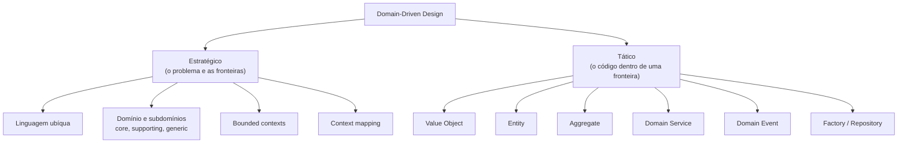
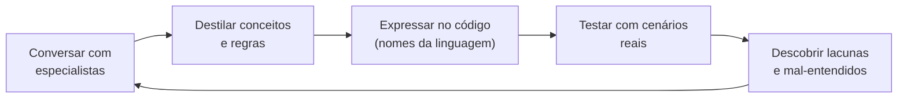

# 2.1 · O que é DDD

**Domain-Driven Design** (Eric Evans, 2003) é uma abordagem para software com **regra de negócio complexa**, em que o design do código é guiado pelo **domínio**: o assunto do negócio, como frete, pagamentos ou estoque.

> 💡 DDD não é uma arquitetura nem um framework. É um **jeito de pensar**: entender profundamente o negócio e fazer o código falar a língua dele.

## As duas metades do DDD

| | Estratégico | Tático |
|---|---|---|
| Pergunta | "**O quê** e **onde**?" | "**Como** no código?" |
| Público | Negócio, produto, arquitetos, times | Desenvolvedores |
| Saída | Mapa de contextos, linguagem, prioridades | Classes, invariantes, testes |
| Erro comum | Pular esta parte | Fazer só esta parte |

> ⚠️ **O erro mais comum é aplicar só o DDD tático** (criar classes chamadas `Entity` e `ValueObject`) sem fazer o estratégico. O resultado é um código com nomes bonitos e fronteiras erradas. Evans chama a parte estratégica de "a mais importante e a mais negligenciada".

## Conceitos básicos

| Termo | Significado | Exemplo |
|---|---|---|
| **Domínio** | A área de conhecimento e atividade do negócio | Logística de entregas |
| **Especialista do domínio** | Quem entende o negócio de verdade | Operador de expedição, analista fiscal |
| **Modelo de domínio** | Uma **abstração seletiva** do domínio, útil para resolver um problema | Pedido, Volume, Faixa de CEP, Cotação |
| **Linguagem ubíqua** | O vocabulário comum entre negócio e código | "Cotação", não "PriceQueryResult" |
| **Bounded context** | A fronteira onde um modelo e sua linguagem são válidos | "Frete" em Cotação ≠ "Frete" em Cobrança |

> 💡 **Um modelo não é uma cópia da realidade.** É um mapa: deixa de fora o que não ajuda a resolver o problema. O mapa do metrô não mostra ruas, e por isso funciona.

## Quando usar DDD

| Use quando | Evite quando |
|---|---|
| A regra de negócio é complexa e muda | É um CRUD simples |
| O negócio é o diferencial competitivo | O problema é técnico (ETL, proxy, integração pura) |
| Há especialistas disponíveis para conversar | Ninguém sabe ou quer explicar as regras |
| O sistema vai viver anos | É um protótipo descartável |
| Vários times trabalham no mesmo produto | É um time de uma pessoa num projeto pequeno |

> 🏛️ **Visão de arquiteto:** dá para usar DDD **seletivamente**. Aplique o tático completo só no **core domain** (2.3). Em subdomínios genéricos, um CRUD bem feito ou um produto pronto costuma ser a melhor escolha.

## O ciclo de modelagem

DDD é **iterativo**: o modelo melhora conforme o time aprende.

Sinais de que o modelo precisa evoluir:
- O especialista usa uma palavra que não existe no código.
- O código tem um `if` cheio de exceções que o negócio explica em uma frase.
- Uma regra simples de explicar é difícil de implementar.

Evans chama a melhora repentina de entendimento de **breakthrough**: o modelo fica mais simples e mais expressivo de uma vez.

## Para fixar

1. Qual a diferença entre DDD estratégico e tático?
2. Por que "modelo não é cópia da realidade"?
3. Cite dois cenários em que DDD não vale a pena.

Respostas

1. O estratégico define o problema, a linguagem e as fronteiras. O tático define como implementar o modelo dentro de uma fronteira.
2. O modelo é uma abstração seletiva, feita para resolver um problema específico. Incluir tudo deixaria o modelo inútil.
3. Um CRUD sem regras, um protótipo descartável, um problema puramente técnico.

