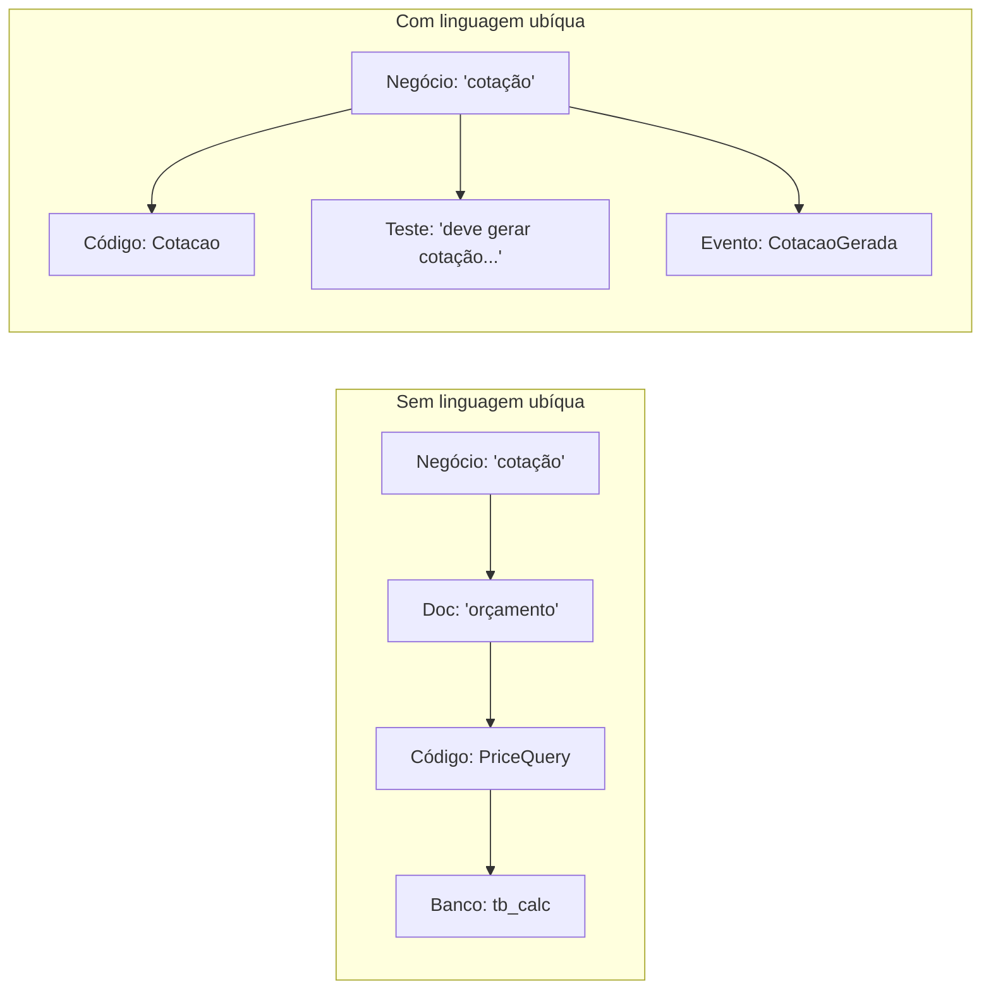

# 2.2 · Linguagem ubíqua

## Problema

O especialista diz "**cotação**", o analista escreve "**orçamento**" no documento, o desenvolvedor cria `PriceQuery` e o banco tem a tabela `tb_calc`. Cada tradução perde informação e gera bugs.

## Ideia

> 💡 Um **vocabulário único**, construído junto com o negócio, usado **em todo lugar**: conversa, documentação, testes, código, banco e eventos.



## Como construir

1. **Ouça** como os especialistas falam. Anote termos, verbos e exceções.
2. **Pergunte** quando um termo for ambíguo: "Pedido cancelado e pedido estornado são a mesma coisa?"
3. **Registre** num glossário vivo, versionado junto com o código.
4. **Use** no código. Se o termo mudar na conversa, mude no código.
5. **Recuse** termos técnicos para conceitos de negócio: `DataManager`, `Processor`, `Handler` genérico.

### Exemplo de glossário

| Termo | Definição do negócio | No código |
|---|---|---|
| **Cotação** | Preço e prazo estimados para enviar um volume entre dois CEPs | `Cotacao` (value object) |
| **Volume** | Uma caixa física com peso e dimensões | `Volume` (entity) |
| **Peso cubado** | Peso calculado pelo volume: `C × L × A / fator` | `Volume.pesoCubado()` |
| **Peso tarifável** | O maior entre o peso real e o cubado | `Volume.pesoTarifavel()` |
| **Postar** | Entregar o volume à transportadora | `Envio.postar()` |
| **Estornar** | Devolver o valor pago depois de cancelado | `Pagamento.estornar()` |

## Verbos importam tanto quanto substantivos

```ts
// ❌ Linguagem técnica: o código não diz o que o negócio faz
pedido.setStatus(3)
pedido.update({ canceledAt: new Date() })

// ✅ Linguagem ubíqua: o código conta a história
pedido.cancelar(motivo)
envio.postar(agencia)
cotacao.expirar()
```

> 💡 Métodos como `setStatus` **escondem a intenção**. Métodos como `cancelar()` dão um lugar natural para as regras ("só cancela se ainda não foi postado").

## A linguagem é limitada por contexto

A mesma palavra pode significar coisas diferentes em áreas diferentes. Isso é normal e é o assunto de [2.4](04-bounded-contexts.md).

| Palavra | Em Vendas | Em Logística | Em Financeiro |
|---|---|---|---|
| **Cliente** | Quem compra | Destinatário com endereço | Pagador com CPF/CNPJ |
| **Pedido** | Carrinho fechado | Lista de volumes a enviar | Título a receber |

## Erros comuns

- ⚠️ **Traduzir para inglês só no código.** Pode fazer, se o time inteiro decidir e o glossário mapear cada termo. O erro é traduzir **sem** combinar.
- ⚠️ **Glossário que ninguém atualiza.** Se mora numa wiki esquecida, morre. Coloque no repositório.
- ⚠️ **Forçar uma palavra única para a empresa inteira.** A linguagem é ubíqua **dentro de um contexto**, não na empresa toda.

## Para fixar

1. Por que `pedido.setStatus(3)` é pior que `pedido.cancelar()`?
2. A palavra "cliente" tem significados diferentes em vendas e no financeiro. Isso é um problema?

<details>
<summary>Respostas</summary>

1. Esconde a intenção, aceita qualquer transição e não dá lugar para a regra. `cancelar()` expressa o negócio e é onde a validação "pode cancelar?" vive.
2. Não. É o sinal de que são **contextos diferentes**. O problema seria forçar um único modelo de "cliente" para todos.

</details>
