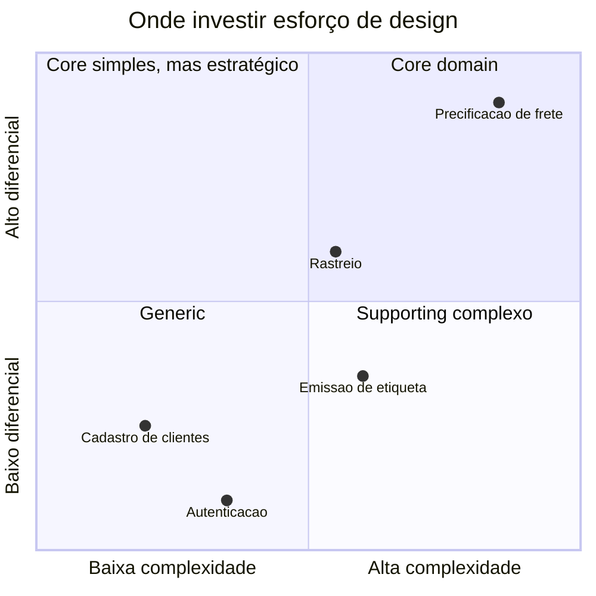
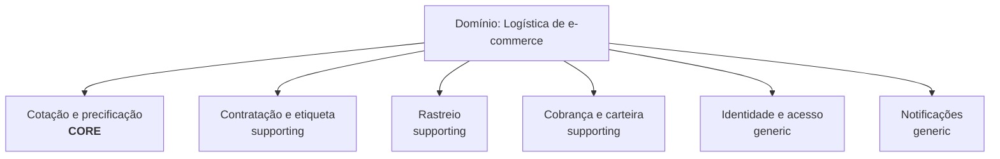

# 2.3 · Domínio e subdomínios

## Problema

Nem todo código merece o mesmo investimento. Gastar meses desenhando o cadastro de usuários enquanto o cálculo de preço, que é o diferencial da empresa, fica num script improvisado é um erro de prioridade.

## Ideia

Divida o domínio em **subdomínios** e classifique cada um pelo valor que gera para o negócio.

## Os três tipos

| Tipo | O que é | Estratégia | Exemplo (empresa de frete) |
|---|---|---|---|
| **Core domain** | O que diferencia a empresa no mercado. Onde está a vantagem competitiva | **Construir dentro de casa**, com os melhores devs e DDD tático completo | Cálculo de preço e escolha da melhor transportadora |
| **Supporting subdomain** | Necessário para o core, específico do negócio, mas não é diferencial | Construir de forma mais simples, ou terceirizar com especificação | Emissão de etiquetas, regras de coleta |
| **Generic subdomain** | Problema resolvido por todo mundo do mesmo jeito | **Comprar ou usar pronto** | Autenticação, envio de e-mail, pagamento |

> 💡 **Pergunta-chave:** "Se fizermos isto igual ao concorrente, perdemos clientes?" Se sim, é core. Se ninguém notaria, é generic.

## Problema x solução

| Espaço do **problema** | Espaço da **solução** |
|---|---|
| Domínio e subdomínios | Bounded contexts |
| Descobertos com o negócio | Desenhados pelo time de tecnologia |
| "Precificação é nosso diferencial" | "O contexto `pricing` tem seu próprio modelo e banco" |

O ideal é **um subdomínio por bounded context**, mas nem sempre acontece (sistemas legados costumam misturar vários).

## Como descobrir os subdomínios

1. Liste as **capacidades** do negócio com verbos: cotar, contratar, coletar, transportar, rastrear, cobrar.
2. Agrupe as que mudam juntas e são feitas pelas mesmas pessoas.
3. Para cada grupo, pergunte: é diferencial? É complexo? Existe pronto no mercado?

## Erros comuns

- ⚠️ Classificar **tudo** como core. Se tudo é prioridade, nada é.
- ⚠️ Construir do zero um subdomínio genérico (um sistema de login próprio, por exemplo) por orgulho técnico.
- ⚠️ Achar que a classificação é eterna. Um supporting pode virar core quando o negócio muda de estratégia.

> 🏛️ **Visão de arquiteto:** a classificação de subdomínios é uma **ferramenta de alocação de pessoas e dinheiro**. Leve-a para a conversa com o produto e com a liderança, não só para o time técnico.

## Para fixar

1. Por que autenticação geralmente é um subdomínio genérico?
2. Onde você aplicaria o DDD tático completo?

Respostas

1. É um problema resolvido da mesma forma por quase todas as empresas, e existem produtos prontos e seguros. Fazer igual ao concorrente não perde clientes.
2. No core domain, onde a complexidade e o diferencial justificam o investimento.

