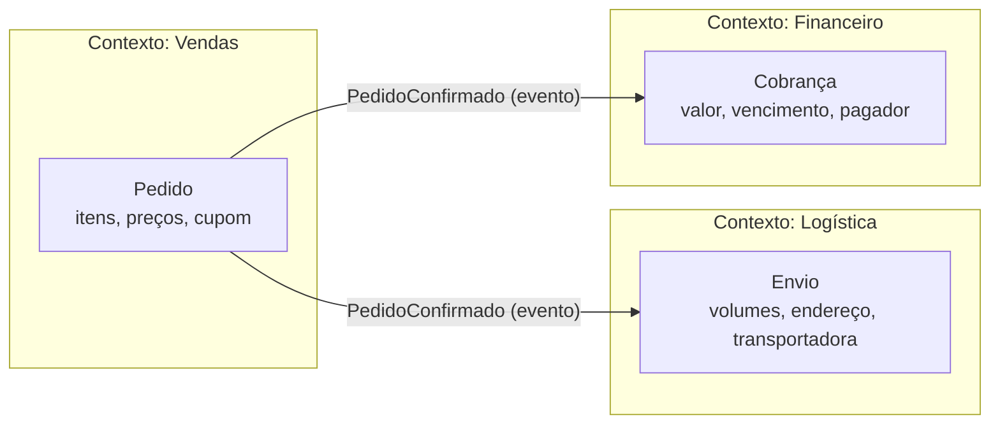
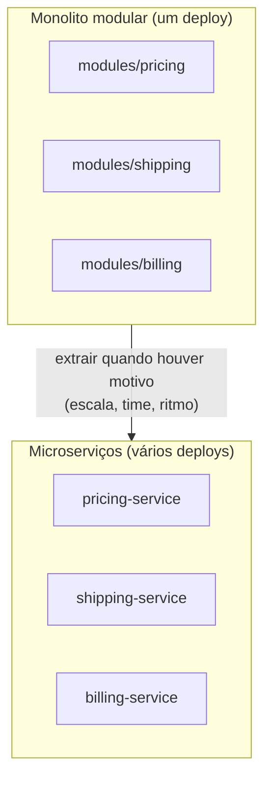

# 2.4 · Bounded Context

## Problema

Uma empresa tenta criar **um único modelo** de `Pedido` que serve para vendas, logística, financeiro e suporte. A classe acaba com 80 campos, metade nulos dependendo de quem usa, e qualquer mudança quebra quatro times.

## Ideia

> 💡 Um **bounded context** é uma fronteira explícita dentro da qual **um modelo e sua linguagem são consistentes**. Fora dela, a mesma palavra pode significar outra coisa, e tudo bem.



Cada contexto tem **seu próprio modelo**. Eles se comunicam por **contratos explícitos** (eventos, APIs), e não compartilhando classes ou tabelas.

## O que um bounded context tem

| Elemento | Exemplo |
|---|---|
| Uma **linguagem** própria | Em Logística, "pedido" se chama "envio" |
| Um **modelo** próprio | `Envio`, `Volume`, `Etiqueta` |
| Uma **equipe** dona (idealmente) | Time de Logística |
| Um **código** próprio | Um módulo, um serviço ou um repositório |
| Um **armazenamento** próprio (idealmente) | Schema ou banco separado |
| **Contratos** públicos | Eventos publicados, API |

## Como encontrar as fronteiras

Sinais de que você está cruzando uma fronteira:

- A **mesma palavra** muda de significado ("cliente" em vendas x em cobrança).
- **Pessoas diferentes** são donas das regras.
- As regras **mudam em ritmos diferentes**.
- Um **subconjunto de dados** só interessa a um grupo.
- Há uma **transformação** natural no meio do processo (o pedido "vira" envio).

## Bounded context x subdomínio x módulo x microserviço

| Conceito | Espaço | Pergunta |
|---|---|---|
| **Subdomínio** | Problema | "Que parte do negócio é esta?" |
| **Bounded context** | Solução (modelo) | "Onde este modelo é válido?" |
| **Módulo** | Código | "Em que pasta/pacote fica?" |
| **Microserviço** | Implantação | "Em que processo roda?" |

> ⚠️ **Bounded context não é microserviço.** Dá para ter vários bounded contexts num único monolito, cada um num módulo bem isolado. Isso se chama **monolito modular** e costuma ser o ponto de partida mais saudável.



> 🏛️ **Visão de arquiteto:** comece com módulos bem separados. Extrair um módulo isolado para um serviço é fácil. Juntar microserviços mal recortados é muito caro.

## Regras de convivência entre contextos

1. **Não compartilhe entidades.** Cada contexto tem a sua versão do conceito.
2. **Não compartilhe tabelas.** Ler a tabela de outro contexto cria acoplamento invisível.
3. **Comunique por contrato.** Evento publicado ou API versionada.
4. **Traduza na borda.** Ao receber dados de outro contexto, converta para o seu modelo (Anticorruption Layer, em [2.5](05-context-mapping.md)).
5. **Tipos compartilhados só se forem técnicos ou estáveis.** Um `Money` genérico tudo bem. Um `Pedido` compartilhado, não.

## Exemplo em código: mesma ideia, modelos diferentes

```ts
// modules/sales/domain/entities/order.ts
export class Order {
  constructor(
    readonly id: string,
    readonly items: OrderItem[],
    readonly coupon: Coupon | null,
  ) {}
  total(): Money { /* soma itens e aplica cupom */ }
}

// modules/shipping/domain/entities/shipment.ts
export class Shipment {
  constructor(
    readonly id: string,
    readonly orderId: string,        // referência por ID, não pelo objeto
    readonly volumes: Volume[],
    readonly destination: Address,
  ) {}
  post(agency: Agency) { /* ... */ }
}
```

`Shipment` guarda só o `orderId`. Ele não importa a classe `Order` do outro contexto.

## Para fixar

1. Um bounded context precisa ser um microserviço?
2. Por que é ruim que o contexto de Logística leia direto a tabela `orders` de Vendas?
3. O que é um monolito modular?

<details>
<summary>Respostas</summary>

1. Não. Pode ser um módulo dentro de um monolito.
2. Cria acoplamento invisível: Vendas não pode mudar a própria tabela sem quebrar Logística, e ninguém sabe disso até quebrar.
3. Um único deploy, mas com módulos isolados por bounded context, que se comunicam por contratos.

</details>
