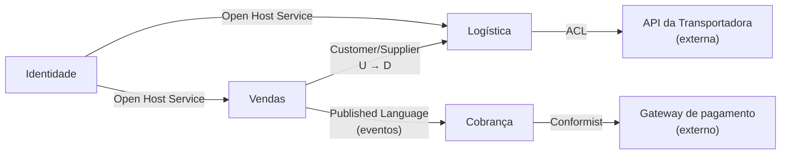
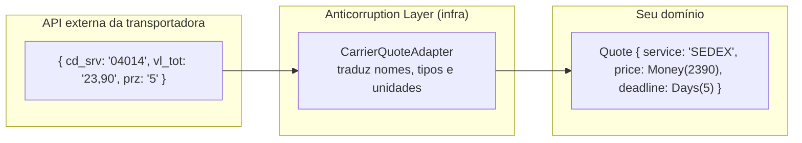

# 2.5 · Context Mapping

## Problema

Bounded contexts não vivem isolados: Logística precisa saber que um pedido foi confirmado, e Cobrança precisa saber o preço do frete. **Como** eles se relacionam define quem manda em quem, quem sofre quando algo muda e onde colocar tradutores.

## Ideia

Um **context map** desenha os contextos e o **tipo de relação** entre eles. Ele mostra tanto a integração técnica quanto a **relação entre times**.



**U** = upstream (quem fornece, cujas mudanças afetam o outro). **D** = downstream (quem consome).

## Os padrões de relação

| Padrão | Ideia | Quando usar |
|---|---|---|
| **Partnership** | Dois times evoluem juntos, combinando mudanças | Contextos que só fazem sentido juntos e times próximos |
| **Shared Kernel** | Pequeno pedaço de modelo compartilhado e versionado em conjunto | Tipos estáveis e realmente comuns (ex.: `Money`). Mantenha **mínimo** |
| **Customer/Supplier** | Upstream entrega o que o downstream precisa; o downstream participa do planejamento | Dependência clara com boa relação entre times |
| **Conformist** | Downstream aceita o modelo do upstream como ele é | Upstream não vai mudar por você (API externa grande) e o modelo dele é aceitável |
| **Anticorruption Layer (ACL)** | Camada de tradução que protege seu modelo do modelo alheio | Upstream legado, confuso ou externo. **O mais usado** |
| **Open Host Service (OHS)** | Upstream oferece uma API pública e estável para vários consumidores | Um contexto consumido por muitos |
| **Published Language** | Formato de troca documentado (schema de evento, JSON Schema, Protobuf) | Junto com OHS ou com eventos |
| **Separate Ways** | Não integrar. Cada um resolve sozinho | O custo de integrar é maior que o de duplicar |
| **Big Ball of Mud** | Reconhece uma área sem modelo claro | Para **demarcar** o legado e não deixar a bagunça vazar |

## Anticorruption Layer em detalhe

> 💡 A ACL é um **tradutor na fronteira**. O resto do seu contexto nunca vê o modelo externo.



```ts
// data: o contrato que o SEU domínio entende
export interface CarrierQuoteGateway {
  quote(input: QuoteInput): Promise<Quote[]>
}

// infra: a ACL que traduz o mundo externo
type ExternalQuote = { cd_srv: string; vl_tot: string; prz: string }

export class AcmeCarrierQuoteAdapter implements CarrierQuoteGateway {
  constructor(private readonly http: HttpClient) {}

  async quote(input: QuoteInput): Promise<Quote[]> {
    const raw: ExternalQuote[] = await this.http.post('/calc', toExternal(input))
    return raw.map((item) =>
      new Quote({
        service: SERVICE_CODES[item.cd_srv] ?? 'UNKNOWN',
        price: Money.fromDecimalString(item.vl_tot.replace(',', '.')),
        deadline: Number(item.prz),
      }),
    )
  }
}
```

Se a transportadora mudar o formato, **só o adapter muda**.

## Como desenhar o seu context map

1. Liste os bounded contexts (seus e externos).
2. Para cada par que conversa, descubra quem é **upstream** e quem é **downstream**.
3. Escolha o padrão da relação. Seja honesto: se o outro time nunca atende seus pedidos, você é **Conformist** ou precisa de uma **ACL**, não Customer/Supplier.
4. Desenhe e versione o mapa junto com a documentação de arquitetura.

> 🏛️ **Visão de arquiteto:** o context map é um **diagnóstico político** tanto quanto técnico. Ele mostra dependências entre times, e por isso ajuda a planejar roadmap e priorizar conversas.

## Para fixar

1. Quando você escolheria Conformist em vez de ACL?
2. Por que o Shared Kernel deve ser mínimo?
3. Onde, na arquitetura em camadas, mora uma ACL?

<details>
<summary>Respostas</summary>

1. Quando o modelo do upstream é bom o bastante para o seu caso e traduzir custaria mais do que ajudaria.
2. Tudo no kernel exige coordenação entre times para mudar. Quanto maior, maior o acoplamento.
3. Na infra, como um adapter que implementa um contrato definido pelo seu domínio ou camada data.

</details>
