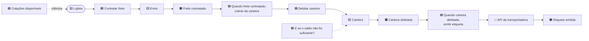

# 2.6 · Event Storming: descobrindo o domínio

## Problema

Requisitos escritos por uma pessoa e lidos por outra perdem nuances. O desenvolvedor descobre as regras de verdade só depois do deploy, pelo bug.

## Ideia

**Event Storming** (Alberto Brandolini) é uma oficina colaborativa em que negócio e tecnologia mapeiam o processo usando **post-its coloridos** numa parede longa (ou num quadro digital, como Miro).

> 💡 Comece pelos **eventos de domínio**: fatos que aconteceram, no passado, que importam para o negócio. "Pedido confirmado", "Volume postado", "Pagamento estornado".

## As cores

| Cor | Elemento | Exemplo |
|---|---|---|
| 🟧 Laranja | **Evento de domínio** (verbo no passado) | `Cotação gerada` |
| 🟦 Azul | **Comando**: a intenção que causa o evento | `Gerar cotação` |
| 🟨 Amarelo pequeno | **Ator**: quem dispara o comando | Lojista |
| 🟨 Amarelo grande | **Aggregate**: quem recebe o comando e garante as regras | `Cotacao` |
| 🟪 Lilás | **Política**: "sempre que X, então Y" | "Quando pagamento aprovado, emitir etiqueta" |
| 🟩 Verde | **Read model**: a informação que o ator vê para decidir | Tela de preços por transportadora |
| 🩷 Rosa | **Sistema externo** | API dos Correios |
| 🟥 Vermelho | **Hotspot**: dúvida, conflito ou problema | "O que acontece se a API cair?" |

## O fluxo de uma linha

## As três fases

| Fase | Objetivo | Duração típica |
|---|---|---|
| **Big Picture** | Todo o processo de ponta a ponta, só com eventos e hotspots. Descobrir os subdomínios | 2 a 4 h |
| **Process Level** | Um processo com comandos, políticas, read models e sistemas externos | 2 h por processo |
| **Design Level** | Os aggregates e as regras, pronto para virar código | 2 h por aggregate |

## Do post-it para o código

| Post-it | Vira no código |
|---|---|
| 🟧 Evento | `class FreteContratado implements DomainEvent` |
| 🟦 Comando | Método do aggregate (`envio.contratar()`) ou input do usecase |
| 🟨 Aggregate | Aggregate root (`class Envio`) |
| 🟪 Política | Handler de evento / Orchestrator / Saga |
| 🟩 Read model | Query (`ListarCotacoesQuery`) |
| 🩷 Sistema externo | Adapter na infra (com ACL) |
| 🟥 Hotspot | Pergunta para o especialista, ou um caso de teste |

## Dicas de facilitação

- Convide **quem faz o trabalho de verdade**, não só gestores.
- Regra: **eventos no passado** e escritos na linguagem do negócio.
- Não discuta tecnologia na Big Picture.
- Hotspots não são falha: são o que a oficina tem de mais valioso.
- Fotografe tudo e transforme os eventos no glossário ([2.2](02-linguagem-ubiqua.md)).

## Para fixar

1. Por que começar pelos eventos, e não pelas entidades?
2. Uma política "quando X, então Y" vira o quê no código?

Respostas

1. Eventos são fatos que o negócio reconhece e entende. Partir de entidades leva a modelar dados (tabelas), e não comportamento.
2. Um handler que reage a um evento e dispara um comando: event handler, orchestrator ou saga.

