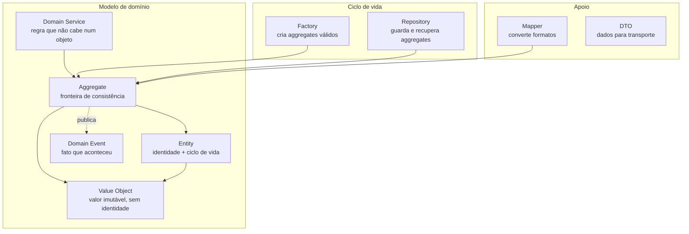
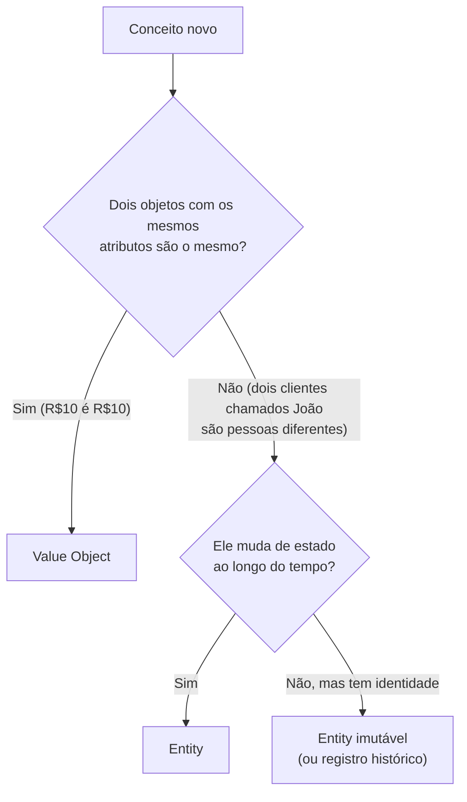

# 3.1 · Visão geral dos blocos táticos

O DDD tático é o conjunto de **blocos de construção** para implementar o modelo de domínio dentro de um bounded context.

## Resumo em uma linha cada

| Bloco | Pergunta que responde | Exemplo |
|---|---|---|
| [Value Object](02-value-object.md) | "Este conceito é só um valor?" | `Money`, `Email`, `Cep`, `Periodo` |
| [Entity](03-entity.md) | "Preciso acompanhar **qual** é este objeto ao longo do tempo?" | `Cliente`, `Volume` |
| [Aggregate](04-aggregate.md) | "Quais objetos precisam estar consistentes **juntos**, na mesma transação?" | `Pedido` + `ItemPedido` |
| [Domain Service](05-domain-service.md) | "Esta regra envolve vários objetos e não pertence a nenhum?" | `CalculadoraDeFrete` |
| [Domain Event](06-domain-event.md) | "Que fato aconteceu que outras partes querem saber?" | `PedidoConfirmado` |
| [Factory](07-factory.md) | "Criar este objeto é complexo?" | `PedidoFactory.deCarrinho()` |
| [Repository](08-repository.md) | "Como guardo e recupero um aggregate inteiro?" | `PedidoRepository` |
| [Mapper / DTO](09-mapper-dto-helper.md) | "Como converto entre formatos?" | `PedidoMapper.toDto()` |

## A decisão mais frequente: VO ou Entity?

> 💡 **Na dúvida, comece como Value Object.** É mais simples, imutável e fácil de testar. Promova a Entity quando surgir a necessidade de identidade.

## Onde cada bloco mora

| Bloco | Camada | Pasta sugerida |
|---|---|---|
| Value Object | domain | `domain/value-objects` |
| Entity, Aggregate | domain | `domain/entities` |
| Domain Service | domain | `domain/services` |
| Domain Event | domain | `domain/events` |
| Factory | domain | `domain/factories` |
| **Contrato** de Repository | data | `data/repositories.ts` |
| **Implementação** de Repository | infra | `infra/repositories` |
| Mapper | domain ou infra | `domain/mappers` |
| Schema, tipos, enums | data | `data/` |

Detalhes no Módulo 4.

## As invariantes são o fio condutor

> 💡 **Invariante** é uma regra que precisa ser **sempre** verdadeira. "Um pedido confirmado tem ao menos um item." "O saldo da carteira nunca fica negativo."

Cada bloco tático existe para **proteger invariantes no nível certo**:

| Nível | Quem protege | Exemplo |
|---|---|---|
| Um valor | Value Object | "Um e-mail tem formato válido" |
| Um objeto com identidade | Entity | "A data de entrega não é anterior à de postagem" |
| Um grupo de objetos | Aggregate Root | "O total do pedido é a soma dos itens" |
| Vários aggregates | Domain Service + Application (consistência eventual) | "Não pode haver dois envios para o mesmo pedido" |

Veja [3.11](11-invariantes-e-validacao.md) para a estratégia completa de validação.
