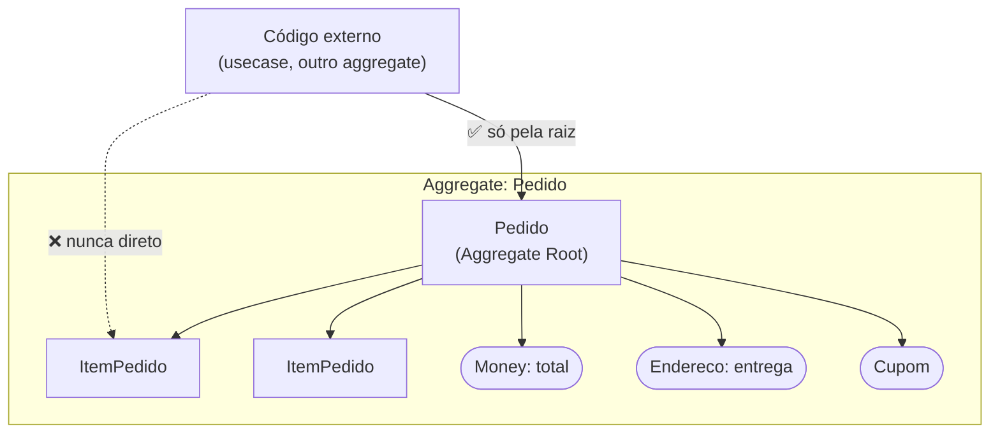
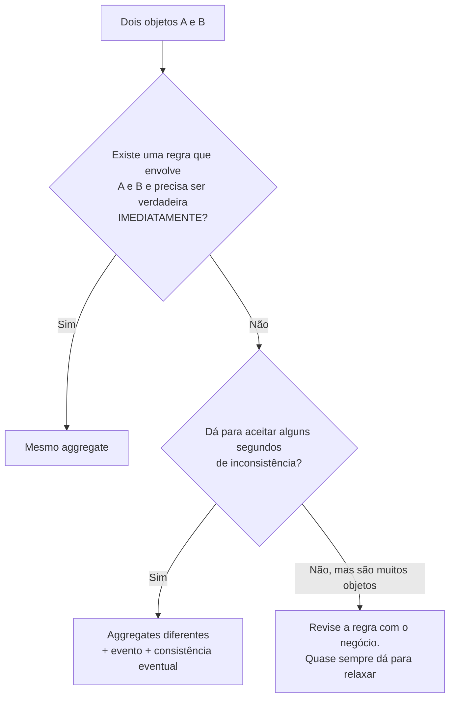

# 3.4 · Aggregate

## Problema

```ts
const pedido = await repo.buscar(id)
pedido.itens.push(new Item('produto-x', 3))  // ninguém recalculou o total
pedido.total = pedido.total - 1000          // desconto aplicado "na mão"
pedido.status = 'ENVIADO'                   // pulou o pagamento
```

Quando qualquer código altera qualquer parte de um conjunto de objetos, **ninguém garante as regras do conjunto**.

## Ideia

> 💡 Um **Aggregate** é um grupo de Entities e Value Objects tratado como **uma unidade de consistência**. Ele tem **uma** porta de entrada, a **Aggregate Root**, que é a única responsável por manter as invariantes do grupo.



## As quatro regras de ouro (Vaughn Vernon)

| # | Regra | Por quê |
|---|---|---|
| 1 | **Proteja as invariantes reais dentro da fronteira** | O aggregate existe para isso |
| 2 | **Desenhe aggregates pequenos** | Menos conflito de concorrência, carga mais rápida |
| 3 | **Referencie outros aggregates só pelo ID** | Evita carregar o mundo inteiro e acoplar fronteiras |
| 4 | **Use consistência eventual entre aggregates** | Uma transação altera **um** aggregate |

## Exemplo completo: Pedido

```ts
// domain/entities/order-item.ts
export class OrderItem {
  constructor(
    readonly productId: string,
    readonly unitPrice: Money,
    private _quantity: number,
  ) {
    if (!Number.isInteger(_quantity) || _quantity <= 0) throw new Error('Quantity must be a positive integer')
  }

  get quantity() { return this._quantity }

  subtotal() { return this.unitPrice.multiply(this._quantity) }

  /** @internal só o Order chama */
  increase(by: number) { this._quantity += by }
}
```

```ts
// domain/entities/order.ts
type OrderStatus = 'DRAFT' | 'PLACED' | 'PAID' | 'CANCELLED'

export class Order {
  #items: OrderItem[] = []
  #status: OrderStatus = 'DRAFT'
  #events: DomainEvent[] = []

  private constructor(
    readonly id: string,
    readonly customerId: string,  // regra 3: outro aggregate só pelo ID
  ) {}

  static create(id: string, customerId: string) {
    return new Order(id, customerId)
  }

  get status() { return this.#status }
  get items(): readonly OrderItem[] { return [...this.#items] } // cópia: ninguém altera de fora

  total(): Money {
    return this.#items.reduce((sum, item) => sum.add(item.subtotal()), Money.zero())
  }

  addItem(productId: string, unitPrice: Money, quantity: number) {
    this.assertStatus('DRAFT', 'add items')
    const existing = this.#items.find((item) => item.productId === productId)
    if (existing) existing.increase(quantity)
    else this.#items.push(new OrderItem(productId, unitPrice, quantity))
  }

  removeItem(productId: string) {
    this.assertStatus('DRAFT', 'remove items')
    this.#items = this.#items.filter((item) => item.productId !== productId)
  }

  place(now: Date) {
    this.assertStatus('DRAFT', 'place')
    if (this.#items.length === 0) throw new Error('Cannot place an empty order')
    this.#status = 'PLACED'
    this.#events.push(new OrderPlaced(this.id, this.total(), now))
  }

  markAsPaid(now: Date) {
    this.assertStatus('PLACED', 'mark as paid')
    this.#status = 'PAID'
    this.#events.push(new OrderPaid(this.id, now))
  }

  cancel(reason: string, now: Date) {
    if (this.#status === 'CANCELLED') return
    if (this.#status === 'PAID') throw new Error('Paid orders must be refunded, not cancelled')
    this.#status = 'CANCELLED'
    this.#events.push(new OrderCancelled(this.id, reason, now))
  }

  pullEvents(): DomainEvent[] {
    const events = this.#events
    this.#events = []
    return events
  }

  private assertStatus(expected: OrderStatus, action: string) {
    if (this.#status !== expected) throw new Error(`Cannot ${action} when order is ${this.#status}`)
  }
}
```

Invariantes protegidas pela raiz:

| Invariante | Onde |
|---|---|
| Quantidade é inteiro positivo | `OrderItem` (constructor) |
| Itens só mudam enquanto `DRAFT` | `Order.addItem/removeItem` |
| Pedido não é colocado vazio | `Order.place` |
| Pedido pago não é cancelado (é estornado) | `Order.cancel` |
| O total é sempre a soma dos itens | `Order.total` (calculado, nunca atribuído) |
| Ninguém altera a lista de fora | `get items` devolve cópia |

> 💡 **Dados derivados não se guardam, se calculam.** `total()` é calculado a partir dos itens; não existe `setTotal`. Se precisar persistir por performance, é um detalhe da infra, e a raiz continua sendo a fonte da verdade.

## Como decidir a fronteira



Exemplos:

| Situação | Decisão |
|---|---|
| Itens e total do pedido | **Mesmo aggregate** (total precisa bater sempre) |
| Pedido e estoque do produto | **Diferentes**. Reserva de estoque por evento |
| Pedido e cliente | **Diferentes**. Pedido guarda `customerId` |
| Carteira e seus lançamentos | **Mesmo** se o saldo precisa ser checado a cada débito. Pode virar Event Sourcing (Módulo 5) |

## Concorrência: optimistic locking

Dois usuários editam o mesmo aggregate ao mesmo tempo. Sem controle, o último a salvar apaga o trabalho do outro.

```ts
// o aggregate carrega uma versão
class Order {
  constructor(/* ... */, readonly version: number) {}
}

// a infra só grava se a versão não mudou
// UPDATE orders SET ..., version = version + 1 WHERE id = $1 AND version = $2
// se nenhuma linha foi afetada → lança ConcurrencyError e o usecase decide (repetir ou avisar)
```

Aggregates pequenos = menos conflitos.

## Erros comuns

- ⚠️ **Aggregate gigante** ("Cliente com todos os pedidos, endereços e pagamentos"). Lento e cheio de conflitos.
- ⚠️ **Expor a coleção interna** (`get items() { return this.#items }`). Quem recebe pode dar `push`.
- ⚠️ **Referenciar outro aggregate pelo objeto** (`order.customer.address`). Use o ID e busque quando precisar.
- ⚠️ **Alterar dois aggregates na mesma transação** "porque é mais fácil". Funciona até a primeira condição de corrida.

## Para fixar

1. Por que `get items()` devolve uma cópia?
2. Pedido e Estoque deveriam ficar no mesmo aggregate?
3. Por que `total()` não tem setter?

<details>
<summary>Respostas</summary>

1. Para que ninguém altere a lista sem passar pela raiz, o que burlaria as invariantes.
2. Normalmente não. O estoque é compartilhado por muitos pedidos; colocá-los juntos geraria conflitos constantes. Reserve estoque por evento, com consistência eventual.
3. Porque é derivado dos itens. Permitir atribuição deixaria o total divergir da soma.

</details>
