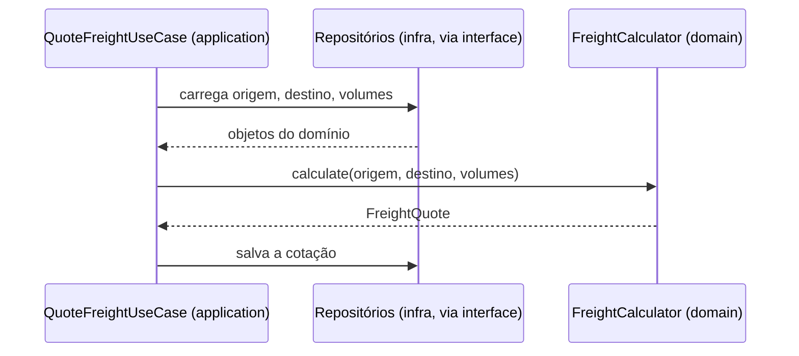

# 3.5 · Domain Service

## Problema

Calcular o frete precisa da **origem**, do **destino**, dos **volumes** e da **tabela de preços**. Colocar `calcularFrete()` dentro de `Volume` obriga o volume a conhecer endereços e tabelas. Colocar dentro de `Endereco` é ainda mais estranho.

## Ideia

> 💡 Um **Domain Service** guarda uma regra de negócio que **não pertence naturalmente a nenhuma Entity ou Value Object**, geralmente porque envolve vários deles. Ele é **sem estado** e **não acessa o mundo externo**.

| Característica | Significado |
|---|---|
| **Regra de negócio pura** | Só lógica do domínio |
| **Stateless** | Não guarda estado entre chamadas |
| **Opera com objetos do domínio** | Recebe e devolve Entities e VOs |
| **Sem I/O** | Não acessa banco, fila ou HTTP. Recebe os dados já carregados |
| **Nome da linguagem ubíqua** | `CalculadoraDeFrete`, `PoliticaDeDesconto`, não `FreightHelper` |

## Exemplo: cálculo de frete com Strategy

```ts
// data/freight.ts — contrato da estratégia (camada data)
export interface DistanceStrategy {
  distanceInKm(origin: Geolocation, destination: Geolocation): number
}
```

```ts
// domain/services/haversine-distance.ts
export class HaversineDistance implements DistanceStrategy {
  private static readonly EARTH_RADIUS_KM = 6371

  distanceInKm(a: Geolocation, b: Geolocation): number {
    const toRad = (deg: number) => (deg * Math.PI) / 180
    const dLat = toRad(b.data.latitude - a.data.latitude)
    const dLon = toRad(b.data.longitude - a.data.longitude)
    const h =
      Math.sin(dLat / 2) ** 2 +
      Math.cos(toRad(a.data.latitude)) * Math.cos(toRad(b.data.latitude)) * Math.sin(dLon / 2) ** 2
    return 2 * HaversineDistance.EARTH_RADIUS_KM * Math.asin(Math.sqrt(h))
  }
}
```

```ts
// domain/services/freight-calculator.ts
export class FreightCalculator {
  constructor(
    private readonly distance: DistanceStrategy,
    private readonly pricePerKm: Money,
  ) {}

  calculate(origin: Geolocation, destination: Geolocation, volumes: readonly Volume[]): FreightQuote {
    const km = this.distance.distanceInKm(origin, destination)
    const billableKg = volumes.reduce((sum, volume) => sum + volume.billableWeightKg(), 0)
    const weightFactor = billableKg <= 100 ? 1 : 1 + (billableKg - 100) * 0.01
    const price = this.pricePerKm.multiply(km * weightFactor)
    const estimatedHours = km / 60

    return new FreightQuote(price, Math.ceil(estimatedHours / 24))
  }
}
```

Note:
- O service **recebe** a estratégia de distância. Trocar Haversine por uma tabela de rotas não muda o service (padrão **Strategy**, Módulo 6).
- A distância é **síncrona**. Se precisasse de uma API externa (Google Maps), o resultado seria buscado **antes**, na camada de aplicação, e passado como dado. **O domínio não faz I/O.**

## Domain Service x Application Service

Essa é a confusão mais comum. A diferença está em **I/O** e em **regra de negócio**.

| | Domain Service | Application Service / Usecase |
|---|---|---|
| Camada | domain | application |
| Contém regra de negócio? | **Sim** | Só orquestração |
| Acessa banco/HTTP/fila? | **Não** | Sim, via interfaces |
| Estado | Stateless | Stateless |
| Exemplo | `FreightCalculator.calculate()` | `QuoteFreightUseCase.execute()`: busca dados, chama o calculator, salva, publica evento |



## Quando usar / quando não usar

| Use | Evite |
|---|---|
| A regra envolve **vários** aggregates ou VOs | Quando a regra cabe numa Entity (vira **modelo anêmico**) |
| Colocar a regra num objeto o obrigaria a conhecer coisas que não são dele | Quando o "service" faz I/O (é um application service) |
| A regra é um conceito do negócio com nome próprio | Para agrupar funções soltas (vira um "helper") |

> ⚠️ **Domain Services demais são um cheiro.** Se cada regra vira um service, as entities ficam só com dados: o modelo ficou anêmico ([3.10](10-modelo-rico-vs-anemico.md)).

## Para fixar

1. Por que o Domain Service não pode chamar uma API externa?
2. `TransferirSaldoEntreCarteiras` é domain service ou usecase?

<details>
<summary>Respostas</summary>

1. Porque o domínio precisa ser puro: determinístico, testável sem infra e independente de tecnologia. O I/O fica na application/infra, e o resultado entra no domínio como dado.
2. Depende do que faz. A **regra** (as duas carteiras precisam ser da mesma moeda, o débito não pode deixar saldo negativo) é domain service. **Carregar** as carteiras, chamar a regra, salvar e publicar eventos é o usecase.

</details>
