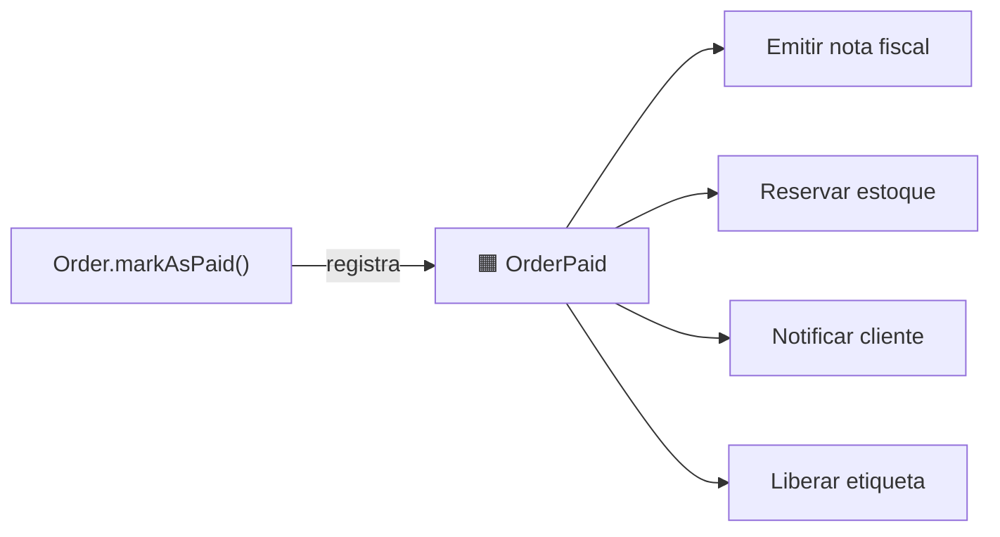
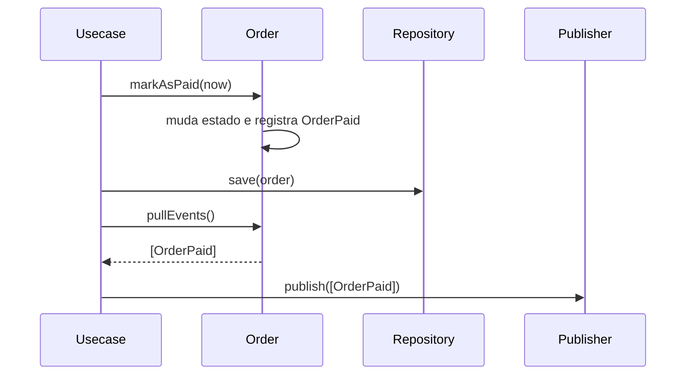

# 3.6 · Domain Event

## Problema

Quando um pedido é pago, é preciso emitir a nota, reservar estoque, avisar o cliente e liberar a etiqueta. Colocar tudo isso dentro de `Order.markAsPaid()` acopla o pedido a quatro outras áreas.

## Ideia

> 💡 Um **Domain Event** é um **fato que aconteceu** no domínio e que interessa a outras partes. Ele é **imutável**, nomeado **no passado** e carrega os dados necessários para quem reagir.

`PedidoPago`, `VolumePostado`, `CarteiraDebitada`, `CotacaoExpirada`.



O pedido **não sabe** quem reage. Novos interessados entram sem mudar o aggregate (OCP).

## Anatomia

```ts
// domain/events/domain-event.ts
export interface DomainEvent {
  readonly name: string
  readonly aggregateId: string
  readonly occurredAt: Date
}
```

```ts
// domain/events/order-paid.ts
export class OrderPaid implements DomainEvent {
  readonly name = 'order.paid'

  constructor(
    readonly aggregateId: string,
    readonly amount: Money,
    readonly occurredAt: Date,
  ) {}
}
```

Boas práticas:
- **Nome no passado**, na linguagem do negócio.
- **Imutável.**
- **Carrega o essencial**: o ID do aggregate e os dados que os interessados precisam para não ter que consultar de volta. Não carregue o aggregate inteiro.
- **Versione** o formato quando ele sair do contexto (`order.paid.v1`).

## Fluxo: registrar, salvar, publicar

O aggregate **registra** o evento. Quem **publica** é a aplicação, **depois** de salvar com sucesso.

```ts
// no aggregate (domain)
markAsPaid(now: Date) {
  this.assertStatus('PLACED', 'mark as paid')
  this.#status = 'PAID'
  this.#events.push(new OrderPaid(this.id, this.total(), now))
}

pullEvents(): DomainEvent[] {
  const events = this.#events
  this.#events = []
  return events
}
```

```ts
// no usecase (application)
export class PayOrderUseCase {
  constructor(
    private readonly orders: OrderRepository,
    private readonly events: EventPublisher,
  ) {}

  async execute(input: PayOrderUseCase.Input, now = new Date()) {
    const order = await this.orders.findById(input.orderId)
    if (!order) throw new NotFoundError('Order not found')

    order.markAsPaid(now)
    await this.orders.save(order)                 // 1. persiste o estado
    await this.events.publish(order.pullEvents()) // 2. publica os fatos
  }
}
```



> ⚠️ **O problema da escrita dupla:** se salvar funcionar e publicar falhar, o evento se perde. Se publicar antes e salvar falhar, publica-se uma mentira. A solução robusta é o **Transactional Outbox** (Módulo 5): o evento é gravado na **mesma transação** do aggregate, numa tabela `outbox`, e um processo separado publica.

## Domain Event x Integration Event

| | Domain Event | Integration Event |
|---|---|---|
| Alcance | Dentro do bounded context | Entre contextos/serviços |
| Formato | Classe do domínio | Contrato público versionado (JSON, Avro, Protobuf) |
| Transporte | Em memória ou outbox | Broker (Kafka, RabbitMQ, SQS) |
| Mudança | Livre, é interno | Cuidadosa, quebra consumidores |

Um domain event pode ser **traduzido** em um integration event na borda do contexto.

## Para que mais servem

- **Desacoplar** efeitos colaterais do aggregate.
- **Consistência eventual** entre aggregates (o evento de um dispara a mudança do outro).
- **Auditoria**: a lista de eventos é um histórico do que aconteceu.
- **Event Sourcing**: o estado é reconstruído a partir dos eventos (Módulo 5).

## Erros comuns

- ⚠️ **Nome no imperativo** (`PagarPedido`). Isso é um comando, não um evento.
- ⚠️ **Publicar dentro do aggregate.** O aggregate não deve conhecer o broker.
- ⚠️ **Evento com o aggregate inteiro.** Vaza o modelo interno e acopla os consumidores.
- ⚠️ **Assumir ordem e entrega única.** Brokers entregam **pelo menos uma vez** e nem sempre em ordem. Consumidores precisam ser **idempotentes**.

## Para fixar

1. Por que o evento é publicado depois do `save`?
2. Qual a diferença entre `PagarPedido` e `PedidoPago`?

<details>
<summary>Respostas</summary>

1. Para não anunciar algo que não foi persistido. E, mesmo assim, há risco se a publicação falhar; por isso existe o Outbox.
2. `PagarPedido` é um comando: uma intenção que pode ser recusada. `PedidoPago` é um evento: um fato que já aconteceu.

</details>
