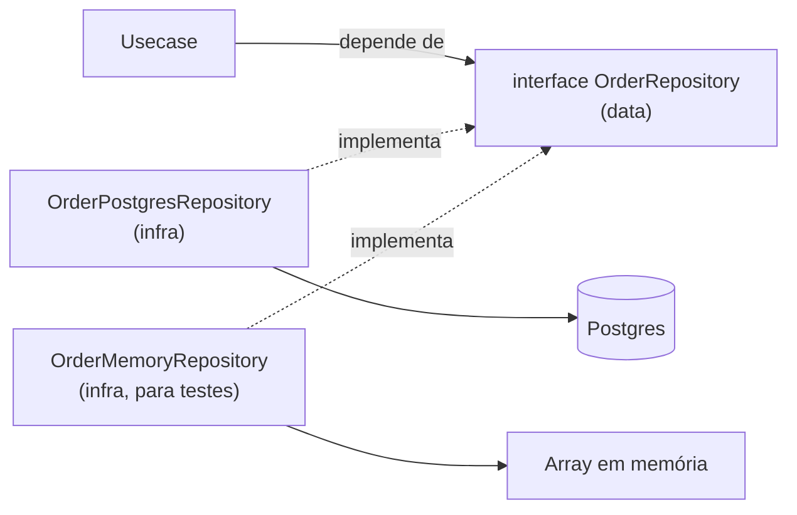

# 3.8 · Repository

## Problema

Se o usecase escreve SQL diretamente, ele fica preso ao banco: não dá para testar sem Postgres, e trocar o ORM obriga a reescrever regra de negócio.

## Ideia

> 💡 Um **Repository** dá a ilusão de uma **coleção em memória de aggregates**. O domínio pede "me dá o pedido X" e "guarda este pedido", sem saber como isso é feito.



## As regras

1. **Um repository por aggregate root.** Não existe `OrderItemRepository`: itens são salvos junto com o pedido.
2. **O contrato fala a língua do domínio**: `findById`, `save`, `findPendingByCustomer`. Não `executeQuery`.
3. **Recebe e devolve aggregates inteiros**, válidos.
4. **O contrato mora em `data`** (ou no domínio); **a implementação mora em `infra`**.
5. **Não tem regra de negócio.** Ele guarda e busca.

## Contrato

```ts
// data/repositories.ts
export interface OrderRepository {
  findById(id: string): Promise<Order | null>
  save(order: Order): Promise<void>
  findOpenByCustomer(customerId: string): Promise<Order[]>
}
```

## Implementação em memória (base dos testes)

```ts
// infra/repositories/memory/order-memory-repository.ts
export class OrderMemoryRepository implements OrderRepository {
  private readonly rows = new Map<string, OrderProps>()

  async findById(id: string) {
    const row = this.rows.get(id)
    return row ? Order.restore(row) : null
  }

  async save(order: Order) {
    this.rows.set(order.id, order.toJSON()) // guarda um snapshot, não a referência
  }

  async findOpenByCustomer(customerId: string) {
    return [...this.rows.values()]
      .filter((row) => row.customerId === customerId && row.status !== 'CANCELLED')
      .map((row) => Order.restore(row))
  }
}
```

> 💡 Guardar o **snapshot** (`toJSON()`) e reconstruir com `restore` imita o banco de verdade: o teste pega bugs de mapeamento e de mutação acidental que guardar a referência esconderia.

## Implementação real (esboço)

```ts
// infra/repositories/postgres/order-postgres-repository.ts
export class OrderPostgresRepository implements OrderRepository {
  constructor(private readonly db: Database) {}

  async findById(id: string) {
    const row = await this.db.query('SELECT ... FROM orders WHERE id = $1', [id])
    if (!row) return null
    const items = await this.db.query('SELECT ... FROM order_items WHERE order_id = $1', [id])
    return OrderMapper.toDomain(row, items)
  }

  async save(order: Order) {
    await this.db.transaction(async (tx) => {
      await tx.upsert('orders', OrderMapper.toRow(order))
      await tx.replace('order_items', { order_id: order.id }, OrderMapper.toItemRows(order))
    })
  }
}
```

## Repository, Query e Mutation

O Repository clássico serve bem para **carregar e salvar um aggregate**. Ele sofre quando aparecem:
- **Leituras complexas**: telas que juntam várias tabelas, paginação, filtros, agregações.
- **Escritas complexas**: criar vários aggregates numa transação, atualizações condicionais.

Nesses casos, separe em classes de **método único** (inspiração CQRS):

| Peça | Papel | Método | Exemplo |
|---|---|---|---|
| **Repository** | CRUD do aggregate | vários (`findById`, `save`...) | `OrderRepository` |
| **Query** | Uma leitura especializada | `execute()` | `ListOrdersWithCustomerQuery` |
| **Mutation** | Uma escrita especializada, geralmente transacional | `execute()` | `CreateAccountMutation` |

Detalhes no Módulo 4 ([4.5](../modulo-04-arquitetura/05-camada-infra.md)).

## Erros comuns

- ⚠️ **Repository genérico para tudo** (`BaseRepository<T>` com 30 métodos). Viola ISP e expõe operações que o domínio não quer (como `update` parcial que pula invariantes).
- ⚠️ **Repository que devolve linhas do banco** ou objetos do ORM. Devolva aggregates.
- ⚠️ **Um repository por tabela.** É por aggregate.
- ⚠️ **Lógica de negócio no repository** ("se o status for X, salva em outra tabela").

## Para fixar

1. Por que não existe `OrderItemRepository`?
2. Por que o repository em memória guarda `toJSON()` e não o objeto?
3. Quando usar uma Query em vez de um método no Repository?

<details>
<summary>Respostas</summary>

1. Itens fazem parte do aggregate `Order` e só são salvos e carregados através dele.
2. Para imitar o banco: devolve uma instância nova a cada leitura e testa o mapeamento de ida e volta.
3. Quando a leitura é especializada (joins, filtros, paginação, DTO para tela) e não precisa do aggregate completo.

</details>
