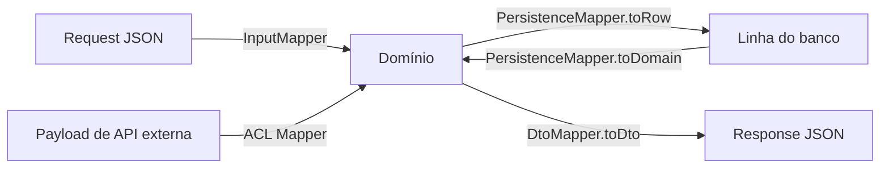

# 3.9 · Mapper, DTO e Helper

## DTO (Data Transfer Object)

Um **DTO** é uma estrutura **só de dados**, sem comportamento, feita para **atravessar fronteiras**: resposta HTTP, mensagem de fila, linha de banco.

```ts
export type OrderDto = {
  id: string
  status: 'DRAFT' | 'PLACED' | 'PAID' | 'CANCELLED'
  totalCents: number
  items: { productId: string; quantity: number; unitPriceCents: number }[]
}
```

| | Entity / Aggregate | DTO |
|---|---|---|
| Comportamento | Sim | Não |
| Invariantes | Protegidas | Nenhuma |
| Formato | O do domínio | O de quem consome |
| Muda quando | O negócio muda | O contrato da API/tela muda |

> 💡 **Nunca devolva a Entity direto para fora.** Se a API devolve a entity, qualquer refactor interno quebra o cliente. O DTO é o **contrato público**.

## Mapper

Um **Mapper** transforma dados de um formato em outro, ajustando nomes, tipos e valores.



```ts
// domain/mappers/order-mapper.ts
export const OrderMapper = {
  toDto(order: Order): OrderDto {
    return {
      id: order.id,
      status: order.status,
      totalCents: order.total().cents,
      items: order.items.map((item) => ({
        productId: item.productId,
        quantity: item.quantity,
        unitPriceCents: item.unitPrice.cents,
      })),
    }
  },
}
```

### Mapper que consolida dados

Um mapper também pode **normalizar** entradas em formatos diferentes. Exemplo: uma declaração de conteúdo que chega como array **ou** como objeto indexado, e precisa virar um resumo.

```ts
type ContentItem = { description: string; quantity: number | string; value: number }

export function contentDeclarationMapper(
  input?: ContentItem[] | Record<string, ContentItem>,
): { description: string; quantity: number; amount: number } {
  if (!input) throw new Error('Content declaration is missing')

  const items = Array.isArray(input) ? input : Object.values(input)
  if (items.length === 0) throw new Error('Content declaration is empty')

  return items.reduce(
    (acc, item, index) => {
      const quantity = Number.parseInt(String(item.quantity), 10)
      return {
        description: index === 0 ? limitDescription(item.description) : acc.description,
        quantity: acc.quantity + quantity,
        amount: acc.amount + item.value * quantity,
      }
    },
    { description: '', quantity: 0, amount: 0 },
  )
}
```

### Onde mora o mapper

| Mapper | Camada |
|---|---|
| Domínio ↔ DTO de resposta | domain (`domain/mappers`) ou application |
| Domínio ↔ linha do banco | infra (junto do repository) |
| Payload externo ↔ domínio (ACL) | infra (junto do adapter) |

## Helper

Um **Helper** é uma função pequena, estática e de baixo nível.

```ts
// domain/helpers/limit-description.ts
import { DESCRIPTION_MAX_LENGTH } from '../../data/constants'

export function limitDescription(description: string): string {
  return description.length > DESCRIPTION_MAX_LENGTH
    ? description.slice(0, DESCRIPTION_MAX_LENGTH)
    : description
}
```

> ⚠️ 📌 **Evite helpers.** Eles viram depósito de funções sem dono (`utils.ts` com 2.000 linhas). Antes de criar um, pergunte: "**De quem é este comportamento?**" Quase sempre a resposta é um Value Object.

```ts
// ❌ helper solto
formatCpf(cpf: string)
isValidCpf(cpf: string)

// ✅ o comportamento tem dono
new Cpf('123.456.789-09').formatted
```

Helpers aceitáveis: funções **genéricas e técnicas** sem conceito de negócio por trás (truncar texto, `sleep`, `chunk` de array).

## Para fixar

1. Por que não devolver a Entity diretamente na API?
2. Onde mora o mapper que converte a resposta da API dos Correios para o seu domínio?
3. Qual a alternativa a um helper `formatarCep()`?

<details>
<summary>Respostas</summary>

1. A entity é o modelo interno. Expô-la acopla o cliente ao modelo e pode vazar dados. O DTO é o contrato estável.
2. Na infra, junto do adapter: é a Anticorruption Layer.
3. Um Value Object `Cep` com um getter `formatado`.

</details>
