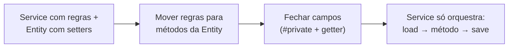

# 3.10 · Modelo rico x modelo anêmico

## O sintoma

```ts
// "Entity" com só dados
class Wallet {
  id!: string
  balanceCents!: number
  blocked!: boolean
}

// toda a regra em um service
class WalletService {
  debit(wallet: Wallet, amountCents: number) {
    if (wallet.blocked) throw new Error('Blocked')
    if (amountCents <= 0) throw new Error('Invalid amount')
    if (wallet.balanceCents < amountCents) throw new Error('Insufficient funds')
    wallet.balanceCents -= amountCents
  }
}

// ... e em outro lugar alguém faz:
wallet.balanceCents -= 500 // pulou todas as regras
```

Martin Fowler chamou isso de **Anemic Domain Model**: objetos que parecem do domínio, mas não têm comportamento. É programação procedural com roupa de OO.

## O modelo rico

```ts
class Wallet {
  #balance: Money
  #blocked: boolean
  #events: DomainEvent[] = []

  constructor(readonly id: string, balance: Money, blocked = false) {
    this.#balance = balance
    this.#blocked = blocked
  }

  get balance() { return this.#balance }

  debit(amount: Money, now: Date) {
    if (this.#blocked) throw new Error('Wallet is blocked')
    if (amount.isNegative() || amount.cents === 0) throw new Error('Amount must be positive')
    if (amount.isGreaterThan(this.#balance)) throw new Error('Insufficient funds')

    this.#balance = this.#balance.subtract(amount)
    this.#events.push(new WalletDebited(this.id, amount, now))
  }

  credit(amount: Money, now: Date) {
    if (amount.isNegative() || amount.cents === 0) throw new Error('Amount must be positive')
    this.#balance = this.#balance.add(amount)
    this.#events.push(new WalletCredited(this.id, amount, now))
  }
}
```

Agora **é impossível** deixar a carteira com saldo negativo: não há outro caminho para alterar o saldo.

## Comparação

| | Anêmico | Rico |
|---|---|---|
| Onde está a regra | Em services, espalhada | Dentro do objeto dono dos dados |
| Proteção | Depende de todos lembrarem de chamar o service | Garantida pelo encapsulamento |
| Leitura | "O que acontece com a carteira?" exige procurar em vários arquivos | Abra `Wallet` |
| Testes | Precisam montar services e mocks | `new Wallet(...).debit(...)` |
| Bom para | CRUD, dados sem regra | Regra de negócio rica |

## Como migrar de anêmico para rico

1. **Ache os `if`s sobre o estado** do objeto em services e controllers.
2. **Mova** cada regra para um método do objeto, com nome do negócio.
3. **Feche** os campos: `#privado` + getter.
4. **Remova setters.** Substitua por métodos de intenção.
5. **O service fica fino**: carrega, chama o método, salva.



## "Mas e o Tell, Don't Ask?"

O modelo rico é o **Tell, Don't Ask** aplicado: em vez de perguntar o saldo e decidir fora, você **manda** a carteira debitar e ela decide.

## Quando o anêmico é aceitável

> 🏛️ Nem todo lugar precisa de modelo rico. Em um **subdomínio genérico** ou numa tela de **cadastro sem regra**, um DTO + validação de schema + repository é mais simples e está certo. Use o modelo rico onde existe **regra que vale proteger**.

## Para fixar

1. Por que `wallet.balanceCents -= 500` é perigoso num modelo anêmico?
2. Como o service fica depois da migração para modelo rico?

<details>
<summary>Respostas</summary>

1. Pula todas as regras (bloqueio, saldo suficiente, valor positivo), e nada impede isso.
2. Fino: carrega a carteira, chama `wallet.debit(...)`, salva e publica os eventos.

</details>
