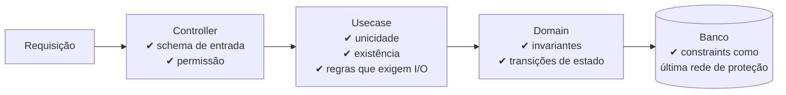

# 3.11 · Invariantes e validação: o que validar e onde

## Problema

A mesma regra ("CEP tem 8 dígitos") aparece no front, no controller, no service e no banco, cada uma com uma versão um pouco diferente. Ao mesmo tempo, outra regra importante ("o total não pode ficar negativo") não está em lugar nenhum.

## Três tipos de validação

| Tipo | Pergunta | Exemplo | Onde |
|---|---|---|---|
| **De formato** (sintática) | "Os dados estão bem formados?" | E-mail tem `@`; CEP tem 8 dígitos; campo obrigatório presente | **Schema** em `data`, aplicado no **controller/handler** (entrada) e no **construtor do VO/Entity** |
| **De invariante** (domínio) | "Isto pode ser verdade no negócio?" | Saldo não fica negativo; pedido pago não é cancelado | **Dentro** do VO/Entity/Aggregate |
| **De aplicação** (contexto) | "Isto é permitido agora, dado o resto do sistema?" | E-mail já está em uso; usuário tem permissão; slug bloqueado | **Usecase** (consulta repositório) ou **controller** (permissão) |



## Regras práticas

1. **Valide o formato na entrada** e devolva um erro amigável (`400 Bad Request`).
2. **Valide de novo no domínio.** O domínio não confia em quem o chama: amanhã ele pode ser chamado por uma fila, um script ou outro usecase.
3. **Invariantes moram no objeto que tem dados para garanti-las** (veja a tabela de níveis em [3.1](01-visao-geral.md)).
4. **Regras que exigem consulta** (unicidade, existência) moram no **usecase**, porque o domínio não faz I/O.
5. **Constraints do banco** (`UNIQUE`, `NOT NULL`, `CHECK`) são a última rede, para condições de corrida.

> 💡 "Duplicar" a validação de formato no controller e no VO **não é violação de DRY** se os dois usam **o mesmo schema** da camada `data`. O conhecimento está num lugar só.

## O schema é a fonte única

```ts
// data/postcode.ts
import { z } from 'zod'

export const postcodeSchema = z
  .string()
  .regex(/^\d{5}-?\d{3}$/, 'Invalid postcode')
  .transform((value) => value.replace('-', ''))
```

```ts
// controller: valida a entrada inteira
const input = quoteRequestSchema.parse(request.body) // usa postcodeSchema por dentro

// domain: o VO se protege com o mesmo schema
export class Postcode {
  readonly #value: string
  constructor(input: string) { this.#value = postcodeSchema.parse(input) }
  get value() { return this.#value }
}
```

## Erros: tipos e camadas

Lançar `Error` genérico em todo lugar impede a borda de responder corretamente. Use **tipos de erro** que a borda saiba traduzir.

| Erro | Quando | HTTP típico |
|---|---|---|
| `ValidationError` | Formato inválido | 400 |
| `DomainError` / `LogicError` | Regra de negócio violada | 422 ou 409 |
| `NotFoundError` | Recurso não existe | 404 |
| `ForbiddenError` | Sem permissão | 403 |
| `ConflictError` | Concorrência / unicidade | 409 |

```ts
// shared/errors.ts
export class DomainError extends Error { readonly kind = 'domain' as const }
export class NotFoundError extends Error { readonly kind = 'not_found' as const }

// no domínio
if (amount.isGreaterThan(this.#balance)) throw new DomainError('Insufficient funds')

// na borda (presentation/http)
function toHttpStatus(error: unknown): number {
  if (error instanceof ZodError) return 400
  if (error instanceof NotFoundError) return 404
  if (error instanceof DomainError) return 422
  return 500
}
```

### Exceção ou Result?

| Abordagem | Prós | Contras |
|---|---|---|
| **Lançar exceção** | Simples, idiomático em TS/JS, interrompe o fluxo | O tipo de erro não aparece na assinatura |
| **Devolver `Result<T, E>`** | Erro explícito no tipo; obriga a tratar | Mais verboso; exige disciplina em toda a cadeia |

📌 Neste curso: **exceções tipadas** para violações de regra, porque é mais simples de ensinar e é o padrão da maioria dos times TypeScript. Times com forte cultura funcional costumam preferir `Result`.

## Para fixar

1. "O e-mail já está em uso" é validado onde?
2. Por que validar no controller **e** no Value Object?
3. Que tipo de erro e status HTTP para "saldo insuficiente"?

<details>
<summary>Respostas</summary>

1. No usecase, porque precisa consultar o repositório. E uma constraint `UNIQUE` no banco protege contra corrida.
2. O controller dá um erro amigável cedo. O VO garante que o domínio nunca recebe dado inválido, venha de onde vier. Os dois usam o mesmo schema, então não há duplicação de conhecimento.
3. Um `DomainError`, traduzido para 422 (ou 409, conforme a convenção do time).

</details>
