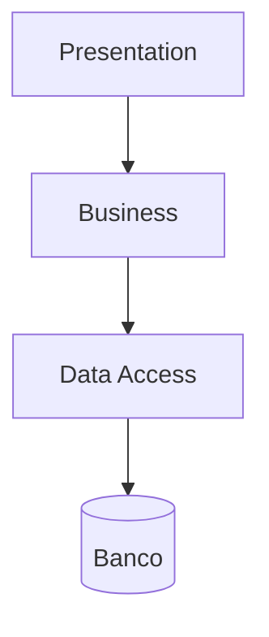
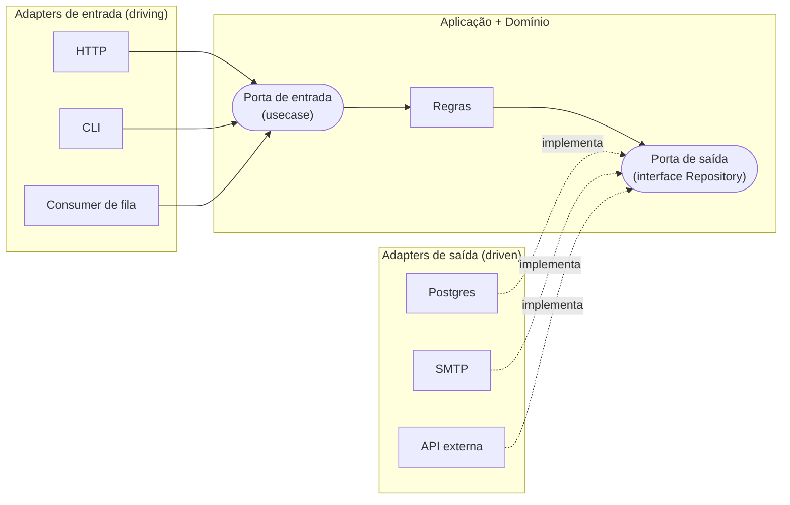
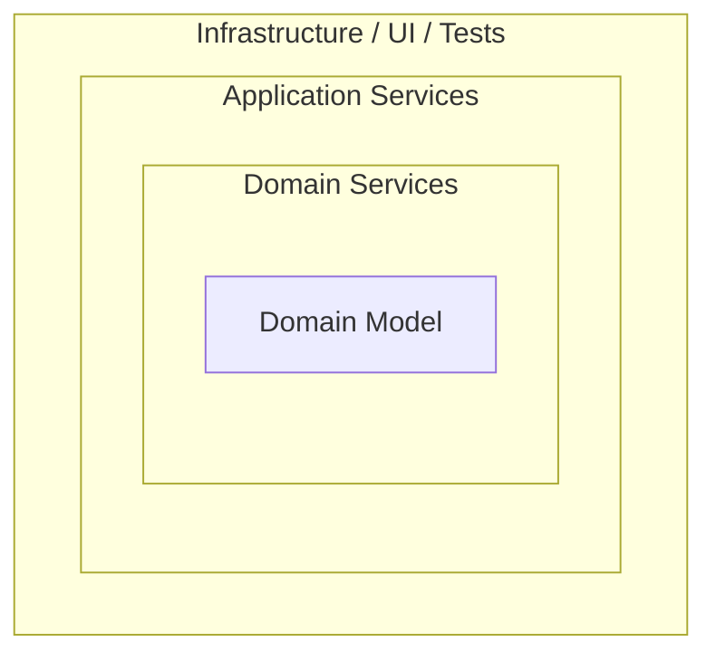
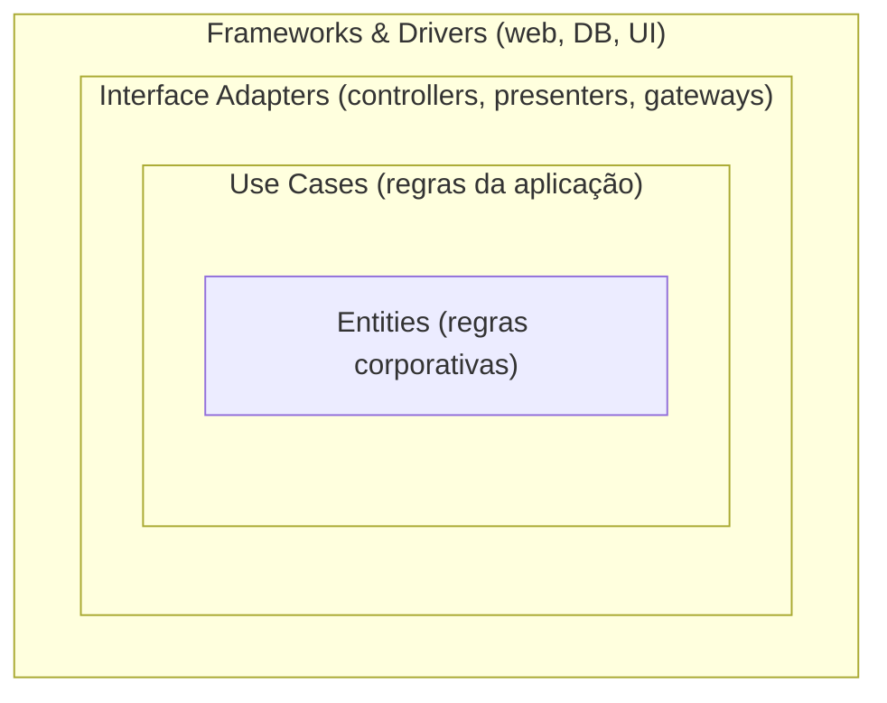
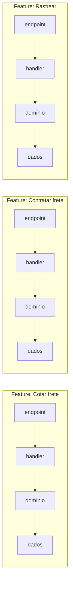
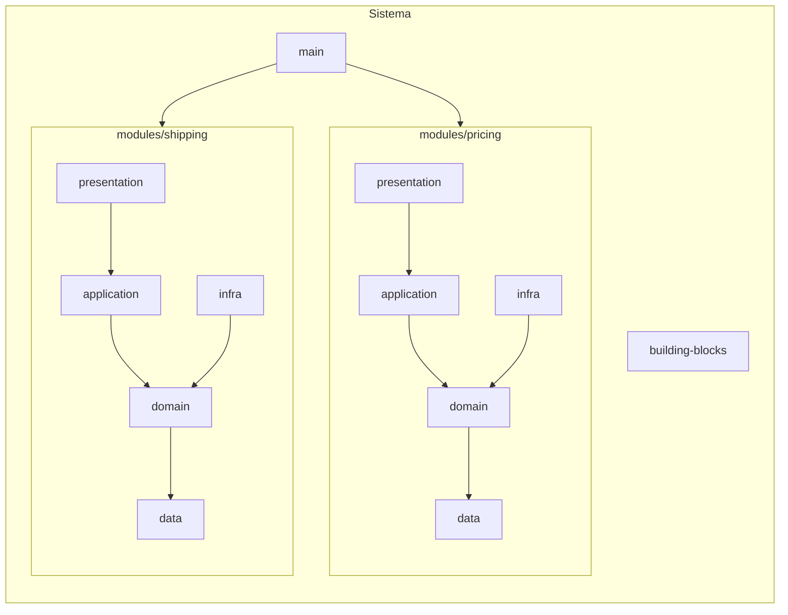

# 4.1 · Estilos arquiteturais: Layered, Hexagonal, Onion, Clean e Vertical Slices

## Problema

"Qual arquitetura usar?" vira discussão de time porque os nomes são muitos. Na prática, **os estilos modernos concordam no essencial** e diferem em vocabulário e ênfase.

## 1. Layered (camadas tradicionais)

- **Ideia:** cada camada só fala com a de baixo.
- **Problema:** o negócio **depende** do acesso a dados. Trocar o banco ou testar sem ele é difícil.

## 2. Hexagonal / Ports and Adapters (Alistair Cockburn, 2005)

- **Ideia:** o núcleo define **portas** (interfaces). O mundo externo se conecta por **adapters**.
- **Entrada (driving):** quem **chama** o sistema (HTTP, CLI, fila).
- **Saída (driven):** o que o sistema **chama** (banco, e-mail, APIs).
- **Ganho:** o mesmo núcleo serve HTTP, CLI e testes.

## 3. Onion (Jeffrey Palermo, 2008)

- **Ideia:** camadas concêntricas; todas as dependências apontam para o centro.
- **Ênfase:** o modelo de domínio no centro, sem dependência de nada.

## 4. Clean Architecture (Robert C. Martin, 2012)

- **A regra de dependência:** "o código-fonte só pode apontar **para dentro**". Nada de dentro sabe o nome de algo de fora.
- **Ênfase:** usecases explícitos como camada própria.
- **Main / composition root:** a camada mais externa, que monta tudo.

## 5. Vertical Slices (Jimmy Bogard, 2018)

- **Ideia:** organizar por **funcionalidade** (fatia vertical), e não por camada técnica.
- **Ganho:** tudo de uma feature junto; mudar uma feature mexe numa pasta só.
- **Risco:** duplicação entre fatias, se não houver um domínio compartilhado.

## O que todas concordam

| Princípio | Layered | Hexagonal | Onion | Clean | Slices |
|---|:-:|:-:|:-:|:-:|:-:|
| Separar regra de negócio de detalhe técnico | ✔ | ✔ | ✔ | ✔ | ✔ |
| Dependências apontam para o domínio | ✘ | ✔ | ✔ | ✔ | ~ |
| Infra trocável por interfaces | ✘ | ✔ | ✔ | ✔ | ~ |
| Usecase como conceito explícito | ✘ | ~ | ✔ | ✔ | ✔ (handler) |
| Organização por funcionalidade | ✘ | ✘ | ✘ | ✘ | ✔ |

## A combinação deste curso

> 💡 Este curso usa um modelo **híbrido**, comum em times que aplicam DDD:
> - **Módulos por bounded context** (influência de Vertical Slices e do monolito modular).
> - **Camadas dentro de cada módulo** (Onion/Clean).
> - **Portas e adapters** para todo I/O (Hexagonal).
> - **Domínio rico** no centro (DDD).

A próxima página detalha cada camada.

> 🏛️ **Visão de arquiteto:** essa combinação herda a complexidade de todas as que junta. Ela compensa em sistemas com regra rica, vários times e vida longa. Para um serviço pequeno, um módulo com `domain` + `infra` + um handler pode bastar. **A estrutura deve ser proporcional ao problema.**

## Para fixar

1. Qual a regra de dependência da Clean Architecture?
2. O que é uma porta "driving" e uma "driven" na Hexagonal?
3. Qual o risco principal de Vertical Slices puro?

Respostas

1. As dependências de código-fonte só apontam para dentro: camadas internas não conhecem as externas.
2. Driving: por onde o mundo chama o sistema (HTTP, CLI, fila). Driven: o que o sistema chama (banco, e-mail, APIs).
3. Duplicar regras de negócio entre fatias, por falta de um modelo de domínio compartilhado.

