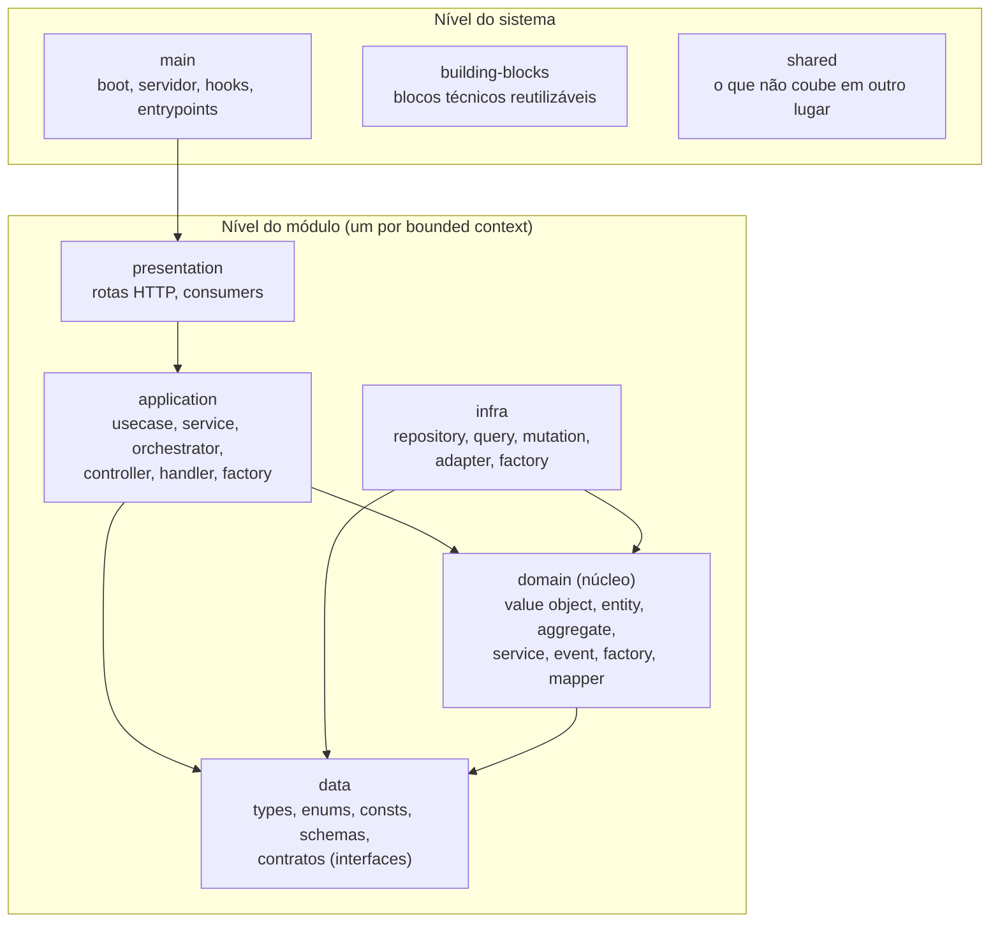

# 4.2 · O modelo em camadas

Esta é a estrutura de referência do curso. Ela organiza o código em **camadas** (para controlar dependências e separar o que muda pouco do que muda muito) e, dentro delas, em **pastas** (famílias de código).

## Visão geral

Setas = "pode importar de". Todas apontam para dentro.

## As camadas, de dentro para fora

| # | Camada | Responsabilidade | Muda quando... |
|:-:|---|---|---|
| 1 | **data** | Código de mais baixo nível: tipos, enums, constantes, schemas e **contratos** (interfaces). Nenhuma implementação de processamento | O formato de um dado muda |
| 2 | **domain** | O conhecimento do negócio: o que o sistema **é** | Uma regra de negócio muda |
| 3 | **infra** | Comunicação com o mundo externo: banco, filas, APIs. Implementa os contratos de `data` | Uma tecnologia muda |
| 4 | **application** | Orquestra casos de uso: coordena domínio e infra | Um fluxo de negócio muda |
| 5 | **presentation** | Recebe requisições e mensagens e encaminha para a application | A forma de entrada muda (REST, gRPC, fila) |
| 6 | **main** | Sobe o sistema e **liga as peças** (composition root) | A forma de implantar muda |

E duas de apoio, no nível do sistema:

| Camada | Responsabilidade |
|---|---|
| **building-blocks** | Fundação técnica **independente de negócio** e reutilizável entre módulos: adapter de HTTP, consumer de fila, logger, contratos genéricos |
| **shared** | Recursos comuns que não couberam em outra camada. Use com parcimônia |

## Por que `data` fica abaixo de `domain`?

Nesta visão (inspirada na Clean Architecture), **data** não significa "acesso a banco". Significa **o código mais estável e de mais baixo nível possível**: tipagem e arquivos estáticos.

| Visão | O que "data" significa |
|---|---|
| DDD clássico | Parte da infraestrutura (persistência) |
| Onion | Nas bordas, dependente do domínio |
| **Este curso** | A camada **mais interna**: tipos, schemas, constantes e contratos. **Todas as camadas podem importá-la; ela só importa tipagem** |

Vantagens:
- Os **contratos** (interfaces de repository, gateway, publisher) ficam num lugar que **todo mundo pode importar** sem criar ciclos.
- `data` pode ser publicada como um **pacote** para outros serviços validarem tipos no CI (útil entre bounded contexts que trocam mensagens).

> ⚠️ O nome "data" confunde. Se o seu time preferir, chame de `contracts`, `types` ou `core`. O importante é a **regra**: só tipos, constantes, schemas e interfaces.

## O que cada camada **faz** e **não faz**

| Camada | Faz | Não faz |
|---|---|---|
| **data** | Declara tipos, enums, constantes, schemas, interfaces | Processamento, I/O, classes com lógica |
| **domain** | Valida invariantes, executa regras, emite eventos | I/O, conhecer HTTP, banco, filas, frameworks |
| **infra** | Implementa contratos usando ORMs, SDKs e drivers | Regra de negócio; **importar de application** |
| **application** | Orquestra: carrega, chama domínio, salva, publica; aplica regras de **aplicação** ("após criar, envie um evento") | Regra de negócio complexa; acesso direto ao banco; formatação de resposta para UI |
| **presentation** | Define rotas, escuta filas, chama controllers/handlers | Regra de negócio; acesso a banco |
| **main** | Configura, conecta dependências, sobe servidores, hooks de ciclo de vida | Regra de negócio. **Ninguém depende dela** |

## Benefícios e riscos

| Benefícios | Riscos |
|---|---|
| Domínio no centro, protegido de mudanças técnicas | Herda a complexidade das arquiteturas que combina |
| Alta coesão e baixo acoplamento | Camadas redundantes, se mal balanceada |
| Responsabilidades claras para times grandes | Exige disciplina e governança (revisão de imports) |
| **Testes em memória**: alta cobertura, baixo esforço | Risco de "arquitetura pela arquitetura" |
| Trocar framework, banco ou broker sem tocar no domínio | Lenta para MVPs e protótipos |

## As próximas páginas

| Página | Conteúdo |
|---|---|
| [4.3](03-regra-de-dependencia.md) | Quem pode importar quem, e como impor isso |
| [4.4](04-camada-application.md) | Usecase, Service, Orchestrator, Controller, Handler, Factory |
| [4.5](05-camada-infra.md) | Repository, Query, Mutation, Adapter, Factory |
| [4.6](06-presentation-e-main.md) | Rotas, consumers, entrypoints, hooks |
| [4.7](07-building-blocks-e-shared.md) | O que é técnico e reutilizável |
| [4.8](08-estrutura-de-pastas.md) | A árvore de pastas completa |
| [4.9](09-fluxo-ponta-a-ponta.md) | Uma requisição atravessando todas as camadas |
| [4.10](10-nomenclatura.md) | Como nomear arquivos, classes e tipos |
| [4.11](11-decisoes-e-tradeoffs.md) | Como decidir e registrar decisões |
