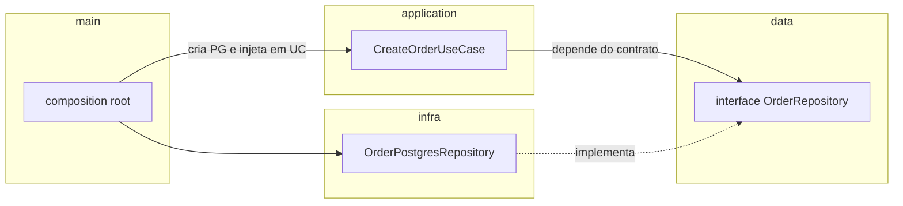

# 4.3 · A regra de dependência

## A regra

> 💡 **Camadas internas nunca conhecem as externas.** As externas podem conhecer as internas. A comunicação no sentido contrário acontece por **contratos** (interfaces) definidos dentro e implementados fora.

## Matriz de imports permitidos

| De ↓ / Para → | data | domain | infra | application | presentation | main | building-blocks |
|---|:-:|:-:|:-:|:-:|:-:|:-:|:-:|
| **data** | ✔ (tipos) | ✘ | ✘ | ✘ | ✘ | ✘ | só tipos |
| **domain** | ✔ | ✔ | ✘ | ✘ | ✘ | ✘ | VOs/tipos genéricos |
| **infra** | ✔ | ✔ | ✔ | **✘** | ✘ | ✘ | ✔ |
| **application** | ✔ | ✔ | só via contrato (`data`) e factories | ✔ | ✘ | ✘ | ✔ |
| **presentation** | ✔ | evite | ✘ | ✔ | ✔ | ✘ | ✔ |
| **main** | ✔ | ✔ | ✔ | ✔ | ✔ | ✔ | ✔ |

Regras de ouro:
1. `data` só importa tipos.
2. `domain` não importa `infra`, `application`, `presentation` nem bibliotecas de I/O.
3. `infra` pode importar `domain`, mas **nunca `application`**.
4. `application` usa a infra **pelo contrato**; a implementação concreta chega por **factory/injeção**.
5. **Nenhuma camada importa `main`.**
6. **Módulos não importam o interior de outros módulos.** Comunicam-se por contratos públicos ou eventos.

## Inversão de dependência na prática



Em tempo de **compilação**, as setas apontam para `data`. Em tempo de **execução**, o `UseCase` chama o `Postgres`. É isso que "inversão" significa.

## Como impor a regra (sem depender de memória)

### 1. Path aliases deixam os imports legíveis

```json
// tsconfig.json
{
  "compilerOptions": {
    "baseUrl": ".",
    "paths": {
      "@modules/*": ["src/modules/*"],
      "@building-blocks/*": ["src/building-blocks/*"],
      "@shared/*": ["src/shared/*"]
    }
  }
}
```

### 2. Lint de fronteiras

Com `eslint-plugin-boundaries` ou `dependency-cruiser`, o CI falha quando alguém importa errado.

```js
// .dependency-cruiser.js (trecho)
module.exports = {
  forbidden: [
    {
      name: 'domain-nao-importa-infra',
      from: { path: 'src/modules/[^/]+/domain' },
      to: { path: 'src/modules/[^/]+/(infra|application|presentation)' },
    },
    {
      name: 'infra-nao-importa-application',
      from: { path: 'src/modules/[^/]+/infra' },
      to: { path: 'src/modules/[^/]+/application' },
    },
    {
      name: 'ninguem-importa-main',
      from: { pathNot: 'src/main' },
      to: { path: 'src/main' },
    },
  ],
}
```

> 🏛️ **Visão de arquiteto:** regra de arquitetura que depende da memória das pessoas **não existe**. Coloque no CI.

### 3. Testes de arquitetura

Um teste simples que lê os arquivos de `domain` e falha se encontrar `import ... from '.../infra/...'` já pega a maioria dos erros.

## Sinais de violação

| Sintoma | Violação |
|---|---|
| Entity com `import { prisma }` | domain → infra |
| Repository chamando um usecase | infra → application |
| Usecase com `new PostgresRepository()` dentro | application → implementação concreta |
| `if (process.env.NODE_ENV === 'test')` no domínio | domain conhece o ambiente |
| Módulo `shipping` importando `modules/sales/domain/entities/order` | acoplamento entre bounded contexts |

## Para fixar

1. A infra pode importar o domínio? E a application?
2. Onde o usecase recebe a implementação concreta do repository?
3. Como garantir a regra sem depender de revisão manual?

<details>
<summary>Respostas</summary>

1. Pode importar o domínio (para montar e devolver entities), mas não a application.
2. No construtor, injetada por uma factory chamada no `main` (composition root) ou nos testes.
3. Com lint de fronteiras (dependency-cruiser, eslint-plugin-boundaries) e testes de arquitetura no CI.

</details>
