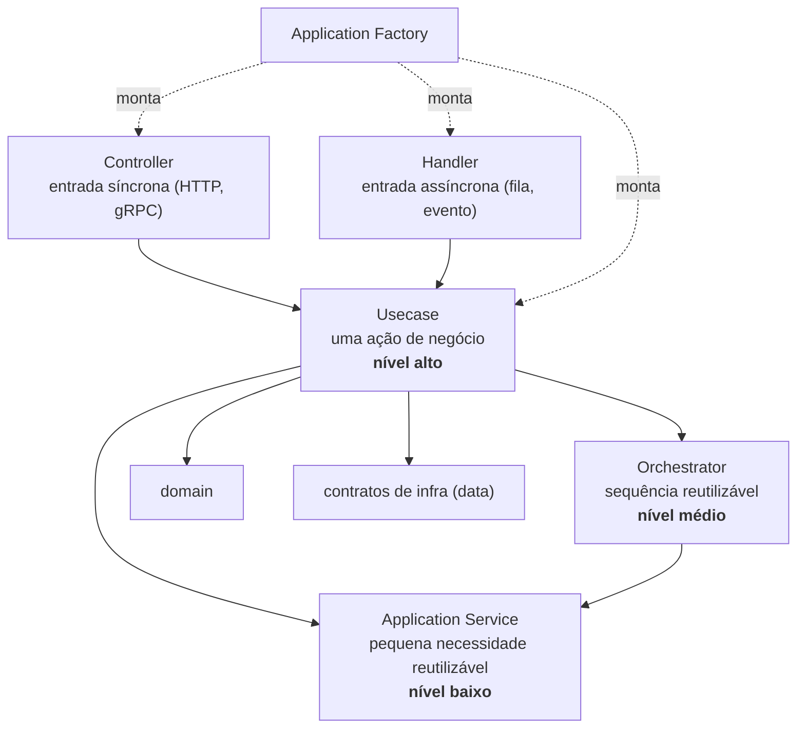
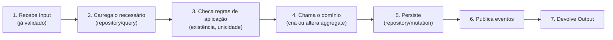

# 4.4 · Camada Application

> A application **orquestra**. Ela coordena domínio e infra para atender uma necessidade de negócio. Não implementa regras complexas (isso é do domínio) e não acessa o banco diretamente (isso é da infra).

## As peças e seus níveis



| Peça | Responsabilidade | Nível |
|---|---|---|
| **Application Service** | Coordena uma **pequena** necessidade reutilizável (gerar hash de senha, montar um contexto) | Baixo |
| **Orchestrator** | Coordena **vários services** numa sequência reutilizável por vários usecases | Médio |
| **Usecase** | Orquestra **uma** ação de negócio específica | Alto |
| **Controller** | Porta de entrada síncrona. Valida, checa permissão, chama o usecase, formata a resposta | Borda |
| **Handler** | Porta de entrada assíncrona. Como o controller, mas para mensagens | Borda |
| **Factory** | Monta as peças acima com suas dependências | Composição |

---

## Usecase

Representa **uma ação de negócio** em resposta a uma intenção: `CreateOrder`, `CancelShipment`, `QuoteFreight`, `GetOrderDetails`.

Características:
- **Unitário e autocontido:** uma ação, clara, com um método `execute`.
- Depende **só de interfaces** de infra, nunca de implementações.
- Usa entities, aggregates, domain services, repositories, queries, mutations, mappers.
- Devolve entidades, DTOs, eventos ou um resultado simples.
- Fácil de testar: troque as dependências por versões em memória.

> 📌 **Um usecase não chama outro usecase.** Se dois usecases precisam da mesma sequência de passos, extraia essa sequência para um **Orchestrator** ou **Service**. Isso evita cadeias de usecases difíceis de entender, transações aninhadas e dependências circulares.

### O roteiro típico de um usecase



```ts
// application/usecases/create-account.ts
export namespace CreateAccountUseCase {
  export type Input = { name: string; email: string; account: string }
  export type Output = { userId: string; tenantSlug: string }
}

export class CreateAccountUseCase {
  constructor(
    private readonly users: UserRepository,
    private readonly tenants: TenantRepository,
    private readonly createAccount: CreateAccountMutation,
    private readonly events: EventPublisher,
  ) {}

  async execute(
    input: CreateAccountUseCase.Input,
    now: Date,
    newId: string,
  ): Promise<CreateAccountUseCase.Output> {
    // 3. regras de aplicação (exigem consulta)
    if (await this.users.findByEmail(input.email)) throw new DomainError('E-mail in use')

    const slug = slugify(input.account)
    if (!slug) throw new DomainError('Impossible to slugify account name')
    if (TENANT_SLUG_BLOCKED.includes(slug)) throw new DomainError('Slug blocked')
    if (await this.tenants.findBySlug(slug)) throw new DomainError('Slug in use')

    // 4. domínio: cada entity se valida sozinha
    const email = new Email(input.email)
    const user = User.create({ id: newId, name: input.name, email, now })
    const tenant = Tenant.create({ id: newId, ownerId: user.id, slug, now })
    const member = Member.create({ userId: user.id, tenantId: tenant.id, role: 'ADMIN', now })
    const organization = email.isPublicDomain()
      ? null
      : Organization.create({ id: newId, ownerId: user.id, slug, now })

    // 5. persistência atômica de vários aggregates (Mutation transacional)
    await this.createAccount.execute({ user, tenant, member, organization })

    // 6. eventos
    await this.events.publish([new AccountCreated(user.id, tenant.id, now)])

    // 7. saída
    return { userId: user.id, tenantSlug: tenant.slug }
  }
}
```

Note:
- `now` e `newId` vêm de fora: o usecase é **determinístico** e testável.
- Criar vários aggregates de uma vez exige uma **Mutation** transacional (4.5). É uma exceção consciente à regra "uma transação, um aggregate": todos nascem juntos e nada existe antes.

---

## Application Service

Uma classe que resolve uma **necessidade pequena e reutilizável** da aplicação, muitas vezes com um padrão comportamental por trás. Pode ser usada por usecases ou por orchestrators.

```ts
// application/services/password-service.ts
export class PasswordService {
  constructor(private readonly crypt: Crypt) {} // contrato em data

  async hash(plain: string) {
    const salt = await this.crypt.genSalt(10)
    return this.crypt.hash(plain, salt)
  }

  async matches(plain: string, hashed: string) {
    return this.crypt.compare(plain, hashed)
  }
}
```

| Faz | Não faz |
|---|---|
| Coordena entities e contratos para uma necessidade reutilizável | Regra de domínio (cálculos de negócio) |
| Trata exceções e prepara dados para as camadas de cima | HTTP, REST, gRPC |
| Centraliza um fluxo usado por vários usecases | Assumir o papel de usecase, query, mutation ou repository |

---

## Orchestrator

Coordena **múltiplos services em sequência**, com lógica condicional, compensações e tratamento de falhas no nível do processo.

```ts
// application/orchestrators/dispatch-delivery.ts
export class DispatchDeliveryOrchestrator {
  constructor(
    private readonly notifier: NotifyCustomerService,
    private readonly tracking: TrackingService,
    private readonly history: ShipmentHistoryService,
  ) {}

  async execute(shipmentId: string, now: Date): Promise<void> {
    await this.tracking.start(shipmentId, now)
    await this.history.record(shipmentId, 'DISPATCHED', now)
    await this.notifier.send(shipmentId, 'Seu pedido saiu para entrega')
  }
}
```

Quando usar:
- Uma **sequência de passos** com ordem importante ou condicionais.
- A mesma sequência é necessária em **vários usecases**.
- É preciso **compensar** passos em caso de falha (veja Saga no Módulo 5).

> ⚠️ Orchestrator **coordena ações; não implementa regras**. A regra continua no domínio.

---

## Controller

A porta de entrada **síncrona**. Recebe a requisição, converte em input, chama o usecase e devolve a resposta.

| Faz | Não faz |
|---|---|
| Valida o input com schema | Regra de negócio |
| Verifica autenticação e permissão | Acesso a banco |
| Monta o usecase pela factory | Instanciar entities ou fazer cálculos |
| Converte o resultado em resposta (DTO, `toJSON`) | |
| Lida com contexto, headers, i18n | |

```ts
// application/controllers/invite-user.ts
export namespace InviteUserController {
  export type Request = z.input<typeof inviteUserSchema>
  export type Response = { invite: InviteDto }
}

export class InviteUserController {
  constructor(
    private readonly ctx: AuthContext,
    private readonly usecases: AuthUseCaseFactory,
  ) {}

  async execute(
    request: InviteUserController.Request,
    now = new Date(),
    newId = uuidv7(),
  ): Promise<InviteUserController.Response> {
    const input = inviteUserSchema.parse(request)           // 1. valida
    this.ctx.ability().throwUnlessCan('invite', 'User')    // 2. permissão
    const invite = await this.usecases                     // 3. usecase pronto
      .inviteUser(this.ctx)
      .execute(input, now, newId)
    return { invite: InviteMapper.toDto(invite) }           // 4. resposta
  }
}
```

---

## Handler

O "controller do mundo assíncrono". Trata mensagens de filas, eventos ou streams (Kafka, RabbitMQ, SQS).

| | Controller | Handler |
|---|---|---|
| Entrada | Requisição HTTP | Mensagem de fila/evento |
| Saída | Resposta HTTP | `ack` / `nack` (ou nada) |
| Lida com | Rotas e verbos | Tópicos, filas, eventos |
| Chama | Usecase | Usecase |

Deve: validar a mensagem (mesmo vinda de dentro), verificar permissões quando aplicável, chamar o usecase, confirmar (`ack`) ou rejeitar (`nack`), lidar com reprocessamento e **ser idempotente**.

Não deve: ter regra de negócio, depender direto do driver do broker, acessar o banco.

```ts
// application/handlers/shipment-status-updated.ts
export class ShipmentStatusUpdatedHandler {
  constructor(private readonly usecases: ShippingUseCaseFactory) {}

  async handle(message: unknown, ack: Ack, nack: Nack): Promise<void> {
    const parsed = shipmentStatusMessageSchema.safeParse(message)
    if (!parsed.success) {
      nack(false)                                  // inválida: não reenfileira (vai para DLQ)
      return
    }
    try {
      await this.usecases.updateStatus().execute(parsed.data)
      ack()
    } catch (error) {
      nack(isTransient(error))                    // erro temporário: tenta de novo
    }
  }
}
```

Detalhes de mensageria no Módulo 5.

---

## Application Factory

Encapsula a **construção** dos componentes da application. Centraliza a composição de dependências, e o resto do sistema só pede "instâncias prontas".

```ts
// application/factories/usecases.ts
export class ShippingUseCaseFactory {
  constructor(
    private readonly repositories: ShippingRepositoryFactory, // memória ou banco
    private readonly events: EventPublisher,
  ) {}

  updateStatus() {
    return new UpdateShipmentStatusUseCase(this.repositories.shipment(), this.events)
  }

  cancel() {
    return new CancelShipmentUseCase(this.repositories.shipment(), this.events)
  }
}
```

Vantagens:
- **Separa composição de execução.**
- Facilita testes: troque a `RepositoryFactory` de banco pela de memória.
- Um único lugar para mudar a montagem.

Isso é uma **Abstract Factory** (Módulo 6): uma família de objetos compatíveis entre si.

## Para fixar

1. Por que um usecase não deve chamar outro usecase?
2. Qual a diferença entre Orchestrator e Application Service?
3. O que um Handler faz com uma mensagem com formato inválido?

<details>
<summary>Respostas</summary>

1. Cria cadeias difíceis de entender, transações aninhadas e risco de ciclos. Extraia a parte comum para um Orchestrator ou Service.
2. O Service resolve uma necessidade pequena e reutilizável. O Orchestrator coordena vários services numa sequência reutilizável.
3. Rejeita sem reenfileirar (`nack(false)`), para que vá para a dead-letter queue em vez de ficar em loop.

</details>
