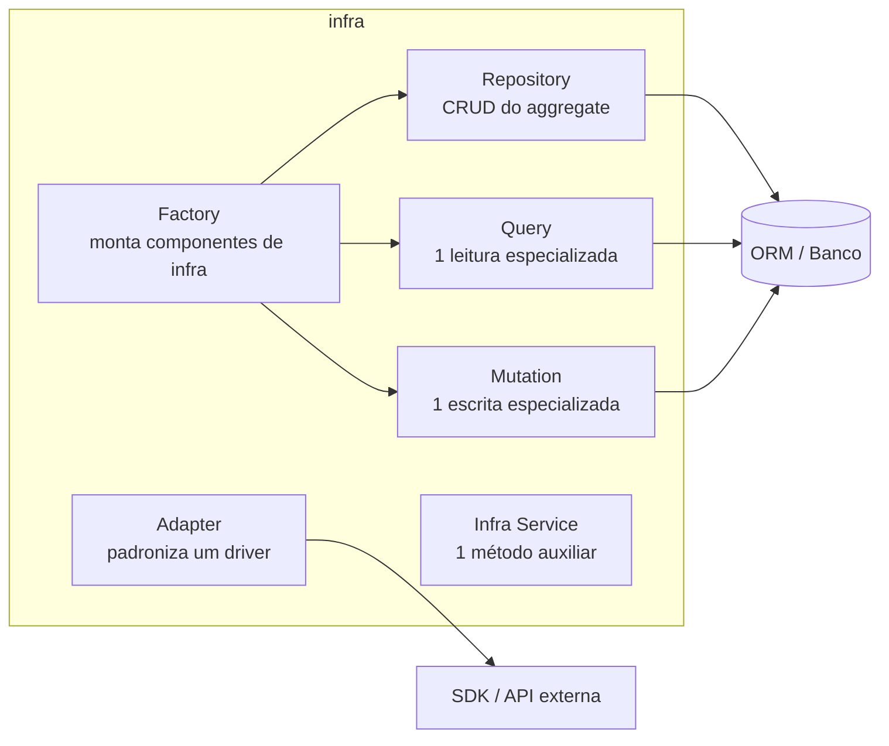

# 4.5 · Camada Infra

> A infra é a **ponte entre o domínio e o mundo externo**. Banco, cache, filas, APIs de terceiros, arquivos. Ela **implementa** os contratos declarados em `data` e **pode importar de `domain`**, mas **não de `application`**.

## As peças



| Peça | Descrição |
|---|---|
| **Repository** | Persistência simples: CRUD de aggregates, mais operações unitárias como `activate`, `disable` |
| **Query** | Classe com **um único método de execução** para **buscar** agregados ou DTOs |
| **Mutation** | Classe com **um único método de execução** para **alterar** agregados |
| **Adapter** | Padroniza como usamos um driver ou SDK |
| **Infra Factory** | Constrói componentes de infra (repositories, queries, mutations) |
| **Infra Service** | Um método auxiliar da infra (ex.: assinar uma URL) |

---

## Repository

Visto em detalhe em [3.8](../modulo-03-ddd-tatico/08-repository.md). Resumo:

- Um por **aggregate root**.
- Contrato em `data`, implementação em `infra`.
- Devolve **aggregates válidos**.
- Tem uma versão **em memória** para testes.

```ts
// infra/repositories/memory/user-memory-repository.ts
export class UserMemoryRepository implements UserRepository {
  private readonly rows = new Map<string, UserProps>()

  async findById(id: string) {
    const row = this.rows.get(id)
    return row ? User.restore(row) : null
  }

  async findByEmail(email: string) {
    const row = [...this.rows.values()].find((r) => r.email === email)
    return row ? User.restore(row) : null
  }

  async save(user: User) {
    this.rows.set(user.id, user.toJSON())
  }
}
```

---

## Query (lado da leitura)

Um **Repository especializado em uma leitura**. Não altera estado. Use quando o repository CRUD não "aguenta" a leitura: joins, agregações JSON, denormalização, cache, paginação.

- Um método: `execute(...)`.
- Devolve **agregados** ou **DTOs** (DTO quando o volume é grande ou a tela precisa de uma forma própria).
- Inspirada no lado **Query** do CQRS.

```ts
// data/queries.ts
export interface UserWithMembershipsQuery {
  execute(where: { id?: string; email?: string }): Promise<UserWithMembershipsDto>
}

// infra/queries/drizzle/user-with-memberships.ts
export class UserWithMembershipsDrizzleQuery implements UserWithMembershipsQuery {
  constructor(private readonly orm: Orm) {}

  async execute(where: { id?: string; email?: string }) {
    const [row] = await this.orm
      .select({
        id: users.id,
        name: users.name,
        email: users.email,
        tenants: sql<TenantDto[]>`COALESCE(json_agg(row_to_json(${tenants})) FILTER (WHERE ${tenants.id} IS NOT NULL), '[]')`,
      })
      .from(users)
      .leftJoin(members, eq(members.userId, users.id))
      .leftJoin(tenants, eq(tenants.id, members.tenantId))
      .where(buildFilters(where))
      .groupBy(users.id)
      .limit(1)

    if (!row) throw new NotFoundError('User not found')
    return row
  }
}
```

---

## Mutation (lado da escrita)

Um **Repository especializado em uma escrita**, com operação única e bem definida que altera o estado. Inspirada no lado **Command** do CQRS.

- Um método: `execute(...)`.
- Atua sobre entities e aggregates para persistir mudanças.
- Devolve **o mínimo**: ID, status ou eventos. Se precisar devolver o aggregate, devolva-o reconstruído.
- É o lugar natural de **transações** (`BEGIN/COMMIT/ROLLBACK`).

Use quando o CRUD não basta:
- Criar **vários aggregates juntos** (conta + tenant + membro).
- Atualização **condicional** (`UPDATE ... WHERE status = 'PENDING'`).
- Gravar o aggregate **e** o evento no outbox na mesma transação.

```ts
// data/mutations.ts
export type CreateAccountInput = {
  user: User
  tenant: Tenant
  member: Member
  organization: Organization | null
}

export interface CreateAccountMutation {
  execute(input: CreateAccountInput): Promise<void>
}

// infra/mutations/drizzle/create-account.ts
export class CreateAccountDrizzleMutation implements CreateAccountMutation {
  constructor(private readonly orm: Orm) {}

  async execute({ user, tenant, member, organization }: CreateAccountInput) {
    await this.orm.transaction(async (tx) => {
      await tx.insert(users).values(UserMapper.toRow(user))
      await tx.insert(tenants).values(TenantMapper.toRow(tenant))
      if (organization) await tx.insert(organizations).values(OrganizationMapper.toRow(organization))
      await tx.insert(members).values(MemberMapper.toRow(member))
    })
  }
}
```

### Repository x Query x Mutation

| Situação | Use |
|---|---|
| Carregar um aggregate pelo ID, alterar e salvar | **Repository** |
| Tela de listagem com filtros, joins e paginação | **Query** |
| Relatório com agregações | **Query** (talvez num read model) |
| Criar vários aggregates atomicamente | **Mutation** |
| Atualização condicional em massa | **Mutation** |

> 💡 Separar leitura (Query) de escrita (Mutation) deixa **a intenção** explícita, respeita o SRP e prepara o terreno para CQRS completo se um dia for preciso.

---

## Adapter

Conecta a aplicação a uma tecnologia concreta **atrás de uma interface própria**. É o padrão **Adapter** do GoF (Módulo 6) aplicado à arquitetura.

| Direção | Exemplo |
|---|---|
| **Outbound** (o sistema chama) | Cliente HTTP, gateway de pagamento, envio de e-mail, publicação em fila |
| **Inbound** (o mundo chama) | Controllers, consumers, resolvers GraphQL. Neste curso ficam em `presentation`/`application` |

```ts
// data/payment.ts
export interface PaymentGateway {
  charge(amount: Money, token: string): Promise<{ transactionId: string }>
}

// infra/adapters/stripe-payment-gateway.ts
export class StripePaymentGateway implements PaymentGateway {
  constructor(private readonly stripe: Stripe) {}

  async charge(amount: Money, token: string) {
    const intent = await this.stripe.paymentIntents.create({
      amount: amount.cents,
      currency: amount.currency.toLowerCase(),
      payment_method: token,
      confirm: true,
    })
    return { transactionId: intent.id }
  }
}
```

**Adapters de módulo x adapters de building-blocks:**
- `building-blocks/adapters`: técnicos e genéricos (HTTP, consumer Kafka/RabbitMQ). Servem qualquer módulo.
- `modules/x/infra/adapters`: específicos do módulo (API de uma transportadora, gateway de pagamento).

---

## Infra Factory

Monta os componentes de infra. Em geral existe uma versão de **banco** e uma de **memória** com a **mesma interface**:

```ts
// data/factories.ts
export interface ShippingRepositoryFactory {
  shipment(): ShipmentRepository
}

// infra/factories/database.ts
export class ShippingDatabaseRepositoryFactory implements ShippingRepositoryFactory {
  constructor(private readonly orm: Orm) {}
  shipment() { return new ShipmentPostgresRepository(this.orm) }
}

// infra/factories/memory.ts
export class ShippingMemoryRepositoryFactory implements ShippingRepositoryFactory {
  private readonly shipments = new ShipmentMemoryRepository() // mesma instância entre chamadas
  shipment() { return this.shipments }
}
```

O `main` escolhe qual usar. Os testes usam a de memória.

## Para fixar

1. Quando trocar um método do Repository por uma Query?
2. Por que a Mutation é o lugar natural para transações?
3. Qual a diferença entre um adapter em `building-blocks` e um em `modules/x/infra`?

<details>
<summary>Respostas</summary>

1. Quando a leitura é especializada (joins, agregações, paginação, DTO de tela) e não precisa do aggregate completo.
2. Porque ela representa uma única operação de escrita completa, que pode envolver várias tabelas ou aggregates, e precisa ser atômica.
3. O de building-blocks é técnico e genérico, reutilizável por qualquer módulo. O do módulo é específico daquele contexto de negócio.

</details>
