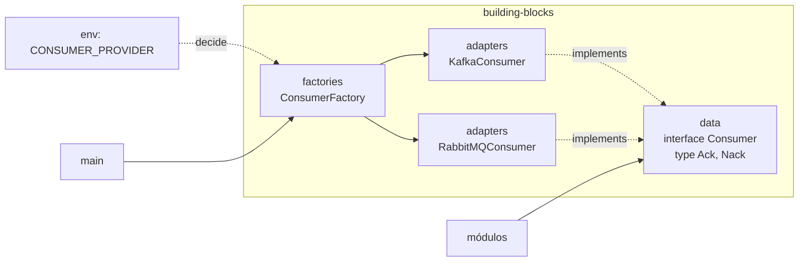

# 4.7 · Building blocks e Shared

## Building blocks: a fundação técnica

> **Building blocks** são os blocos de construção **reutilizáveis** e **independentes de negócio**: implementam infraestrutura, contratos e integrações genéricas que não pertencem a nenhum domínio (frete, pagamento, usuário).

Coloque aqui o que for:
- **Reutilizável** entre vários módulos.
- **Independente de negócio** (não sabe o que é um frete).
- **Técnico** ou de suporte.

| Benefício | Por quê |
|---|---|
| Reuso | Um único adapter de HTTP para todos os módulos |
| Centralização | Decisões técnicas num só lugar |
| Baixo acoplamento | Os módulos não sabem qual biblioteca está por trás |
| Testabilidade | Fácil mockar `HttpClient`, `Publisher`, `Consumer` |
| Portabilidade | Trocar Kafka ↔ RabbitMQ sem reescrever o sistema |

## A estrutura: data → adapters → factories



### 1. `data`: o "o quê" (contratos)

```ts
// building-blocks/data/http.ts
export interface HttpClient {
  get<T>(url: string): Promise<T>
  post<T>(url: string, body: unknown): Promise<T>
}

// building-blocks/data/consumer.ts
export type Ack = () => void
export type Nack = (requeue: boolean) => void
export type MessageHandler = (message: unknown, ack: Ack, nack: Nack) => Promise<void>

export interface Consumer {
  connect(group: string): Promise<void>
  consume(topic: string, handler: MessageHandler): void
}
```

### 2. `adapters`: o "como" (tecnologia real)

```ts
// building-blocks/adapters/http/fetch-http-client.ts
export class FetchHttpClient implements HttpClient {
  constructor(private readonly baseUrl: string) {}

  async get<T>(url: string): Promise<T> {
    const response = await fetch(this.baseUrl + url)
    if (!response.ok) throw new HttpError(response.status)
    return response.json() as Promise<T>
  }

  async post<T>(url: string, body: unknown): Promise<T> {
    const response = await fetch(this.baseUrl + url, {
      method: 'POST',
      headers: { 'content-type': 'application/json' },
      body: JSON.stringify(body),
    })
    if (!response.ok) throw new HttpError(response.status)
    return response.json() as Promise<T>
  }
}
```

```ts
// building-blocks/adapters/messaging/kafka-consumer.ts
export class KafkaConsumer implements Consumer {
  #consumer: KafkaJsConsumer | null = null

  constructor(private readonly kafka: Kafka) {}

  async connect(groupId: string) {
    if (this.#consumer) return
    this.#consumer = this.kafka.consumer({ groupId })
    await this.#consumer.connect()
  }

  consume(topic: string, handler: MessageHandler) {
    const consumer = this.#consumer
    if (!consumer) throw new Error('Consumer not connected')

    void consumer.subscribe({ topic }).then(() =>
      consumer.run({
        autoCommit: false,
        eachMessage: async ({ topic, partition, message }) => {
          const ack: Ack = () =>
            void consumer.commitOffsets([{ topic, partition, offset: (BigInt(message.offset) + 1n).toString() }])
          const nack: Nack = () => { /* não comita: a mensagem será relida (ou envie para DLQ) */ }
          await handler(JSON.parse(message.value?.toString() ?? 'null'), ack, nack)
        },
      }),
    )
  }
}
```

### 3. `factories`: escolher a implementação

```ts
// building-blocks/factories/consumer-factory.ts
let instance: Consumer | null = null // Singleton: uma conexão por processo

export function getConsumer(env: Env): Consumer {
  if (instance) return instance
  switch (env.CONSUMER_PROVIDER) {
    case 'kafka':
      instance = new KafkaConsumer(new Kafka({ clientId: env.KAFKA_CLIENT_ID, brokers: [env.KAFKA_URL] }))
      break
    case 'rabbitmq':
      instance = new RabbitMQConsumer(env.RABBITMQ_URL)
      break
    default:
      throw new Error(`Unsupported CONSUMER_PROVIDER: ${env.CONSUMER_PROVIDER}`)
  }
  return instance
}
```

Essa factory combina três padrões:
- **Factory Method:** decide a classe pelo valor da env.
- **Singleton:** guarda a instância para não abrir várias conexões.
- **Service Locator:** devolve "o driver certo" para quem pedir.

> ⚠️ **Service Locator** esconde dependências quando usado **dentro** do domínio ou de usecases. Use-o só no `main` ou nas factories de borda. Dentro do núcleo, prefira injeção pelo construtor.

## O que **não** é building block

| Parece técnico, mas é negócio | Onde fica |
|---|---|
| "Calcular o preço do frete" | `modules/pricing/domain` |
| "Adapter da API da transportadora X" | `modules/shipping/infra/adapters` (conhece o domínio de frete) |
| "Value Object `Cep`" usado por vários módulos | **Pode** ficar em building-blocks se for genérico e estável. Senão, cada contexto tem o seu |

> 🏛️ **Visão de arquiteto:** building-blocks tende a virar o novo "utils". Revise periodicamente: se algo só é usado por um módulo, devolva para o módulo.

## Shared

> Recursos comuns que não couberam em nenhuma outra camada ou pasta.

Exemplos aceitáveis: classes base de erro, tipos utilitários de TypeScript, constantes globais de configuração.

> ⚠️ `shared` é um **sinal de alerta**. Se cresce muito, é porque faltam fronteiras. Cada item deveria ter um motivo claro para não estar num módulo ou em building-blocks.

## Para fixar

1. O adapter da API de uma transportadora é building block?
2. Por que a factory de consumer guarda a instância?
3. Qual o risco do Service Locator?

<details>
<summary>Respostas</summary>

1. Não. Ele conhece o domínio de frete, então mora na infra do módulo de shipping.
2. Para garantir uma única conexão por processo (Singleton) e evitar abrir conexões repetidas.
3. Esconder as dependências: o código pede o que precisa a um registro global, e isso não aparece no construtor. Restrinja ao main e às factories.

</details>
