# 4.8 · Estrutura de pastas

> Camadas controlam **dependências**. Pastas separam **famílias de código**. A árvore abaixo é a referência do curso; ajuste os nomes ao seu time, mas mantenha as regras.

## A árvore completa

```text
src/
├── main/                                  ← SISTEMA: composition root
│   ├── app.ts
│   ├── server.ts
│   ├── boot.ts
│   ├── entrypoints/                       ← http.ts, workers.ts, cli.ts
│   ├── hooks/                             ← warmup.ts, shutdown.ts, lifecycle.ts
│   └── middlewares/
│
├── building-blocks/                       ← SISTEMA: técnico e reutilizável
│   ├── data/                              ← contratos genéricos: HttpClient, Consumer, Publisher, Logger
│   ├── adapters/                          ← fetch, axios, kafka, rabbitmq, s3...
│   ├── factories/                         ← escolhem o adapter por configuração
│   └── value-objects/                     ← só VOs genéricos e estáveis (Email, Money...)
│
├── shared/                                ← SISTEMA: o mínimo possível (erros base, tipos utilitários)
│
└── modules/                               ← um por bounded context
    └── shipping/
        ├── data/                          ← 1. tipos, enums, consts, schemas, contratos
        │   ├── shipment.ts                ←    schema + type
        │   ├── constants.ts
        │   ├── repositories.ts            ←    interface ShipmentRepository
        │   ├── queries.ts                 ←    interfaces de Query
        │   ├── mutations.ts               ←    interfaces de Mutation
        │   └── gateways.ts                ←    interface CarrierGateway
        │
        ├── domain/                        ← 2. o núcleo
        │   ├── value-objects/
        │   ├── entities/                  ←    entities + aggregate roots (aggregate não tem pasta)
        │   ├── services/
        │   ├── events/
        │   ├── factories/
        │   ├── mappers/
        │   └── helpers/                   ←    evite
        │
        ├── infra/                         ← 3. mundo externo
        │   ├── repositories/
        │   │   ├── postgres/
        │   │   └── memory/
        │   ├── queries/
        │   ├── mutations/
        │   ├── adapters/                  ←    API da transportadora (ACL)
        │   └── factories/                 ←    database.ts, memory.ts
        │
        ├── application/                   ← 4. orquestração
        │   ├── usecases/
        │   ├── services/
        │   ├── orchestrators/
        │   ├── controllers/
        │   ├── handlers/
        │   └── factories/                 ←    usecases.ts, controllers.ts, handlers.ts
        │
        └── presentation/                  ← 5. entrada
            ├── http/                      ←    routers
            └── messaging/                 ←    consumers
```

## Famílias de pastas

```mermaid
flowchart TB
    subgraph NEG["Modelagem do negócio"]
        a["entities"] ~~~ b["value-objects"] ~~~ c["services"] ~~~ d["events"]
    end
    subgraph SUP["Suporte à criação e reuso"]
        e["factories"] ~~~ f["mappers"] ~~~ g["helpers"]
    end
    subgraph EXT["Mundo externo"]
        h["adapters"] ~~~ i["repositories"] ~~~ j["queries"] ~~~ k["mutations"]
    end
    subgraph EXP["Exposição"]
        l["controllers"] ~~~ m["handlers"] ~~~ n["routers"] ~~~ o["consumers"] ~~~ p["entrypoints"]
    end
    subgraph FLX["Fluxos de negócio"]
        q["usecases"] ~~~ r["orchestrators"] ~~~ s["services"]
    end
```



## Onde coloco isto?

| Tenho... | Vai em |
|---|---|
| Um tipo, enum, constante ou schema zod | `modules/x/data` |
| A interface de um repository, query, mutation ou gateway | `modules/x/data` |
| Um valor imutável com regra (CEP, dinheiro, período) | `modules/x/domain/value-objects` |
| Um objeto com identidade e regras | `modules/x/domain/entities` |
| Uma regra que envolve vários objetos, sem I/O | `modules/x/domain/services` |
| Um fato que aconteceu | `modules/x/domain/events` |
| Uma montagem complexa de objetos do domínio | `modules/x/domain/factories` |
| Uma conversão domínio ↔ DTO | `modules/x/domain/mappers` |
| SQL / ORM do aggregate | `modules/x/infra/repositories` |
| Uma leitura com joins para uma tela | `modules/x/infra/queries` |
| Uma escrita transacional complexa | `modules/x/infra/mutations` |
| Cliente da API de um parceiro | `modules/x/infra/adapters` |
| Um fluxo de negócio completo | `modules/x/application/usecases` |
| Receber HTTP | `modules/x/application/controllers` + `modules/x/presentation/http` |
| Receber mensagem | `modules/x/application/handlers` + `modules/x/presentation/messaging` |
| Cliente HTTP genérico, consumer Kafka | `building-blocks/adapters` |
| Subir o servidor e montar dependências | `main` |

## Testes: junto do código

📌 Coloque o teste **ao lado** do arquivo testado:

```text
domain/value-objects/
├── postcode.ts
└── postcode.test.ts
```

Vantagem: quando o arquivo muda ou é removido, o teste está à vista. Testes de integração e e2e podem ficar em `test/` na raiz.

## Variações aceitáveis

| Variação | Quando |
|---|---|
| Juntar `presentation` dentro de `application` | Módulos pequenos, só HTTP |
| Remover `data` e colocar contratos em `domain/ports` | Times que preferem o vocabulário hexagonal |
| Um módulo = um repositório/serviço | Quando o contexto vira microserviço |
| Menos pastas (`domain/`, `infra/`, `app/`) | Serviços pequenos. **Estrutura proporcional ao problema** |

> 🏛️ A árvore é um **meio**. O fim é: dependências para dentro, domínio puro, I/O atrás de contratos e cada coisa fácil de encontrar.
