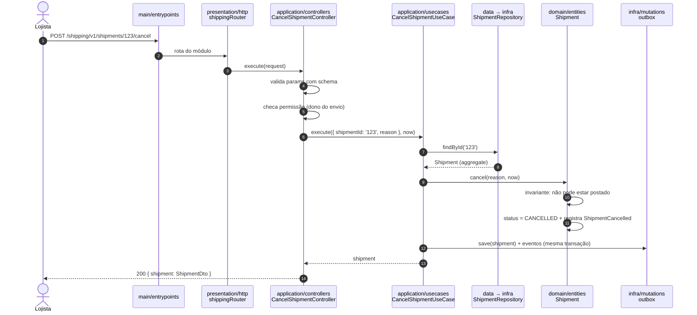
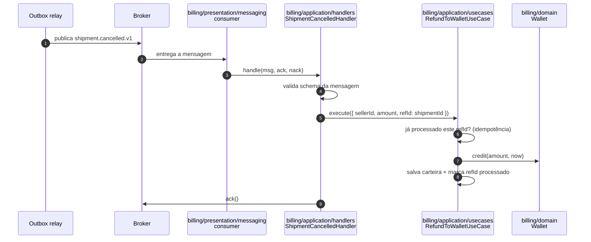

# 4.9 · Fluxo ponta a ponta

Vamos seguir duas requisições atravessando todas as camadas: uma **HTTP** (síncrona) e uma **mensagem** (assíncrona).

## Cenário

"O lojista cancela um envio que ainda não foi postado. O valor volta para a carteira dele."

## 1. Fluxo HTTP: cancelar envio



### O código de cada parte, enxuto

```ts
// domain/entities/shipment.ts
cancel(reason: string, now: Date) {
  if (this.#status === 'CANCELLED') return                        // idempotente
  if (this.#status !== 'CONTRACTED') throw new DomainError('Only contracted shipments can be cancelled')
  this.#status = 'CANCELLED'
  this.#events.push(new ShipmentCancelled(this.id, this.#sellerId, this.#price, reason, now))
}
```

```ts
// application/usecases/cancel-shipment.ts
export class CancelShipmentUseCase {
  constructor(private readonly shipments: ShipmentRepository) {}

  async execute(input: CancelShipmentUseCase.Input, now: Date) {
    const shipment = await this.shipments.findById(input.shipmentId)
    if (!shipment) throw new NotFoundError('Shipment not found')
    shipment.cancel(input.reason, now)
    await this.shipments.save(shipment) // a implementação grava estado + outbox numa transação
    return shipment
  }
}
```

```ts
// application/controllers/cancel-shipment.ts
async execute(request: CancelShipmentController.Request, now = new Date()) {
  const input = cancelShipmentSchema.parse(request)
  await this.ctx.assertOwnsShipment(input.shipmentId)
  const shipment = await this.usecases.cancel().execute(input, now)
  return { shipment: ShipmentMapper.toDto(shipment) }
}
```

## 2. Fluxo assíncrono: estornar para a carteira

O evento `ShipmentCancelled` sai do outbox, vai para o broker e chega ao módulo **billing**, que credita a carteira.



Pontos de arquitetura:
- **Shipping não conhece Billing.** Ele só publica um fato.
- **Billing não lê a tabela de Shipping.** Ele recebe o que precisa no evento.
- O handler é **idempotente**: se a mensagem chegar duas vezes, o estorno acontece uma vez.

## 3. Onde cada responsabilidade ficou

| Responsabilidade | Camada |
|---|---|
| URL, verbo, status HTTP | presentation + controller |
| Formato do input | schema em `data`, aplicado no controller |
| Permissão | controller |
| "Envio existe?" | usecase |
| "Pode cancelar?" | **domain** (aggregate) |
| Persistir estado + evento | infra (repository + outbox) |
| Levar o evento a outro contexto | infra (outbox relay) + broker |
| Reagir ao evento | handler + usecase de outro módulo |
| "Já estornei?" | usecase de billing (idempotência) |
| Creditar sem estourar regras | **domain** de billing (`Wallet.credit`) |

> 💡 Repare: as **duas** decisões de negócio do cenário ("pode cancelar?" e "como creditar?") estão no **domínio**. Todo o resto é orquestração e tecnologia.
