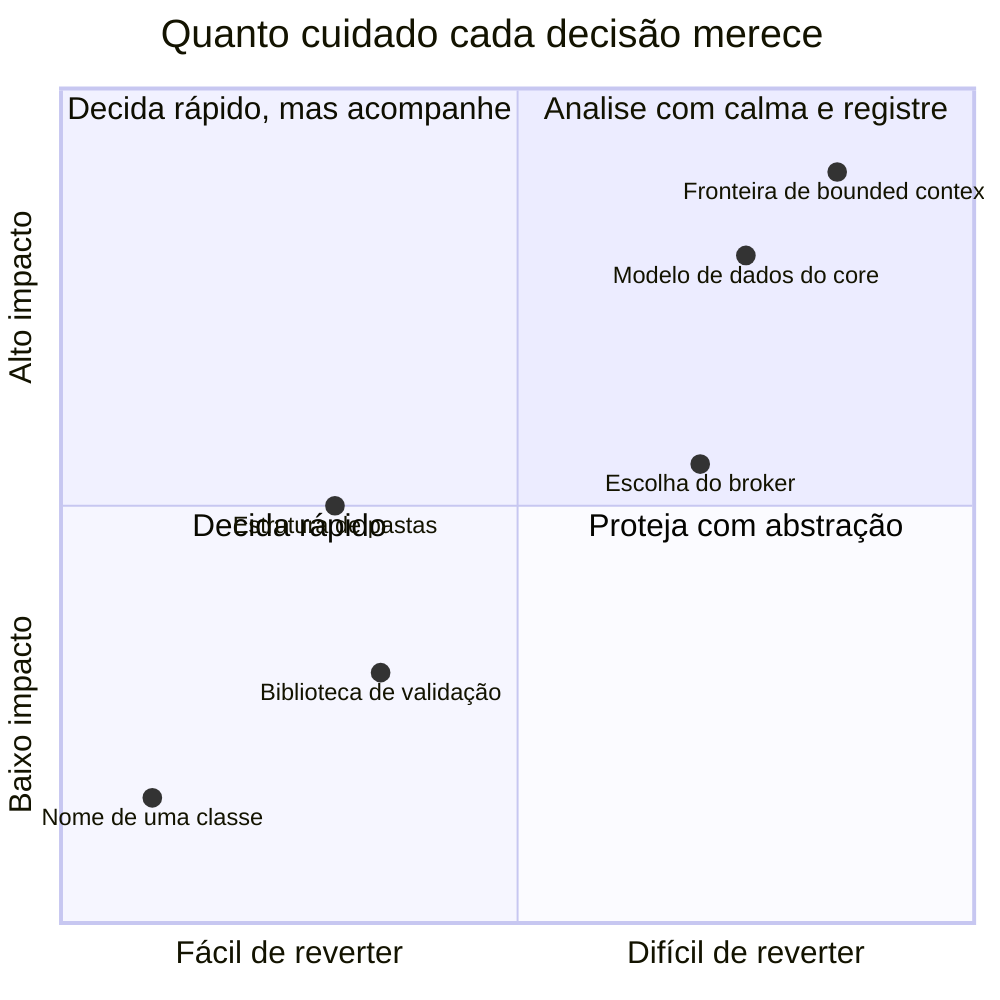

# 4.11 · Decisões e trade-offs: pensando como arquiteto

> 💡 "Tudo em arquitetura de software é um trade-off." — Mark Richards & Neal Ford. Se você acha que encontrou uma decisão sem desvantagem, ainda não encontrou a desvantagem.

## O que um arquiteto faz de diferente

| Desenvolvedor pergunta | Arquiteto pergunta |
|---|---|
| "Como implemento isso?" | "O que vai mudar aqui nos próximos 2 anos?" |
| "Qual é o melhor padrão?" | "Qual é o **custo** deste padrão para este time?" |
| "Funciona?" | "O que acontece quando falhar? E com 100× de carga?" |
| "Está limpo?" | "Daqui a 6 meses, um dev novo entende em 10 minutos?" |
| "Qual tecnologia?" | "Esta decisão é fácil ou difícil de reverter?" |

## Decisões reversíveis x irreversíveis



- **Difíceis de reverter** (fronteiras de contexto, modelo de dados público, contratos de eventos): invista tempo, consulte o negócio e **registre**.
- **Fáceis de reverter** (nome de pasta, biblioteca interna): decida rápido.
- **Difíceis de reverter e técnicas** (banco, broker): esconda atrás de um **contrato** para torná-las mais reversíveis.

## Características de qualidade (os "-ilities")

Nenhum sistema maximiza todas. Escolha as 3 a 5 mais importantes **para este sistema**.

| Característica | Pergunta | Ferramentas deste curso |
|---|---|---|
| **Manutenibilidade** | É fácil mudar? | Camadas, domínio rico, SOLID |
| **Testabilidade** | É fácil provar que funciona? | DIP, repositórios em memória |
| **Evolutividade** | Aguenta mudanças de negócio? | Bounded contexts, eventos |
| **Escalabilidade** | Aguenta mais carga? | CQRS, mensageria, read models |
| **Disponibilidade** | Continua no ar quando algo falha? | Filas, retry, idempotência, circuit breaker |
| **Consistência** | Os dados estão sempre corretos? | Aggregates, transações, outbox |
| **Desempenho** | Responde rápido? | Queries especializadas, cache, Flyweight/Proxy |
| **Segurança** | Protege dados e acesso? | Validação na borda, permissões no controller |

> ⚠️ Várias se opõem: **consistência forte x disponibilidade** (teorema CAP), **desempenho x manutenibilidade**, **flexibilidade x simplicidade**.

## ADR: Architecture Decision Record

Uma decisão importante sem registro vira "sempre foi assim" em seis meses. Um **ADR** é um documento curto, versionado no repositório, que registra **uma** decisão.

```markdown
# ADR-007: Usar Transactional Outbox para publicar eventos de domínio

- Status: Aceito
- Data: 2026-03-14
- Decisores: time de Shipping, arquitetura

## Contexto
Eventos publicados após o commit se perdem quando o broker está fora,
causando estornos não realizados (incidente INC-231).

## Decisão
Gravar eventos numa tabela `outbox` na mesma transação do aggregate.
Um relay publica e marca como enviado.

## Alternativas consideradas
1. Publicar depois do commit, com retry em memória: perde eventos se o processo cair.
2. Two-phase commit (2PC): não suportado pelo broker; complexo.

## Consequências
+ Nenhum evento se perde se o commit acontecer.
+ Publicação tolera indisponibilidade do broker.
- Entrega pelo menos uma vez: consumidores precisam ser idempotentes.
- Latência extra de alguns segundos.
- Nova tabela e um processo de relay para operar.
```

Um modelo pronto está em [`templates/adr.md`](../../templates/adr.md).

## Sinais de over-engineering

- Interfaces com **uma única implementação** que nunca vai ter outra (e que não servem a testes).
- Camadas que só **repassam chamadas** sem adicionar nada.
- Eventos e filas num sistema com um módulo e um time.
- Microserviços antes de haver mais de um time ou necessidade real de escala independente.
- "Vamos precisar disso um dia" sem data nem dono.

## Sinais de under-engineering

- Regra de negócio dentro de controller ou de query SQL.
- O mesmo `if` de regra repetido em vários lugares.
- Impossível testar sem subir banco.
- Um bug numa área quebra outra que "não tem nada a ver".
- Ninguém sabe dizer onde uma regra está implementada.

> 🏛️ A estrutura certa é a **menor estrutura que mantém o custo de mudança baixo** para o futuro **provável** do sistema. Revise essa aposta periodicamente.
