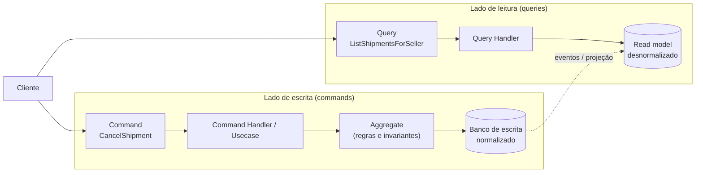
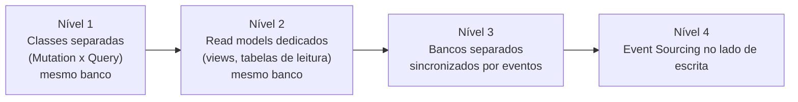

# 5.1 · CQS e CQRS

## CQS: Command Query Separation (Bertrand Meyer, 1988)

> 💡 Um método **ou altera estado** (command) **ou devolve um dado** (query). **Nunca os dois.**

```ts
// ❌ Viola CQS: lê e altera ao mesmo tempo
class Stack<T> {
  pop(): T { /* remove e devolve */ }
}

// ✅ Respeita CQS
class Wallet {
  get balance(): Money { return this.#balance }      // query: não altera
  debit(amount: Money): void { /* altera */ }        // command: não devolve dado
}
```

Benefício: queries podem ser chamadas à vontade, em qualquer ordem, sem efeito colateral. Commands deixam claro onde o estado muda.

> ⚠️ Exceções pragmáticas existem (`pop()`, `array.push()` que devolve o tamanho, um command que devolve o ID gerado). O princípio é um guia, não uma lei.

## CQRS: Command Query Responsibility Segregation (Greg Young, ~2010)

CQRS leva o CQS do **método** para a **arquitetura**: o **modelo de escrita** e o **modelo de leitura** são **separados**.



| | Escrita | Leitura |
|---|---|---|
| Objetivo | Garantir regras | Responder rápido |
| Modelo | Aggregates ricos | DTOs planos, desnormalizados |
| Otimizado para | Consistência | Consultas específicas da tela |
| Retorno | Nada, ou ID/status | Dados |
| Escala | Normalmente menor | Normalmente muito maior |

## Os níveis de CQRS

Não é tudo ou nada. Você pode parar em qualquer degrau.



| Nível | O que muda | Custo |
|---|---|---|
| **1** | Usecases de escrita usam Repository/Mutation; telas usam Query com SQL próprio | Quase zero. **Comece aqui** |
| **2** | Uma view materializada ou tabela otimizada para uma tela pesada | Baixo |
| **3** | Leitura em outro banco (Elasticsearch, Redis), atualizado por eventos | **Consistência eventual**, infra extra |
| **4** | A escrita guarda eventos em vez de estado | Alto (Módulo 5.2) |

> 💡 O **nível 1** é exatamente a separação **Query/Mutation** da camada infra ([4.5](../modulo-04-arquitetura/05-camada-infra.md)).

## Exemplo mínimo: saldo de conta

```ts
// commands não devolvem dados
export class CreditBalanceCommand {
  constructor(
    readonly accountId: string,
    readonly amount: Money,
    readonly occurredAt: Date,
  ) {}
}

export interface CommandHandler<C> {
  handle(command: C): Promise<void>
}

export class CreditBalanceHandler implements CommandHandler<CreditBalanceCommand> {
  constructor(private readonly ledger: LedgerRepository) {}

  async handle(command: CreditBalanceCommand) {
    await this.ledger.append({
      accountId: command.accountId,
      amount: command.amount,
      occurredAt: command.occurredAt,
    })
  }
}
```

```ts
// queries devolvem dados e não alteram nada
export interface QueryHandler<Q, R> {
  handle(query: Q): Promise<R>
}

export class GetBalanceHandler implements QueryHandler<{ accountId: string }, BalanceDto> {
  constructor(private readonly balances: BalanceReadModel) {}

  handle({ accountId }: { accountId: string }) {
    return this.balances.get(accountId) // tabela pronta para leitura
  }
}
```

## Quando usar

| Use CQRS (níveis 2+) quando | Evite quando |
|---|---|
| Leitura e escrita têm cargas muito diferentes | É um CRUD simples |
| As telas precisam de formas muito diferentes do modelo de escrita | Um único modelo atende bem |
| O domínio é complexo e a escrita precisa de aggregates ricos | O time não está pronto para consistência eventual |
| Várias projeções do mesmo dado (lista, dashboard, busca) | |

> 🏛️ **Visão de arquiteto:** o risco do CQRS é aplicá-lo **a um domínio simples**, onde só adiciona complexidade. O que vale para quase todo sistema é a **ideia de separação** (nível 1). Os níveis 3 e 4 são decisões que merecem um ADR.

## Para fixar

1. O que CQS diz sobre um método?
2. Qual o nível de CQRS que quase todo sistema pode aplicar sem custo?
3. Qual a principal consequência do nível 3?

<details>
<summary>Respostas</summary>

1. Que ele deve ou alterar estado ou devolver dado, nunca os dois.
2. O nível 1: classes separadas para leitura (Query) e escrita (Mutation/Repository), no mesmo banco.
3. Consistência eventual: a leitura pode ficar alguns instantes atrás da escrita.

</details>
