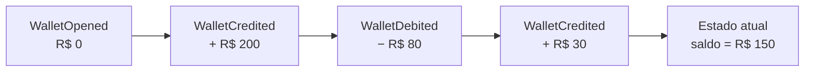
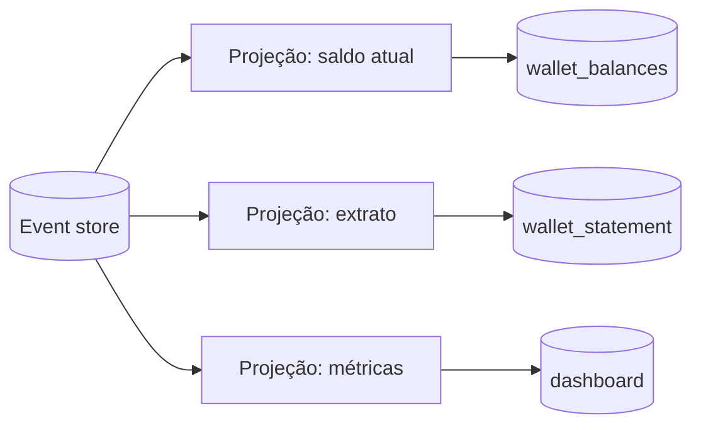

# 5.2 · Event Sourcing

## Problema

Uma tabela `wallets(id, balance)` diz que o saldo é R$ 150. Mas **como** chegou lá? Quem debitou, quando, por quê? Se houve um bug há três semanas, não dá para reconstruir.

## Ideia

> 💡 Em vez de guardar o **estado atual**, guarde a **sequência de eventos** que levou até ele. O estado é **derivado**: reaplicando os eventos em ordem, obtém-se o estado em qualquer momento.



É como um **extrato bancário**: o saldo é a soma das movimentações. Ninguém apaga uma movimentação; um erro é corrigido com **outra movimentação** (estorno).

## Estado x eventos

| | Guardar estado | Event Sourcing |
|---|---|---|
| O que se grava | O resultado | Os fatos |
| Histórico | Perdido (ou em tabela de auditoria à parte) | Completo, por natureza |
| Corrigir um erro | `UPDATE` (apaga o passado) | Novo evento compensatório |
| Consultar | Direto | Por projeções (read models) |
| Complexidade | Baixa | Alta |

## Implementação mínima

```ts
// domain/events/wallet-events.ts
export type WalletEvent =
  | { type: 'WalletOpened'; walletId: string; at: Date }
  | { type: 'WalletCredited'; walletId: string; amountCents: number; at: Date }
  | { type: 'WalletDebited'; walletId: string; amountCents: number; at: Date }
```

```ts
// domain/entities/wallet.ts
export class Wallet {
  #balanceCents = 0
  #version = 0
  #pending: WalletEvent[] = []

  private constructor(readonly id: string) {}

  // reconstrói a partir do histórico
  static fromHistory(id: string, history: WalletEvent[]) {
    const wallet = new Wallet(id)
    for (const event of history) wallet.apply(event)
    return wallet
  }

  static open(id: string, at: Date) {
    const wallet = new Wallet(id)
    wallet.record({ type: 'WalletOpened', walletId: id, at })
    return wallet
  }

  get balanceCents() { return this.#balanceCents }
  get version() { return this.#version }

  // comando: valida a regra e registra o evento
  debit(amountCents: number, at: Date) {
    if (amountCents <= 0) throw new DomainError('Amount must be positive')
    if (amountCents > this.#balanceCents) throw new DomainError('Insufficient funds')
    this.record({ type: 'WalletDebited', walletId: this.id, amountCents, at })
  }

  credit(amountCents: number, at: Date) {
    if (amountCents <= 0) throw new DomainError('Amount must be positive')
    this.record({ type: 'WalletCredited', walletId: this.id, amountCents, at })
  }

  pullPending() {
    const events = this.#pending
    this.#pending = []
    return events
  }

  private record(event: WalletEvent) {
    this.apply(event)
    this.#pending.push(event)
  }

  // aplicar NUNCA valida: o fato já aconteceu
  private apply(event: WalletEvent) {
    switch (event.type) {
      case 'WalletOpened': break
      case 'WalletCredited': this.#balanceCents += event.amountCents; break
      case 'WalletDebited': this.#balanceCents -= event.amountCents; break
    }
    this.#version++
  }
}
```

> 💡 Duas operações distintas:
> - **Comando** (`debit`): **valida** a regra e **registra** um evento.
> - **Apply**: **aplica** o evento ao estado, **sem validar**. O fato já aconteceu; reprocessar o histórico nunca pode falhar.

### Event store

```ts
export interface EventStore {
  load(streamId: string): Promise<WalletEvent[]>
  append(streamId: string, events: WalletEvent[], expectedVersion: number): Promise<void> // falha se a versão mudou
}
```

```ts
// application/usecases/debit-wallet.ts
async execute({ walletId, amountCents }: Input, now: Date) {
  const history = await this.store.load(walletId)
  const wallet = Wallet.fromHistory(walletId, history)
  const versionBefore = wallet.version
  wallet.debit(amountCents, now)
  await this.store.append(walletId, wallet.pullPending(), versionBefore) // optimistic concurrency
}
```

## Projeções

Ler o histórico inteiro para cada tela é caro. **Projeções** consomem os eventos e mantêm **read models** prontos (CQRS nível 3).



Bônus: uma projeção nova pode ser criada **a qualquer momento** reprocessando todos os eventos desde o início.

## Exemplo: PIX com estorno por comandos

Um modelo simplificado mostra a ideia central: **o estorno não apaga a transferência, é um novo fato que a compensa**.

```ts
class Account {
  constructor(readonly id: string, public balance: number) {}
  debit(amount: number) { this.balance -= amount }
  credit(amount: number) { this.balance += amount }
}

class TransferCommand {
  constructor(private readonly from: Account, private readonly to: Account, readonly amount: number) {}
  handle() {
    this.from.debit(this.amount)
    this.to.credit(this.amount)
  }
  reversal() {
    return new TransferCommand(this.to, this.from, this.amount) // o estorno é outra transferência
  }
}

class TransactionBus {
  private readonly pending = new Map<string, TransferCommand>()
  publish(id: string, command: TransferCommand) { this.pending.set(id, command) }
  process() {
    for (const [id, command] of this.pending) {
      command.handle()
      this.pending.delete(id)
    }
  }
}

const alice = new Account('alice', 1000)
const bob = new Account('bob', 0)
const bus = new TransactionBus()

const pix = new TransferCommand(alice, bob, 500)
bus.publish('tx-1', pix)
bus.process()                        // alice 500, bob 500

bus.publish('tx-2', pix.reversal())
bus.process()                        // alice 1000, bob 0
```

> ⚠️ Este exemplo processa **comandos** num barramento em memória e os descarta depois. Em Event Sourcing de verdade, os **eventos** resultantes (`TransferDone`, `TransferReversed`) seriam **gravados para sempre** e seriam a fonte da verdade do saldo.

## Snapshots

Um aggregate com 100.000 eventos demora para carregar. A solução é gravar um **snapshot** do estado a cada N eventos e reaplicar só os eventos posteriores.

## Quando usar

| Use | Evite |
|---|---|
| Auditoria é requisito (financeiro, saúde, jurídico) | CRUD, cadastros |
| O histórico tem valor de negócio (análises, "como estava em tal data") | Time sem experiência com consistência eventual |
| Domínio naturalmente orientado a eventos (ledger, rastreio) | Quando apagar dados é exigência legal e não há estratégia (LGPD: *crypto-shredding*) |

> 🏛️ **Visão de arquiteto:** Event Sourcing é uma decisão **por aggregate**, não para o sistema inteiro. Use onde o histórico é o produto (a carteira), e estado comum no resto.

## Para fixar

1. Por que o `apply` não valida regras?
2. Como se corrige um débito errado em Event Sourcing?
3. Para que servem projeções?

<details>
<summary>Respostas</summary>

1. Porque o evento já é um fato. Reprocessar o histórico precisa sempre dar o mesmo resultado, e a validação já aconteceu quando o evento foi registrado.
2. Com um novo evento compensatório (um crédito de estorno). O histórico nunca é apagado.
3. Para manter read models prontos para leitura, sem reprocessar todo o histórico a cada consulta.

</details>
