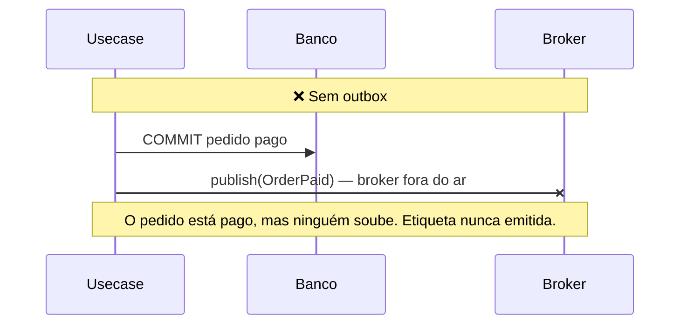
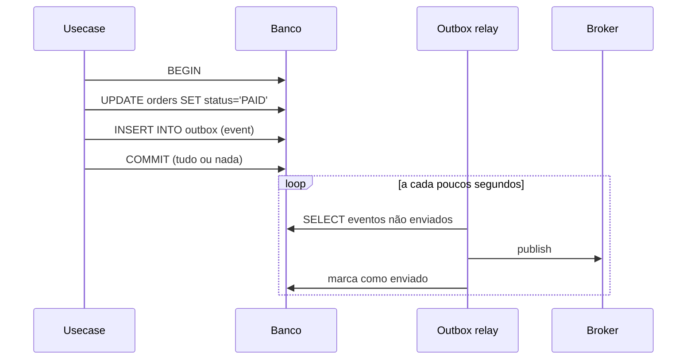
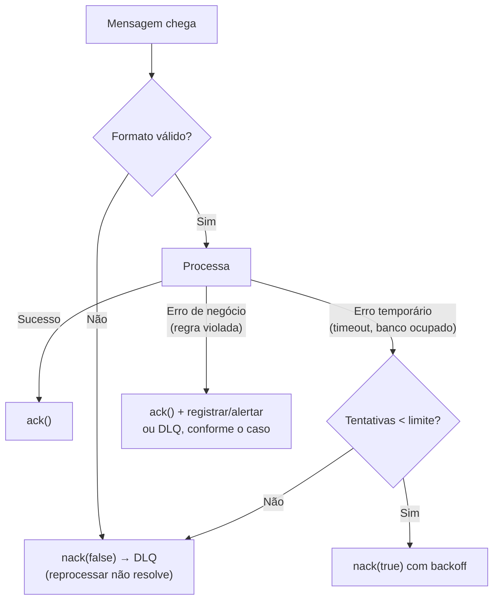

# 5.3 · Mensageria

## Por que usar filas e eventos

| Sem mensageria | Com mensageria |
|---|---|
| O serviço A chama o B por HTTP e **espera** | A publica e segue em frente |
| Se B cair, A falha junto | A mensagem espera na fila até B voltar |
| Pico de carga derruba B | A fila absorve o pico |
| A precisa conhecer todos os interessados | Novos consumidores assinam sem mudar A |

## Vocabulário

| Termo | Significado |
|---|---|
| **Broker** | O servidor de mensagens: Kafka, RabbitMQ, SQS, Pub/Sub |
| **Producer / Publisher** | Quem envia |
| **Consumer** | Quem recebe |
| **Queue (fila)** | Cada mensagem vai para **um** consumidor (trabalho distribuído) |
| **Topic (tópico)** | Cada mensagem vai para **todos** os grupos assinantes (pub/sub) |
| **Ack** | "Processei com sucesso, pode remover" |
| **Nack** | "Falhei" (com ou sem reenfileirar) |
| **DLQ** (dead-letter queue) | Fila para mensagens que falharam além do limite |
| **Retry com backoff** | Tentar de novo esperando cada vez mais (1 s, 2 s, 4 s...) |

## Comando x evento

| | Comando | Evento |
|---|---|---|
| Significado | "Faça isto" | "Isto aconteceu" |
| Tempo verbal | Imperativo (`IssueLabel`) | Passado (`LabelIssued`) |
| Destinatários | **Um** responsável | **Zero ou muitos** interessados |
| Pode ser recusado? | Sim | Não: já aconteceu |
| Acoplamento | O remetente sabe quem executa | O publicador não sabe quem escuta |

## Garantias de entrega

| Garantia | O que significa | Na prática |
|---|---|---|
| **At most once** (no máximo uma) | Pode perder, nunca duplica | Raro em negócio |
| **At least once** (pelo menos uma) | Nunca perde, **pode duplicar** | **O padrão** de Kafka, RabbitMQ e SQS |
| **Exactly once** (exatamente uma) | Nem perde nem duplica | Caro e limitado; simule com **at least once + idempotência** |

> 💡 **Assuma sempre que a mensagem pode chegar duas vezes, ou fora de ordem.** Todo consumidor precisa ser **idempotente**.

## Idempotência

Processar a mesma mensagem N vezes tem o mesmo efeito que processar uma vez.

```ts
export class RefundToWalletUseCase {
  constructor(
    private readonly wallets: WalletRepository,
    private readonly processed: ProcessedMessageRepository,
  ) {}

  async execute(input: { messageId: string; walletId: string; amountCents: number }, now: Date) {
    if (await this.processed.exists(input.messageId)) return   // já fiz: ignora

    const wallet = await this.wallets.findById(input.walletId)
    if (!wallet) throw new NotFoundError('Wallet not found')

    wallet.credit(Money.fromCents(input.amountCents), now)
    await this.wallets.saveWithProcessedMessage(wallet, input.messageId) // mesma transação
  }
}
```

Técnicas de idempotência:
- **Tabela de mensagens processadas** (como acima), com `UNIQUE(message_id)`.
- **Operações naturalmente idempotentes**: `status = 'CANCELLED'` (não `count = count + 1`).
- **Chave de idempotência** vinda do produtor (`Idempotency-Key` em APIs HTTP).
- **Versão/sequência**: ignora eventos com versão menor que a atual.

## O problema da escrita dupla e o Transactional Outbox



**Solução: Transactional Outbox.**



```ts
// infra/repositories/postgres/order-postgres-repository.ts
async save(order: Order) {
  await this.db.transaction(async (tx) => {
    await tx.upsert('orders', OrderMapper.toRow(order))
    const events = order.pullEvents()
    if (events.length > 0) {
      await tx.insert('outbox', events.map((event) => ({
        id: crypto.randomUUID(),
        type: event.name,
        payload: JSON.stringify(event),
        created_at: event.occurredAt,
      })))
    }
  })
}
```

O relay pode publicar o mesmo evento duas vezes (se cair depois de publicar e antes de marcar). Por isso, de novo: **consumidores idempotentes**.

## Tratamento de falhas no handler



| Tipo de erro | Exemplo | Ação |
|---|---|---|
| **Formato inválido** | JSON quebrado, campo faltando | DLQ direto: tentar de novo não resolve |
| **Transitório** | Timeout, banco indisponível | Retry com backoff |
| **De negócio** | "Carteira bloqueada" | Não adianta repetir. Registrar, alertar, compensar |
| **Desconhecido** | Bug | Retry limitado → DLQ → investigar |

## Boas práticas

1. **Valide a mensagem** com schema, mesmo vinda de dentro da empresa.
2. **Versione** os eventos públicos (`shipment.cancelled.v1`). Adicione campos, não remova.
3. **Mensagens pequenas:** IDs e dados essenciais. Não o aggregate inteiro.
4. **Correlation ID** em toda mensagem, para rastrear o fluxo entre serviços.
5. **Métricas:** tamanho da fila, taxa de erro, tempo de processamento, mensagens na DLQ.
6. **Ordem:** se importa, use uma **chave de partição** (ex.: `walletId`) para que eventos do mesmo aggregate cheguem em ordem.

## Para fixar

1. Por que todo consumidor deve ser idempotente?
2. Que problema o Outbox resolve?
3. O que fazer com uma mensagem de formato inválido?

<details>
<summary>Respostas</summary>

1. Porque os brokers garantem entrega "pelo menos uma vez": a mesma mensagem pode chegar mais de uma vez.
2. A escrita dupla: garante que o estado e o evento são gravados juntos, na mesma transação, e que o evento será publicado mesmo se o broker estiver fora.
3. Mandar para a DLQ sem reenfileirar: tentar de novo não vai resolver.

</details>
