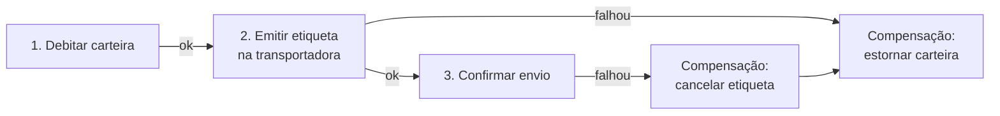
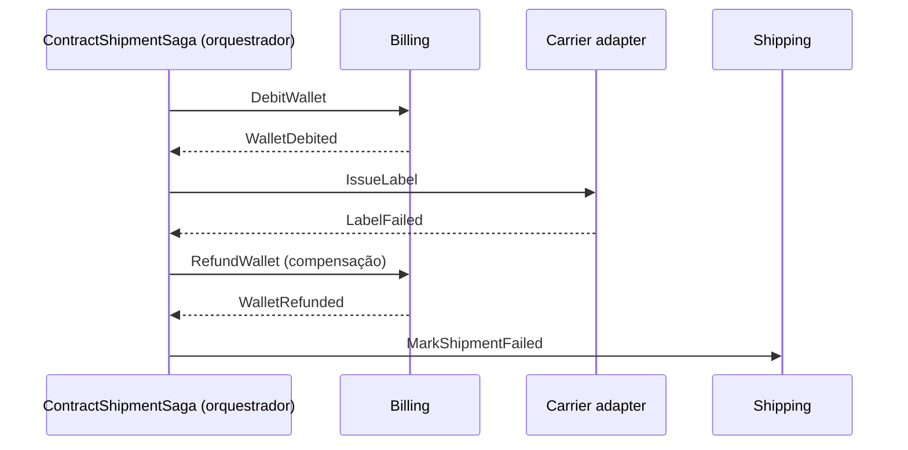

# 5.4 · Consistência eventual e Sagas

## Consistência forte x eventual

| | Forte | Eventual |
|---|---|---|
| Após a escrita | Todo mundo vê o novo valor **imediatamente** | Todo mundo verá o novo valor **em algum momento** |
| Como | Uma transação | Eventos entre aggregates/serviços |
| Escala | Limitada | Alta |
| Disponibilidade | Menor (tudo precisa estar no ar) | Maior |
| Onde usar | **Dentro de um aggregate** | **Entre aggregates e entre contextos** |

> 💡 A pergunta certa para o negócio não é "pode ficar inconsistente?" (a resposta será sempre "não"). É "**quanto tempo** de atraso é aceitável, e **o que fazer** se der errado?". Quase sempre "alguns segundos" e "estornar" são respostas aceitáveis.

## Saga: uma transação de negócio feita de várias transações locais

Um processo como "contratar frete" envolve vários contextos: reservar saldo, emitir etiqueta, confirmar envio. Não existe uma transação que abranja tudo. Uma **saga** executa cada passo como uma transação local e, se um passo falhar, executa **compensações** para desfazer os anteriores.



### Coreografia x Orquestração

| | Coreografia | Orquestração |
|---|---|---|
| Como | Cada serviço reage a eventos e publica outros | Um **orquestrador** central manda cada passo |
| Quem conhece o fluxo | Ninguém por inteiro | O orquestrador |
| Acoplamento | Baixo | Médio (todos falam com o orquestrador) |
| Visibilidade | Difícil de entender e depurar | Fácil: o fluxo está num lugar só |
| Bom para | Poucos passos, contextos independentes | Fluxos longos, com regras e compensações |



### Orquestrador como máquina de estados

```ts
type SagaState = 'STARTED' | 'WALLET_DEBITED' | 'LABEL_ISSUED' | 'COMPLETED' | 'COMPENSATING' | 'FAILED'

export class ContractShipmentSaga {
  constructor(
    readonly id: string,
    private state: SagaState = 'STARTED',
  ) {}

  // cada evento recebido decide o próximo comando
  on(event: SagaEvent): SagaCommand | null {
    switch (this.state) {
      case 'STARTED':
        if (event.type === 'WalletDebited') { this.state = 'WALLET_DEBITED'; return { type: 'IssueLabel' } }
        if (event.type === 'WalletDebitFailed') { this.state = 'FAILED'; return { type: 'MarkShipmentFailed' } }
        break
      case 'WALLET_DEBITED':
        if (event.type === 'LabelIssued') { this.state = 'LABEL_ISSUED'; return { type: 'ConfirmShipment' } }
        if (event.type === 'LabelFailed') { this.state = 'COMPENSATING'; return { type: 'RefundWallet' } }
        break
      case 'LABEL_ISSUED':
        if (event.type === 'ShipmentConfirmed') { this.state = 'COMPLETED'; return null }
        break
      case 'COMPENSATING':
        if (event.type === 'WalletRefunded') { this.state = 'FAILED'; return { type: 'MarkShipmentFailed' } }
        break
    }
    return null // evento inesperado ou duplicado: ignora (idempotência)
  }
}
```

Note o uso do padrão **State** (Módulo 6): o comportamento depende do estado atual. A saga é persistida, para sobreviver a reinícios.

## Regras para compensações

1. **Toda ação que pode precisar ser desfeita tem uma compensação** definida com o negócio.
2. Compensações também são **idempotentes**.
3. Nem tudo se desfaz: um e-mail enviado não volta. Para isso, a compensação é **outra ação** ("enviar e-mail de correção").
4. Ordene os passos do **mais fácil de desfazer** para o **mais difícil**, e deixe o irreversível por último.

## Para fixar

1. Onde usar consistência forte?
2. Qual a diferença entre coreografia e orquestração?
3. Como desfazer o envio de um e-mail numa saga?

<details>
<summary>Respostas</summary>

1. Dentro de um aggregate, numa única transação.
2. Na coreografia, cada serviço reage a eventos e ninguém conhece o fluxo inteiro. Na orquestração, um coordenador central comanda cada passo.
3. Não dá para desfazer. A compensação é uma nova ação, como enviar um e-mail de correção. Por isso, deixe ações irreversíveis por último.

</details>
