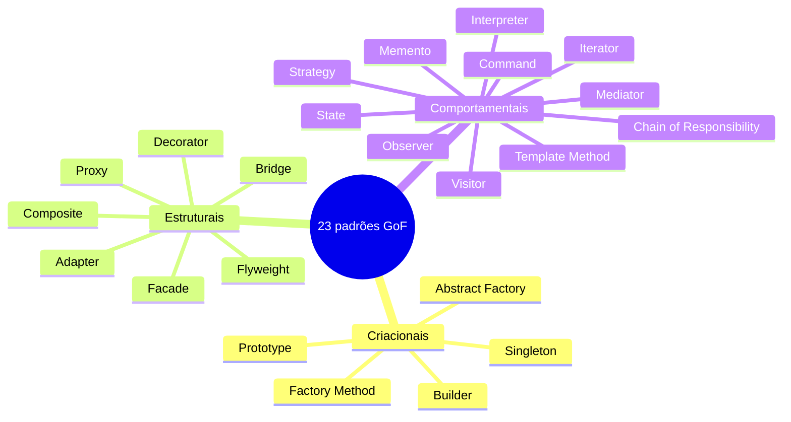

# 6.0 · Design Patterns: como estudar

> Um **padrão de projeto** é uma **solução reutilizável para um problema recorrente num contexto**. Não é código pronto: é um **modelo** que você adapta.

## Por que aprender

- **Vocabulário comum:** "isso é um Strategy" resume dez minutos de explicação.
- **Soluções testadas:** problemas que milhares de pessoas já resolveram.
- **Leitura de código:** frameworks usam padrões o tempo todo (middlewares são Chain of Responsibility; `Array.prototype[Symbol.iterator]` é Iterator; React Context é algo próximo de Observer).
- **Base para arquitetura:** Adapter, Factory, Strategy e Command aparecem em toda a arquitetura do Módulo 4.

## As três famílias (Gang of Four, 1994)

| Família | Foco | Pergunta | Exemplo com "Pedido" |
|---|---|---|---|
| **Criacionais** | Como objetos são **criados** | "Quem cria, e como?" | Como instanciar um Pedido |
| **Estruturais** | Como objetos são **compostos** | "Como encaixo estas peças?" | Como organizar o Pedido com outros objetos |
| **Comportamentais** | Como objetos **colaboram** | "Quem faz o quê, e como conversam?" | Como o Pedido muda de estado |

## Catálogo rápido

### Criacionais

| Padrão | Em uma frase | Página |
|---|---|---|
| **Factory Method** | Delega a escolha da classe concreta a um método | [link](criacionais/factory-method.md) |
| **Abstract Factory** | Cria **famílias** de objetos compatíveis entre si | [link](criacionais/abstract-factory.md) |
| **Builder** | Monta um objeto complexo passo a passo | [link](criacionais/builder.md) |
| **Prototype** | Cria objetos clonando um protótipo | [link](criacionais/prototype.md) |
| **Singleton** | Garante uma única instância com acesso global | [link](criacionais/singleton.md) |

### Estruturais

| Padrão | Em uma frase | Página |
|---|---|---|
| **Adapter** | Converte uma interface na interface que o cliente espera | [link](estruturais/adapter.md) |
| **Bridge** | Separa abstração e implementação em hierarquias independentes | [link](estruturais/bridge.md) |
| **Composite** | Trata objetos individuais e grupos (árvores) da mesma forma | [link](estruturais/composite.md) |
| **Decorator** | Adiciona responsabilidades dinamicamente, embrulhando o objeto | [link](estruturais/decorator.md) |
| **Facade** | Oferece uma interface simples para um subsistema complexo | [link](estruturais/facade.md) |
| **Flyweight** | Compartilha estado imutável entre muitos objetos para economizar memória | [link](estruturais/flyweight.md) |
| **Proxy** | Um substituto que controla o acesso ao objeto real | [link](estruturais/proxy.md) |

### Comportamentais

| Padrão | Em uma frase | Página |
|---|---|---|
| **Chain of Responsibility** | Passa a solicitação por uma cadeia até alguém tratar | [link](comportamentais/chain-of-responsibility.md) |
| **Command** | Transforma uma solicitação em objeto (enfileirar, desfazer, registrar) | [link](comportamentais/command.md) |
| **Interpreter** | Representa uma gramática e interpreta sentenças | [link](comportamentais/interpreter.md) |
| **Iterator** | Percorre uma coleção sem expor sua estrutura | [link](comportamentais/iterator.md) |
| **Mediator** | Centraliza a comunicação entre objetos | [link](comportamentais/mediator.md) |
| **Memento** | Salva e restaura o estado sem violar o encapsulamento | [link](comportamentais/memento.md) |
| **Observer** | Notifica vários objetos quando um muda (um para muitos) | [link](comportamentais/observer.md) |
| **State** | Muda o comportamento conforme o estado interno | [link](comportamentais/state.md) |
| **Strategy** | Família de algoritmos intercambiáveis | [link](comportamentais/strategy.md) |
| **Template Method** | Esqueleto fixo de algoritmo com passos variáveis nas subclasses | [link](comportamentais/template-method.md) |
| **Visitor** | Adiciona operações a uma estrutura sem alterar suas classes | [link](comportamentais/visitor.md) |

## Ordem de estudo recomendada

Os mais usados no dia a dia primeiro:

```mermaid
flowchart LR
    A["1. Strategy"] --> B["2. Factory Method"] --> C["3. Adapter"] --> D["4. Observer"]
    D --> E["5. Decorator"] --> F["6. Template Method"] --> G["7. Command"] --> H["8. State"]
    H --> I["9. Builder"] --> J["10. Facade"] --> K["11. Proxy"] --> L["12. Chain of Responsibility"]
    L --> M["13. os demais"]
```

## Padrões parecidos: como diferenciar

| Parecem iguais | Diferença |
|---|---|
| **Strategy x State** | Strategy: **o cliente** escolhe o algoritmo. State: **o próprio objeto** troca de estado e de comportamento |
| **Strategy x Template Method** | Strategy troca o algoritmo **inteiro** por composição. Template Method fixa o **esqueleto** e varia passos por herança |
| **Decorator x Proxy** | Ambos embrulham o objeto. Decorator **adiciona comportamento**. Proxy **controla o acesso** (lazy, cache, permissão) |
| **Adapter x Facade** | Adapter converte **uma** interface em outra. Facade **simplifica um subsistema** inteiro |
| **Adapter x Bridge** | Adapter conserta incompatibilidade **depois** que existe. Bridge é desenhado **antes**, para separar duas dimensões |
| **Factory x Builder** | Factory decide **qual** objeto criar, em um passo. Builder decide **como** montar, em vários passos |
| **Observer x Mediator** | Observer: **um** notifica **muitos**. Mediator: **muitos** conversam **por um** ponto central |
| **Command x Strategy** | Command encapsula **uma ação** (para executar depois, desfazer). Strategy encapsula **um algoritmo** intercambiável |
| **Composite x Decorator** | Composite agrega **vários** filhos numa árvore. Decorator embrulha **um** objeto |

## Cuidados

> ⚠️ **Padrão não é objetivo.** Aplicar um padrão onde não há o problema que ele resolve só adiciona indireção. Pergunte sempre: "Qual dor isto resolve **aqui**?"

> 🏛️ Muitos padrões GoF nasceram para contornar limitações de linguagens sem funções de primeira classe. Em TypeScript, **uma função às vezes basta** no lugar de um Strategy ou Command de uma classe. Use classes quando há estado, várias operações ou necessidade de nomear o conceito.

## O formato de cada página

Problema → Intenção → Estrutura (diagrama) → Exemplo → Quando usar / evitar → Consequências → Relacionados → Para fixar.

Veja também: [6.99 · Padrões na arquitetura](99-padroes-na-arquitetura.md).
