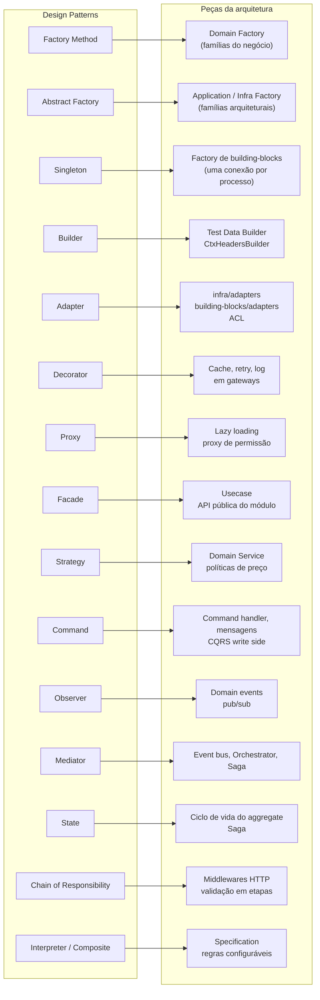

# 6.99 · Padrões na arquitetura

Os padrões não vivem isolados: a arquitetura do Módulo 4 é, em boa parte, **padrões GoF aplicados em escala**. Esta página liga os dois mundos.

## Mapa



## Por camada

| Camada | Padrões frequentes | Exemplo |
|---|---|---|
| **data** | (contratos para) Strategy, Adapter, Abstract Factory | `interface DistanceStrategy`, `interface HttpClient`, `interface RepositoryFactory` |
| **domain** | State, Strategy, Factory Method, Composite, Specification, Observer (eventos) | `Order` com estados; `FreightCalculator` com estratégia; `FreightFactory` |
| **infra** | Adapter, Decorator, Proxy, Abstract Factory | `StripePaymentGateway`, `CachedQuoteGateway`, `DatabaseRepositoryFactory` |
| **application** | Facade (usecase), Command (input/handler), Mediator (orchestrator), Template Method (jobs), Abstract Factory | `CreateOrderUseCase`, `DispatchDeliveryOrchestrator` |
| **presentation** | Chain of Responsibility (middlewares), Adapter (inbound) | Pipeline de auth/log/validação |
| **main** | Singleton, Factory, Builder (montagem) | Pool de conexões único, composition root |
| **building-blocks** | Adapter, Factory Method, Singleton, Service Locator | `getConsumer(env)` escolhendo Kafka ou RabbitMQ |

## Padrões arquiteturais (não GoF) que aparecem no curso

| Padrão | Origem | Onde |
|---|---|---|
| **Repository** | Fowler / Evans | infra ([3.8](../modulo-03-ddd-tatico/08-repository.md)) |
| **Unit of Work** | Fowler | Transações que agrupam várias mudanças (Mutation) |
| **Data Mapper** | Fowler | Mappers entre domínio e banco |
| **Service Layer** | Fowler | A camada application |
| **Specification** | Evans & Fowler | Regras combináveis (Interpreter + Composite) |
| **Anticorruption Layer** | Evans | Adapter que traduz modelos entre contextos |
| **Transactional Outbox** | Comunidade de microserviços | Publicação confiável de eventos ([5.3](../modulo-05-cqrs-eventos-mensageria/03-mensageria.md)) |
| **Saga** | Garcia-Molina & Salem (1987) | Transações longas com compensação ([5.4](../modulo-05-cqrs-eventos-mensageria/04-consistencia-eventual-e-sagas.md)) |
| **CQRS / Event Sourcing** | Young | Módulo 5 |
| **Service Locator** | — | Factories de borda. Evite no núcleo |
| **Dependency Injection** | Fowler | Construtores recebendo dependências; composition root no main |

## Um exemplo que combina vários

"Cotar frete em várias transportadoras, com cache, retry e a melhor opção escolhida por política."

```ts
// Strategy: como escolher a melhor cotação
interface SelectionPolicy { select(quotes: Quote[]): Quote }
const cheapest: SelectionPolicy = { select: (q) => [...q].sort((a, b) => a.price.cents - b.price.cents)[0] }
const fastest: SelectionPolicy = { select: (q) => [...q].sort((a, b) => a.days - b.days)[0] }

// Adapter: cada transportadora atrás do mesmo contrato (ACL)
const carriers: QuoteGateway[] = [new AcmeAdapter(http), new FastShipAdapter(http)]

// Decorator: cache e retry sem tocar nos adapters
const decorated = carriers.map((c) => new CachedQuoteGateway(new RetryingQuoteGateway(c), redis))

// Facade: o usecase esconde tudo isso atrás de um execute()
class QuoteBestFreightUseCase {
  constructor(private readonly gateways: QuoteGateway[], private readonly policy: SelectionPolicy) {}

  async execute(input: QuoteInput) {
    const results = await Promise.allSettled(this.gateways.map((g) => g.quote(input)))
    const quotes = results.flatMap((r) => (r.status === 'fulfilled' ? r.value : []))
    if (quotes.length === 0) throw new DomainError('No carrier available for this route')
    return this.policy.select(quotes)
  }
}

// Factory (no main): monta a combinação certa
const usecase = new QuoteBestFreightUseCase(decorated, input.preference === 'fast' ? fastest : cheapest)
```

> 🏛️ Quatro padrões, e cada um resolve **uma** dor concreta: variar a escolha (Strategy), integrar APIs diferentes (Adapter), adicionar resiliência (Decorator), esconder a orquestração (Facade). **Se você não consegue nomear a dor, não aplique o padrão.**
