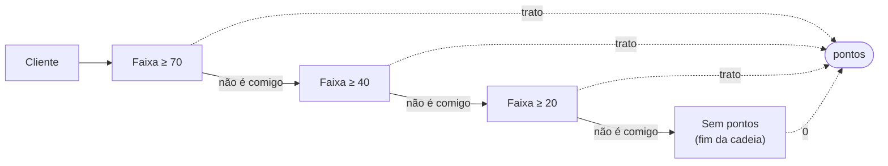
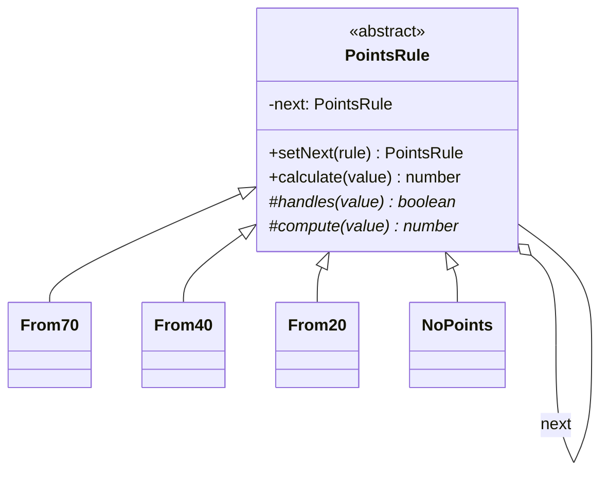

# Chain of Responsibility

**Família:** comportamental

## Problema

Um programa de fidelidade calcula pontos pelo valor do pedido:

| Pedido | Pontos (1ª quinzena) | Pontos (2ª quinzena) |
|---|---|---|
| ≥ R$ 70 | 1 a cada R$ 5 | dobro |
| ≥ R$ 40 | 1 a cada R$ 7 | dobro |
| ≥ R$ 20 | 1 a cada R$ 10 | dobro |
| < R$ 20 | 0 | 0 |

```ts
function points(value: number, day: number) {
  let p: number
  if (value >= 70) p = Math.floor(value / 5)
  else if (value >= 40) p = Math.floor(value / 7)
  else if (value >= 20) p = Math.floor(value / 10)
  else return 0
  return day >= 16 ? p * 2 : p
}
```

Funciona, mas cada nova faixa ou exceção ("clientes VIP", "black friday") faz o `if/else` crescer, e as regras ficam todas acopladas numa função.

## Intenção

> Evitar o acoplamento entre quem **envia** uma solicitação e quem a **trata**, dando a **vários objetos** a chance de tratá-la. Os tratadores formam uma **cadeia**; a solicitação passa por ela até ser tratada.

## Estrutura





## Exemplo

```ts
abstract class PointsRule {
  private next: PointsRule | null = null

  setNext(rule: PointsRule): PointsRule {
    this.next = rule
    return rule // permite encadear: a.setNext(b).setNext(c)
  }

  calculate(value: number): number {
    if (this.handles(value)) return this.compute(value)
    if (!this.next) return 0
    return this.next.calculate(value)
  }

  protected abstract handles(value: number): boolean
  protected abstract compute(value: number): number
}

class Tier extends PointsRule {
  constructor(private readonly minimum: number, private readonly reaisPerPoint: number) { super() }
  protected handles(value: number) { return value >= this.minimum }
  protected compute(value: number) { return Math.floor(value / this.reaisPerPoint) }
}

class NoPoints extends PointsRule {
  protected handles() { return true }
  protected compute() { return 0 }
}

class LoyaltyCalculator {
  private readonly chain: PointsRule

  constructor() {
    const first = new Tier(70, 5)
    first.setNext(new Tier(40, 7)).setNext(new Tier(20, 10)).setNext(new NoPoints())
    this.chain = first
  }

  execute(orderValue: number, day: number) {
    const points = this.chain.calculate(orderValue)
    return day >= 16 ? points * 2 : points
  }
}

const calculator = new LoyaltyCalculator()
calculator.execute(21, 15)  // 2
calculator.execute(21, 16)  // 4
calculator.execute(100, 15) // 20
calculator.execute(100, 16) // 40
```

Nova faixa = um `new Tier(...)` a mais na montagem. Nenhuma regra existente muda.

## Duas variantes

| Variante | Comportamento | Exemplo |
|---|---|---|
| **Primeiro que trata para** | Um elo trata e a cadeia termina | Faixas de pontos, aprovação por alçada |
| **Todos processam (pipeline)** | Cada elo faz sua parte e passa adiante; qualquer um pode interromper | **Middlewares HTTP** |

### Middlewares são Chain of Responsibility

```ts
type Middleware = (req: Request, next: () => Promise<Response>) => Promise<Response>

const auth: Middleware = async (req, next) =>
  req.headers.get('authorization') ? next() : new Response('Unauthorized', { status: 401 })

const logging: Middleware = async (req, next) => {
  const started = Date.now()
  const response = await next()
  console.log(req.method, req.url, response.status, `${Date.now() - started}ms`)
  return response
}

function chain(middlewares: Middleware[], handler: (req: Request) => Promise<Response>) {
  return (req: Request) =>
    middlewares.reduceRight<() => Promise<Response>>((next, mw) => () => mw(req, next), () => handler(req))()
}
```

Outros exemplos: **validação em etapas**, **regras de aprovação por valor** (analista → gerente → diretor), **tratamento de erros** em camadas.

## Quando usar / evitar

| Use | Evite |
|---|---|
| Vários objetos podem tratar, e o tratador é escolhido em runtime | Há um único tratador óbvio |
| A cadeia deve ser configurável ou dinâmica | Quando é vital garantir que **alguém** trate (sem um elo final, a solicitação pode se perder) |
| Substituir `if/else` crescente de regras independentes | |

## Consequências

- ✅ Remetente desacoplado dos tratadores.
- ✅ Adicionar, remover ou reordenar elos é fácil (OCP).
- ⚠️ Sem um elo final, a solicitação pode passar sem tratamento.
- ⚠️ Depurar cadeias longas é mais difícil.

## Relacionados

[Decorator](../estruturais/decorator.md) (estrutura parecida; o decorator sempre delega) · [Command](command.md) (a solicitação que viaja pode ser um command) · [Composite](../estruturais/composite.md) (a cadeia pode seguir a árvore de pais).

## Para fixar

1. Por que existe um elo `NoPoints`?
2. Middlewares HTTP são qual variante?

<details>
<summary>Respostas</summary>

1. Para garantir que toda solicitação seja tratada: ele é o fim da cadeia e devolve 0.
2. Pipeline: cada elo faz sua parte e chama o próximo, e qualquer um pode interromper (como a autenticação).

</details>
