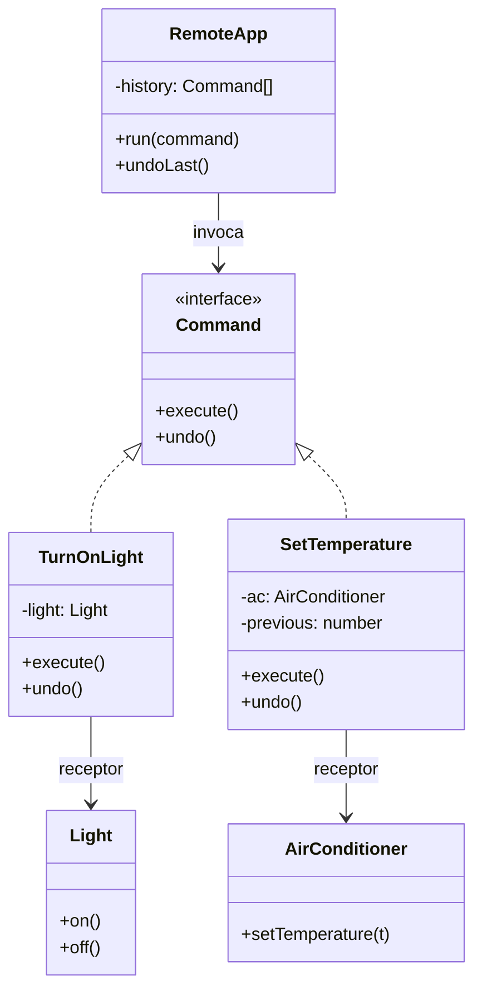

# Command

**Família:** comportamental

## Problema

Um app de casa inteligente controla lâmpadas e ar-condicionado. Cada botão chama um método diferente de um aparelho diferente. Para adicionar **desfazer**, **agendar** ou **registrar** ações, o código do app precisaria conhecer cada aparelho e cada operação.

## Intenção

> **Encapsular uma solicitação como um objeto**, permitindo parametrizar clientes com diferentes solicitações, **enfileirar** ou **registrar** solicitações e suportar operações **reversíveis** (undo).

## Estrutura



| Papel | No exemplo |
|---|---|
| **Command** | Interface com `execute()` e `undo()` |
| **Concrete Command** | `TurnOnLight`, `SetTemperature`: conhecem o receptor e a ação |
| **Receiver** (receptor) | `Light`, `AirConditioner`: fazem o trabalho de verdade |
| **Invoker** (invocador) | `RemoteApp`: executa comandos sem saber o que fazem |
| **Client** | Cria os comandos e os entrega ao invocador |

## Exemplo

```ts
interface Command {
  execute(): void
  undo(): void
}

class Light {
  #on = false
  constructor(readonly name: string) {}
  on() { this.#on = true }
  off() { this.#on = false }
  get isOn() { return this.#on }
}

class AirConditioner {
  #temperature = 26
  get temperature() { return this.#temperature }
  setTemperature(value: number) { this.#temperature = value }
}

class TurnOnLight implements Command {
  constructor(private readonly light: Light) {}
  execute() { this.light.on() }
  undo() { this.light.off() }
}

class SetTemperature implements Command {
  private previous: number | null = null
  constructor(private readonly ac: AirConditioner, private readonly target: number) {}

  execute() {
    this.previous = this.ac.temperature   // guarda o necessário para desfazer
    this.ac.setTemperature(this.target)
  }

  undo() {
    if (this.previous !== null) this.ac.setTemperature(this.previous)
  }
}

class RemoteApp {
  private readonly history: Command[] = []

  run(command: Command) {
    command.execute()
    this.history.push(command)
  }

  undoLast() {
    this.history.pop()?.undo()
  }
}

const app = new RemoteApp()
const living = new Light('Sala')
const ac = new AirConditioner()

app.run(new TurnOnLight(living))  // sala acesa
app.run(new SetTemperature(ac, 22)) // 22 °C
app.undoLast()                    // volta para 26 °C
app.undoLast()                    // sala apagada
```

## Exemplo financeiro: crédito e débito

```ts
class Account {
  #balance = 0
  get balance() { return this.#balance }
  credit(amount: number) { this.#balance += amount }
  debit(amount: number) { this.#balance -= amount }
}

class CreditCommand implements Command {
  constructor(private readonly account: Account, private readonly amount: number) {}
  execute() { this.account.credit(this.amount) }
  undo() { this.account.debit(this.amount) }
}

class DebitCommand implements Command {
  constructor(private readonly account: Account, private readonly amount: number) {}
  execute() { this.account.debit(this.amount) }
  undo() { this.account.credit(this.amount) }
}
```

## Por que transformar uma chamada em objeto?

Porque um objeto pode ser:

| Ação | Uso |
|---|---|
| **Guardado** | Histórico para **desfazer/refazer** |
| **Enfileirado** | Executado depois, em background, por outro processo |
| **Serializado** | Enviado por uma fila (`{ type: 'DebitWallet', walletId, amount }`) |
| **Registrado** | Log de auditoria, recuperação após falha |
| **Composto** | Uma *macro* que executa vários comandos (`TransferCommand` = débito + crédito) |
| **Validado e autorizado** | Antes de executar, num único ponto |

## Command na arquitetura

- **CQRS:** o lado de escrita recebe **commands** (`CancelShipment`) tratados por **command handlers** (Módulo 5).
- **Mensageria:** uma mensagem "faça X" numa fila é um command serializado.
- **Usecase:** o `Input` de um usecase é, na prática, o command; o usecase é o handler.
- **Event Sourcing:** commands geram eventos; o exemplo de PIX com estorno usa commands compostos.

## Command x Mediator x Observer

| Padrão | Ideia | Relação |
|---|---|---|
| **Command** | Abstrai uma solicitação num objeto, para executar depois (desfazer, refazer, agendar) | Uma solicitação reificada |
| **Observer** | Um objeto notifica vários interessados quando muda | **1 para muitos** |
| **Mediator** | Um objeto central reduz o acoplamento entre vários | **Muitos através de um** |

Os três estão na base da **arquitetura orientada a eventos** e do **CQRS**.

## Quando usar / evitar

| Use | Evite |
|---|---|
| Desfazer/refazer | Uma chamada direta simples resolve |
| Enfileirar, agendar, executar remotamente | Quando uma função (callback) já basta e não há histórico |
| Registrar operações para auditoria/recuperação | |
| Transações de alto nível compostas de passos | |

> 💡 Em TypeScript, um command sem `undo` e sem estado é só uma **função**. Use a classe quando há **estado**, **undo** ou **serialização**.

## Consequências

- ✅ Desacopla quem pede de quem executa.
- ✅ Commands são objetos: dá para compor, guardar, enviar.
- ✅ Novos commands sem mudar o invocador (OCP).
- ⚠️ Mais classes; `undo` exige guardar estado anterior.

## Relacionados

[Memento](memento.md) (guarda o estado para o `undo`) · [Chain of Responsibility](chain-of-responsibility.md) · [Composite](../estruturais/composite.md) (macro-commands) · [Strategy](strategy.md) (encapsula um algoritmo; Command encapsula uma ação).

## Para fixar

1. Quais são os quatro papéis do padrão?
2. Por que o `SetTemperature` guarda `previous`?

<details>
<summary>Respostas</summary>

1. Command (interface), Concrete Command, Receiver (quem faz o trabalho) e Invoker (quem executa os comandos).
2. Para conseguir desfazer: o `undo` restaura a temperatura anterior.

</details>
