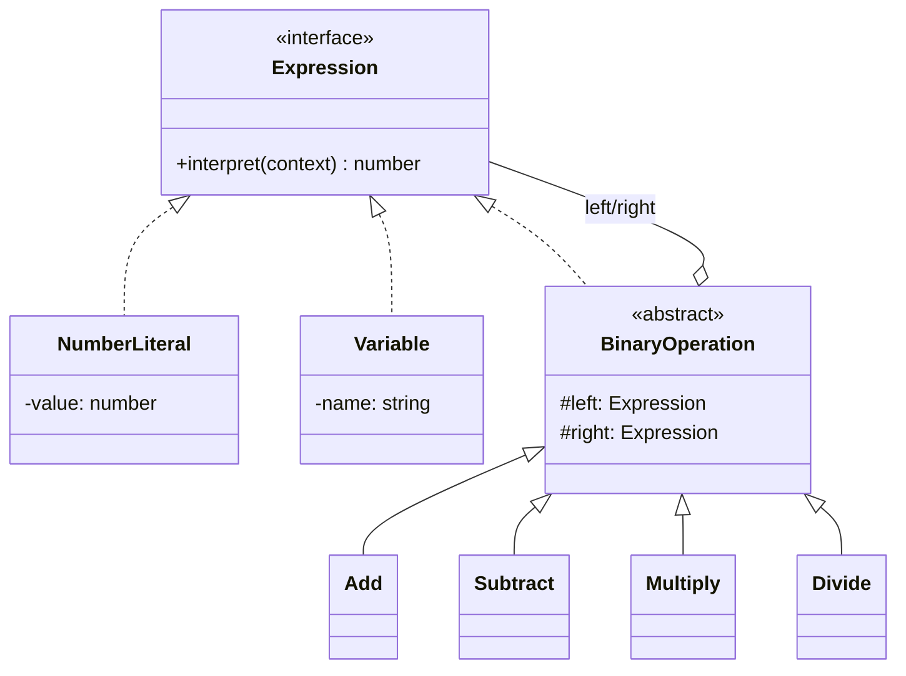
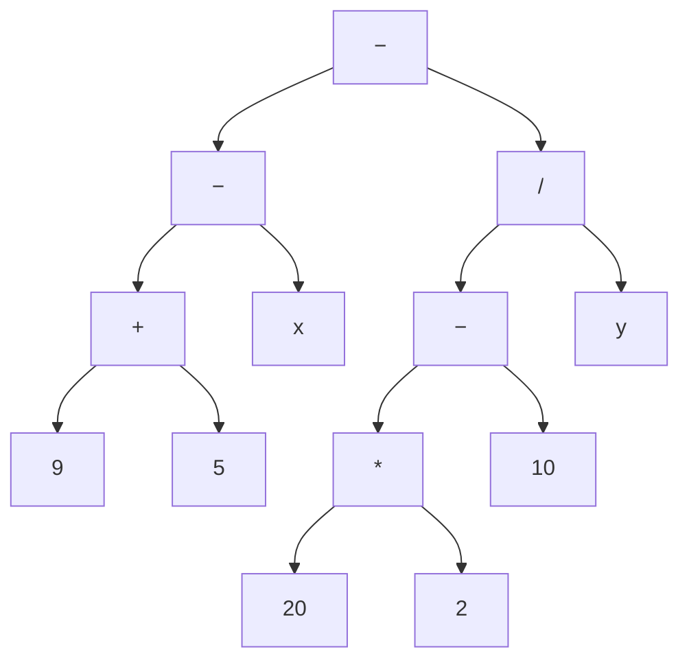

# Interpreter

**Família:** comportamental

## Problema

Usuários precisam escrever **regras** simples, como fórmulas de preço (`base + peso * 2`) ou filtros (`uf = "SP" AND peso > 10`), e o sistema precisa avaliá-las. Escrever um `if` para cada combinação é impossível.

## Intenção

> Dada uma **linguagem**, definir uma representação para a sua **gramática** e um **interpretador** que usa essa representação para avaliar sentenças.

Cada **regra da gramática** vira **uma classe**. Uma sentença vira uma **árvore sintática abstrata** (AST), e interpretar é percorrê-la recursivamente.

## Conceitos

| Termo | Significado | Exemplo |
|---|---|---|
| **Terminal** | Símbolo que não se decompõe | Número `5`, variável `x` |
| **Não terminal** | Regra composta de outras | `Adição(expr, expr)` |
| **Contexto** | Informação global para a interpretação | `{ x: 2, y: 3 }` |
| **AST** | Árvore da sentença | `+(9, 5)` |

## Estrutura



## Exemplo: calculadora em notação polonesa reversa (RPN)

Na RPN, o operador vem **depois** dos operandos: `9 5 +` = 14. A expressão `9 5 + x - 20 2 * 10 - y / -` com `x = 2` e `y = 3` vale **2**.

```ts
type Context = Record<string, number>

interface Expression {
  interpret(context: Context): number
}

// terminais
class NumberLiteral implements Expression {
  constructor(private readonly value: number) {}
  interpret() { return this.value }
}

class Variable implements Expression {
  constructor(private readonly name: string) {
    if (!/^[a-z]$/.test(name)) throw new Error(`Invalid variable: ${name}`)
  }
  interpret(context: Context) {
    const value = context[this.name]
    if (value === undefined) throw new Error(`Variable ${this.name} is not defined`)
    return value
  }
}

// não terminais
abstract class BinaryOperation implements Expression {
  constructor(protected readonly left: Expression, protected readonly right: Expression) {}
  abstract interpret(context: Context): number
}

class Add extends BinaryOperation {
  interpret(c: Context) { return this.left.interpret(c) + this.right.interpret(c) }
}
class Subtract extends BinaryOperation {
  interpret(c: Context) { return this.left.interpret(c) - this.right.interpret(c) }
}
class Multiply extends BinaryOperation {
  interpret(c: Context) { return this.left.interpret(c) * this.right.interpret(c) }
}
class Divide extends BinaryOperation {
  interpret(c: Context) { return Math.floor(this.left.interpret(c) / this.right.interpret(c)) }
}

// o parser monta a AST a partir do texto
const OPERATIONS: Record<string, new (l: Expression, r: Expression) => Expression> = {
  '+': Add, '-': Subtract, '*': Multiply, '/': Divide,
}

function parseRpn(source: string): Expression {
  const stack: Expression[] = []
  for (const token of source.trim().split(/\s+/)) {
    const Operation = OPERATIONS[token]
    if (Operation) {
      const right = stack.pop()
      const left = stack.pop()
      if (!left || !right) throw new Error(`Missing operand for ${token}`)
      stack.push(new Operation(left, right))
    } else if (/^\d+$/.test(token)) {
      stack.push(new NumberLiteral(Number(token)))
    } else {
      stack.push(new Variable(token))
    }
  }
  if (stack.length !== 1) throw new Error('Invalid expression')
  return stack[0]
}

const tree = parseRpn('9 5 + x - 20 2 * 10 - y / -')
tree.interpret({ x: 2, y: 3 }) // 2
```

A árvore montada:



`(9 + 5 − x) − ((20 × 2 − 10) / y)` = `(14 − 2) − (30 / 3)` = `12 − 10` = **2**.

## Onde aparece no dia a dia

- **Regras de negócio configuráveis**: motores de regra, fórmulas de preço, filtros salvos.
- **Specification pattern** do DDD: `new And(new IsActive(), new HasBalanceAbove(100))`. É um Interpreter + Composite de regras booleanas.
- Expressões regulares, SQL, templates (Handlebars), linguagens de query.

```ts
interface Specification<T> { isSatisfiedBy(candidate: T): boolean }

class And<T> implements Specification<T> {
  constructor(private readonly a: Specification<T>, private readonly b: Specification<T>) {}
  isSatisfiedBy(c: T) { return this.a.isSatisfiedBy(c) && this.b.isSatisfiedBy(c) }
}
```

## Quando usar / evitar

| Use | Evite |
|---|---|
| A **gramática é simples** | Gramáticas grandes: a hierarquia de classes fica incontrolável. Use um gerador de parser |
| **Eficiência não é crítica** | Alto desempenho: compile para outra forma em vez de interpretar a árvore |
| Usuários precisam escrever regras/expressões | Quando poucas regras fixas resolvem |

## Consequências

- ✅ Fácil **estender** a gramática (uma classe por regra nova).
- ✅ Fácil **implementar**: as classes são pequenas e parecidas.
- ⚠️ Gramáticas complexas são difíceis de manter.

## Relacionados

[Composite](../estruturais/composite.md) (a AST é um Composite) · [Visitor](visitor.md) (novas operações sobre a AST: imprimir, otimizar, validar) · [Iterator](iterator.md) (percorrer a árvore) · [Flyweight](../estruturais/flyweight.md) (compartilhar terminais).

## Para fixar

1. O que é um símbolo terminal?
2. Qual padrão do DDD é um caso de Interpreter?

<details>
<summary>Respostas</summary>

1. Um símbolo que não se decompõe em outros (um número, uma variável). Ele é o caso base da recursão.
2. O Specification pattern: regras booleanas combináveis com And/Or/Not.

</details>
