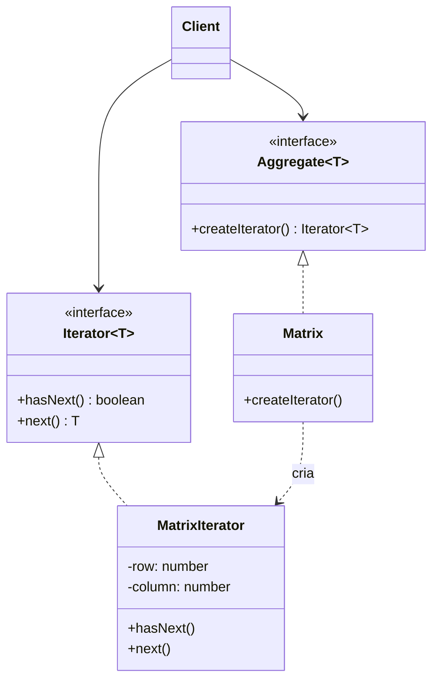

# Iterator

**Família:** comportamental

## Problema

```ts
for (let i = 0; i < list.length; i++) print(list[i])                    // lista
for (let r = 0; r < rows; r++) for (let c = 0; c < cols; c++) print(m[r][c]) // matriz
// árvore: recursão... grafo: fila de BFS...
```

Cada estrutura exige um laço diferente, e o cliente precisa conhecer a **estrutura interna** de cada uma para percorrê-la.

## Intenção

> Fornecer uma forma de **acessar sequencialmente** os elementos de um agregado **sem expor sua representação interna**.

## Estrutura



| Papel | Responsabilidade |
|---|---|
| **Iterator** | Interface com `hasNext()` e `next()` |
| **Concrete Iterator** | Sabe percorrer **uma** estrutura e guarda a posição atual |
| **Aggregate** | Interface que cria iteradores |
| **Concrete Aggregate** | A coleção (lista, matriz, árvore) |

## Exemplo clássico (GoF)

```ts
interface Iterator<T> {
  hasNext(): boolean
  next(): T
}

interface Aggregate<T> {
  createIterator(): Iterator<T>
}

class Matrix<T> implements Aggregate<T> {
  constructor(private readonly cells: T[][]) {}
  get rows() { return this.cells.length }
  get columns() { return this.cells[0]?.length ?? 0 }
  at(row: number, column: number) { return this.cells[row][column] }
  createIterator(): Iterator<T> { return new MatrixIterator(this) }
}

class MatrixIterator<T> implements Iterator<T> {
  private row = 0
  private column = 0

  constructor(private readonly matrix: Matrix<T>) {}

  hasNext() { return this.row < this.matrix.rows }

  next(): T {
    if (!this.hasNext()) throw new Error('No more elements')
    const value = this.matrix.at(this.row, this.column)
    this.column++
    if (this.column >= this.matrix.columns) { this.column = 0; this.row++ }
    return value
  }
}

function printAll<T>(aggregate: Aggregate<T>) {
  const iterator = aggregate.createIterator()
  while (iterator.hasNext()) console.log(iterator.next()) // não sabe se é lista ou matriz
}

printAll(new Matrix([[1, 2, 3], [4, 5, 6], [7, 8, 9]])) // 1 2 3 4 5 6 7 8 9
```

## A forma idiomática em TypeScript: o protocolo de iteração

JavaScript **já tem** o padrão Iterator embutido. Implementando `[Symbol.iterator]`, sua coleção funciona com `for...of`, spread e desestruturação.

```ts
class Matrix<T> implements Iterable<T> {
  constructor(private readonly cells: T[][]) {}

  *[Symbol.iterator](): Iterator<T> {        // generator: o iterador mais simples possível
    for (const row of this.cells) yield* row
  }

  *columnByColumn(): Generator<T> {          // outro tipo de iteração, mesma coleção
    const columns = this.cells[0]?.length ?? 0
    for (let c = 0; c < columns; c++) for (const row of this.cells) yield row[c]
  }
}

const m = new Matrix([[1, 2], [3, 4]])
for (const value of m) console.log(value)   // 1 2 3 4
;[...m.columnByColumn()]                      // [1, 3, 2, 4]
```

### Iteradores preguiçosos e assíncronos

Um uso muito valioso no backend: **paginar uma API ou uma tabela grande** sem carregar tudo na memória.

```ts
async function* allShipments(api: ShippingApi): AsyncGenerator<Shipment> {
  let cursor: string | null = null
  do {
    const page = await api.list({ cursor, limit: 100 })
    yield* page.items
    cursor = page.nextCursor
  } while (cursor)
}

for await (const shipment of allShipments(api)) {
  await reprocess(shipment) // processa um por vez, memória constante
}
```

## Iterator e aggregates do DDD

Um aggregate não deve expor sua coleção interna mutável ([3.4](../../modulo-03-ddd-tatico/04-aggregate.md)). Um iterador é uma forma de **deixar percorrer sem deixar alterar**:

```ts
class Order {
  #items: OrderItem[] = []
  *items(): IterableIterator<OrderItem> { yield* this.#items } // leitura, sem push possível
}
```

## Quando usar / evitar

| Use | Evite |
|---|---|
| Esconder a estrutura interna de uma coleção | Um array simples já resolve |
| Oferecer **vários tipos** de percurso (linhas, colunas, BFS, DFS) | |
| Percorrer dados grandes ou paginados **sob demanda** | |

## Consequências

- ✅ Mesmo código para estruturas diferentes (polimorfismo).
- ✅ Várias iterações simultâneas e independentes.
- ✅ SRP (a lógica de percurso sai da coleção) e OCP (novos percursos sem mudar o cliente).
- ⚠️ Alterar a coleção durante a iteração pode gerar comportamento inesperado.

## Relacionados

[Composite](../estruturais/composite.md) (iterar sobre árvores) · [Visitor](visitor.md) (aplicar uma operação a cada elemento) · [Factory Method](../criacionais/factory-method.md) (`createIterator` é um).

## Para fixar

1. Como o JavaScript implementa o padrão Iterator nativamente?
2. Por que um `AsyncGenerator` é útil para paginação?

<details>
<summary>Respostas</summary>

1. Pelo protocolo `[Symbol.iterator]` (e `[Symbol.asyncIterator]`), usado por `for...of`, spread e desestruturação. Generators (`function*`) criam iteradores facilmente.
2. Busca uma página por vez, sob demanda, mantendo o uso de memória constante, e o consumidor usa um simples `for await`.

</details>
