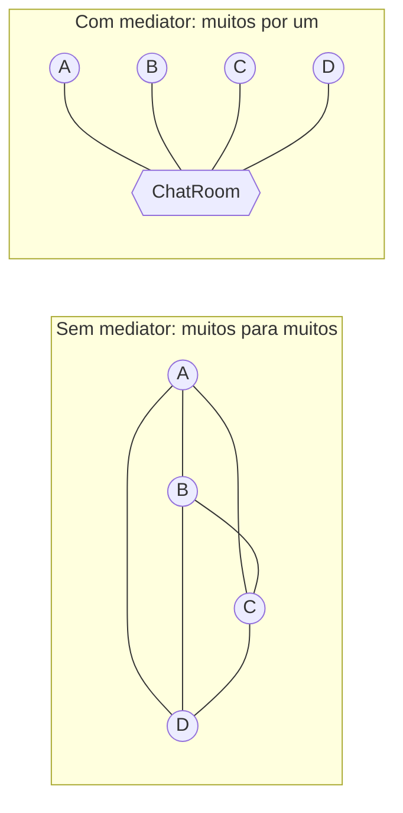
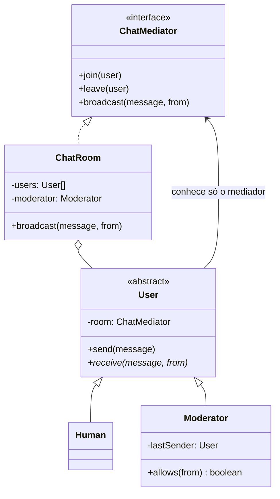

# Mediator

**Família:** comportamental

## Problema

Num chat, se cada usuário enviasse mensagens **diretamente** para os outros, cada um precisaria conhecer todos. Com 10 usuários, são 45 ligações; com 100, 4.950. Adicionar uma regra ("o bot bloqueia mensagens seguidas do mesmo usuário") exigiria mudar todos.



## Intenção

> Definir um objeto que **encapsula como um conjunto de objetos interage**. Os colegas não se referem uns aos outros diretamente, só ao mediador, o que reduz o acoplamento e permite variar as interações de forma independente.

## Estrutura



## Exemplo: salas de chat com moderador

```ts
interface ChatMediator {
  readonly name: string
  join(user: User): void
  leave(user: User): void
  broadcast(message: string, from: User): void
}

abstract class User {
  protected room: ChatMediator | null = null
  constructor(readonly name: string) {}

  enter(room: ChatMediator) {
    this.room?.leave(this) // um usuário está em uma sala por vez
    this.room = room
    room.join(this)
  }

  send(message: string) {
    if (!this.room) throw new Error(`${this.name} is not in a room`)
    this.room.broadcast(message, this)
  }

  abstract receive(message: string, from: User): void
}

class Human extends User {
  readonly inbox: string[] = []
  receive(message: string, from: User) { this.inbox.push(`${from.name}: ${message}`) }
}

class Moderator extends User {
  private lastSender: User | null = null
  constructor() { super('BOT') }
  receive() {}
  allows(from: User) {
    if (from === this) return true
    if (from === this.lastSender) return false // bloqueia mensagens seguidas
    this.lastSender = from
    return true
  }
}

class ChatRoom implements ChatMediator {
  private users: User[] = []

  constructor(readonly name: string, private readonly moderator = new Moderator()) {
    moderator.enter(this)
  }

  join(user: User) { this.users.push(user) }
  leave(user: User) { this.users = this.users.filter((u) => u !== user) }

  broadcast(message: string, from: User) {
    if (!this.moderator.allows(from)) {
      this.moderator.send(`Mensagem de ${from.name} bloqueada`)
      return
    }
    for (const user of this.users) if (user !== from) user.receive(message, from)
  }
}

const room1 = new ChatRoom('Sala 1')
const john = new Human('John')
const paul = new Human('Paul')
john.enter(room1)
paul.enter(room1)

john.send('Olá, tudo bem?')   // Paul recebe
paul.send('Tudo ótimo!')      // John recebe
paul.send('E com você?')      // bloqueada: Paul enviou duas seguidas
```

Os usuários **não sabem que os outros existem**. A regra de moderação mora num lugar só.

## Mediator na arquitetura

| Exemplo | Por que é um mediator |
|---|---|
| **Broker de mensagens / event bus** | Produtores e consumidores só conhecem o barramento |
| **Orchestrator / Saga** | Coordena vários serviços que não se conhecem (Módulo 5) |
| **Controller de UI** | Um formulário coordena campos que dependem uns dos outros |
| **Bibliotecas "mediator" (MediatR, CQRS buses)** | `bus.send(command)` encontra o handler certo |

## Quando usar / evitar

| Use | Evite |
|---|---|
| Muitos objetos se comunicam de forma complexa | Poucos objetos com relação simples |
| As regras de interação mudam com frequência | Quando o mediador começaria a acumular regras de negócio dos colegas |
| Você quer reutilizar os colegas em contextos diferentes | |

## Consequências

- ✅ Troca relações **muitos-para-muitos** por **um-para-muitos**.
- ✅ Centraliza o controle e as regras de interação (SRP).
- ✅ Colegas mais simples e reutilizáveis.
- ⚠️ O mediador pode virar um **objeto deus**, complexo e difícil de manter.

## Relacionados

[Observer](observer.md) (um notifica muitos; o Mediator costuma usar Observer por dentro) · [Facade](../estruturais/facade.md) (simplifica o acesso de fora; o Mediator coordena os de dentro) · [Command](command.md).

## Para fixar

1. Quantas ligações diretas existem entre 10 objetos que se conhecem todos? E com um mediator?
2. Qual é o principal risco do Mediator?

<details>
<summary>Respostas</summary>

1. 10 × 9 / 2 = 45 ligações. Com mediator, 10 (cada um com o mediador).
2. Concentrar lógica demais e virar um objeto deus.

</details>
