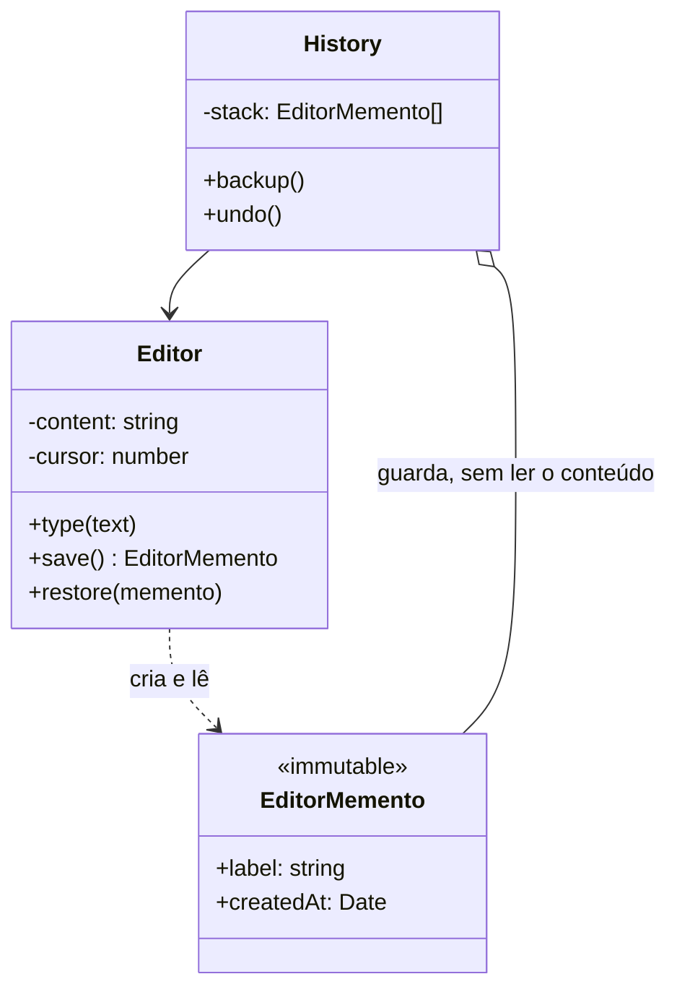

# Memento

**Família:** comportamental

## Problema

Um editor precisa de **Ctrl+Z**. Para desfazer, alguém precisa guardar o estado anterior. Mas o estado do documento é **privado**: expor todos os campos só para salvar um histórico quebraria o encapsulamento.

## Intenção

> **Capturar e externalizar o estado interno** de um objeto, **sem violar o encapsulamento**, para que ele possa ser **restaurado** depois.

## Estrutura



| Papel | Responsabilidade |
|---|---|
| **Originator** (originador) | O objeto cujo estado é salvo; **cria** e **lê** mementos |
| **Memento** | Snapshot imutável do estado. Tem uma interface **ampla** (para o originador) e uma **mínima** (para o cuidador) |
| **Caretaker** (cuidador) | Guarda e devolve mementos, **sem olhar o conteúdo** |

## Exemplo

```ts
// interface MÍNIMA: é o que o cuidador enxerga
interface Memento {
  readonly label: string
  readonly createdAt: Date
}

class Editor {
  #content = ''
  #cursor = 0

  type(text: string) {
    this.#content = this.#content.slice(0, this.#cursor) + text + this.#content.slice(this.#cursor)
    this.#cursor += text.length
  }

  get content() { return this.#content }

  save(): Memento {
    return new EditorSnapshot(this.#content, this.#cursor) // só o Editor conhece a classe concreta
  }

  restore(memento: Memento) {
    if (!(memento instanceof EditorSnapshot)) throw new Error('Foreign memento')
    this.#content = memento.content // interface AMPLA: só o originador lê
    this.#cursor = memento.cursor
  }
}

class EditorSnapshot implements Memento {
  readonly createdAt = new Date()
  constructor(readonly content: string, readonly cursor: number) { Object.freeze(this) }
  get label() { return `${this.createdAt.toISOString()} (${this.content.slice(0, 10)}...)` }
}

class History {
  private readonly stack: Memento[] = []
  constructor(private readonly editor: Editor) {}

  backup() { this.stack.push(this.editor.save()) }

  undo() {
    const memento = this.stack.pop()
    if (memento) this.editor.restore(memento)
  }

  list() { return this.stack.map((m) => m.label) } // vê só os rótulos
}

const editor = new Editor()
const history = new History(editor)

history.backup(); editor.type('Domain')
history.backup(); editor.type('-Driven')
history.backup(); editor.type(' Design')

editor.content  // 'Domain-Driven Design'
history.undo()  // 'Domain-Driven'
history.undo()  // 'Domain'
```

> 💡 Em TypeScript, o truque de "duas interfaces" é feito assim: o cuidador recebe o tipo **`Memento`** (mínimo); só o originador conhece **`EditorSnapshot`** (amplo). Se a classe concreta não for exportada, ninguém de fora consegue ler o conteúdo.

## Memento x Command x Event Sourcing (para undo)

| Estratégia | Guarda | Custo |
|---|---|---|
| **Memento** | O **estado inteiro** a cada passo | Memória (cada snapshot pode ser grande) |
| **Command com undo** | A **operação** e o necessário para revertê-la | Lógica de reversão em cada command |
| **Event Sourcing** | Os **eventos**; o estado é reconstruído | Reprocessamento; snapshots ajudam |

Combinações são comuns: Event Sourcing com **snapshots** periódicos é Memento + eventos.

## Quando usar / evitar

| Use | Evite |
|---|---|
| Desfazer, checkpoints, "voltar ao estado salvo" | Estado muito grande e mudanças muito frequentes (use Command ou eventos) |
| Rollback de uma operação em memória que falhou no meio | Quando expor o estado não é problema (um simples clone resolve) |
| Preservar o encapsulamento é importante | |

## Consequências

- ✅ Preserva o encapsulamento.
- ✅ Simplifica o originador: o histórico fica no cuidador.
- ⚠️ Memória: muitos snapshots grandes custam caro.
- ⚠️ O cuidador não sabe o tamanho do que guarda; limite o histórico.

## Relacionados

[Command](command.md) (undo pode usar mementos) · [Prototype](../criacionais/prototype.md) (um snapshot é um clone) · [Iterator](iterator.md) (um memento pode guardar a posição de uma iteração).

## Para fixar

1. Por que o cuidador não pode ler o conteúdo do memento?
2. Quando preferir Command com undo em vez de Memento?

<details>
<summary>Respostas</summary>

1. Para preservar o encapsulamento do originador: só ele conhece e interpreta o próprio estado.
2. Quando o estado é grande e as operações são pequenas e reversíveis: guardar a operação custa menos que guardar o estado inteiro.

</details>
