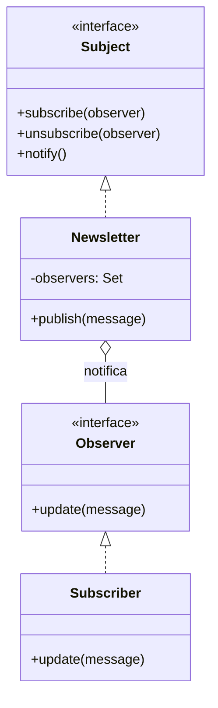

# Observer

**Família:** comportamental

## Problema

Uma newsletter precisa avisar clientes, funcionários, parceiros e fornecedores a cada nova edição. Se a newsletter chamar cada grupo diretamente, ela precisa conhecer todos, e cada novo tipo de assinante obriga a mudar a newsletter.

## Intenção

> Definir uma dependência **um-para-muitos** entre objetos, de modo que, quando um objeto (**subject**) muda de estado, todos os seus dependentes (**observers**) sejam **notificados automaticamente**.

## Estrutura



## Exemplo: newsletter

```ts
interface Observer<T> {
  update(data: T): void
}

class Subject<T> {
  readonly #observers = new Set<Observer<T>>()

  subscribe(observer: Observer<T>) {
    this.#observers.add(observer)
    return () => this.#observers.delete(observer) // devolve o "unsubscribe"
  }

  protected notify(data: T) {
    for (const observer of this.#observers) observer.update(data)
  }
}

class Newsletter extends Subject<string> {
  readonly #editions: string[] = []
  publish(edition: string) {
    this.#editions.push(edition)
    this.notify(edition)
  }
}

class EmailSubscriber implements Observer<string> {
  constructor(readonly name: string, readonly email: string) {}
  update(edition: string) { console.log(`E-mail para ${this.email}: ${edition}`) }
}

const newsletter = new Newsletter()
const ana = new EmailSubscriber('Ana', 'ana@exemplo.com')
const bruno = new EmailSubscriber('Bruno', 'bruno@exemplo.com')

const unsubscribeBruno = newsletter.subscribe(bruno)
newsletter.subscribe(ana)

newsletter.publish('Edição 1')   // Ana e Bruno recebem
unsubscribeBruno()
newsletter.publish('Edição 2')   // só Ana recebe
```

> 💡 Devolver a função de cancelamento (`unsubscribe`) é um idioma moderno muito útil: evita guardar referências só para remover depois e previne vazamento de memória.

## Exemplo: campo de texto e rótulos (binding de UI)

Um `InputText` notifica vários `Label`s que usam o seu valor num template:

```ts
class InputText extends Subject<{ name: string; value: string }> {
  #value = ''
  constructor(readonly name: string) { super() }
  set value(value: string) {
    this.#value = value
    this.notify({ name: this.name, value })
  }
}

class Label implements Observer<{ name: string; value: string }> {
  text = ''
  constructor(private readonly template: string) {}
  update({ name, value }: { name: string; value: string }) {
    this.text = this.template.replace(`{{${name}}}`, value)
  }
}

const input = new InputText('nome')
const greeting = new Label('Olá, {{nome}}!')
input.subscribe(greeting)
input.value = 'Maria'
greeting.text // 'Olá, Maria!'
```

Esse é o princípio por trás de frameworks reativos.

## Push x Pull

| Modelo | Como | Prós | Contras |
|---|---|---|---|
| **Push** | O subject envia os dados no `update(data)` | O observer não precisa consultar | Pode enviar dados que o observer não quer |
| **Pull** | O subject só avisa; o observer consulta o que quiser | Observer decide o que ler | O observer precisa conhecer o subject |

## Observer na arquitetura

| Forma | Exemplo |
|---|---|
| **Em memória** | `EventEmitter` do Node, `EventTarget`, signals |
| **Domain events** | O aggregate registra `OrderPaid`; handlers reagem ([3.6](../../modulo-03-ddd-tatico/06-domain-event.md)) |
| **Pub/Sub distribuído** | Um tópico Kafka com vários grupos consumidores (Módulo 5) |
| **Webhooks** | O sistema notifica URLs registradas por clientes |

## Quando usar / evitar

| Use | Evite |
|---|---|
| Uma mudança precisa refletir em outros objetos, **sem saber quantos** | Quando a ordem das reações importa e precisa ser garantida |
| Desacoplar quem produz de quem reage | Cadeias longas de notificações em cascata (difíceis de depurar) |
| Broadcast de eventos | |

## Consequências

- ✅ Subject e observers variam independentemente (acoplamento abstrato).
- ✅ Broadcast: novos observers sem mudar o subject (OCP).
- ⚠️ **Atualizações inesperadas**: um observer que dispara outra mudança pode causar cascatas.
- ⚠️ **Vazamento de memória**: observers que nunca se desinscrevem continuam referenciados.
- ⚠️ A ordem de notificação normalmente não é garantida.

## Relacionados

[Mediator](mediator.md) (muitos por um; muitas vezes implementado com Observer) · [Command](command.md) · [Singleton](../criacionais/singleton.md) (um event bus costuma ser único).

## Para fixar

1. Por que devolver uma função `unsubscribe` no `subscribe`?
2. Qual a relação entre Observer e domain events?

<details>
<summary>Respostas</summary>

1. Para que quem se inscreveu consiga sair facilmente, evitando vazamento de memória e a necessidade de guardar referências.
2. Domain events são o Observer aplicado ao domínio: o aggregate anuncia um fato, e os interessados (handlers) reagem sem que o aggregate os conheça.

</details>
