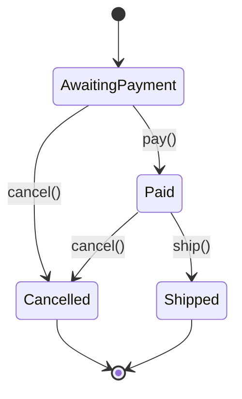
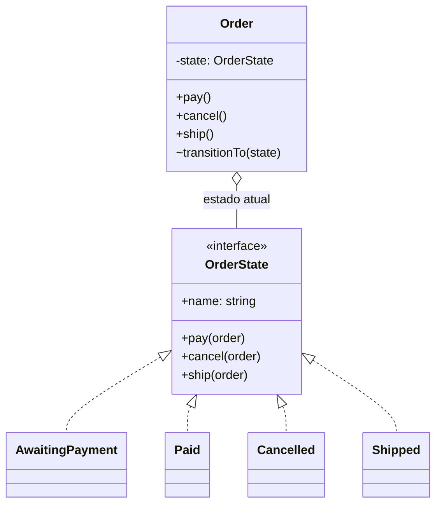

# State

**Família:** comportamental

## Problema

Um pedido passa por **Aguardando pagamento → Pago → Enviado**, e pode ser **Cancelado** antes de ser enviado. Sem o padrão, cada método vira um bloco de `if`:

```ts
class Order {
  static readonly AWAITING = 1; static readonly PAID = 2; static readonly CANCELLED = 3; static readonly SHIPPED = 4
  status = Order.AWAITING

  pay() {
    if (this.status === Order.AWAITING) this.status = Order.PAID
    else throw new Error('Order is not awaiting payment')
  }
  cancel() {
    if (this.status === Order.AWAITING || this.status === Order.PAID) this.status = Order.CANCELLED
    else throw new Error('Order cannot be cancelled')
  }
  ship() {
    if (this.status === Order.PAID) this.status = Order.SHIPPED
    else throw new Error('Order cannot be shipped')
  }
}
```

Cada novo estado ("Em separação", "Devolvido") exige revisar **todos** os métodos.

## Intenção

> Permitir que um objeto **altere seu comportamento quando seu estado interno muda**. O objeto parece ter mudado de classe.

## A máquina de estados



## Estrutura



| Papel | Responsabilidade |
|---|---|
| **Context** (`Order`) | Guarda o estado atual e **delega** as ações a ele |
| **State** | Interface com uma operação por transição |
| **Concrete State** | Implementa o comportamento daquele estado e decide a próxima transição |

## Exemplo

```ts
interface OrderState {
  readonly name: 'AWAITING_PAYMENT' | 'PAID' | 'CANCELLED' | 'SHIPPED'
  pay(order: Order): void
  cancel(order: Order): void
  ship(order: Order): void
}

class InvalidTransition extends Error {}

// base com o comportamento padrão "não permitido"
abstract class BaseState implements OrderState {
  abstract readonly name: OrderState['name']
  pay(_: Order) { throw new InvalidTransition(`Cannot pay an order that is ${this.name}`) }
  cancel(_: Order) { throw new InvalidTransition(`Cannot cancel an order that is ${this.name}`) }
  ship(_: Order) { throw new InvalidTransition(`Cannot ship an order that is ${this.name}`) }
}

class AwaitingPayment extends BaseState {
  readonly name = 'AWAITING_PAYMENT' as const
  pay(order: Order) { order.transitionTo(new Paid()) }
  cancel(order: Order) { order.transitionTo(new Cancelled()) }
}

class Paid extends BaseState {
  readonly name = 'PAID' as const
  cancel(order: Order) { order.transitionTo(new Cancelled()) }
  ship(order: Order) { order.transitionTo(new Shipped()) }
}

class Cancelled extends BaseState { readonly name = 'CANCELLED' as const }
class Shipped extends BaseState { readonly name = 'SHIPPED' as const }

class Order {
  #state: OrderState = new AwaitingPayment()

  get status() { return this.#state.name }

  pay() { this.#state.pay(this) }
  cancel() { this.#state.cancel(this) }
  ship() { this.#state.ship(this) }

  /** @internal usado só pelos estados */
  transitionTo(state: OrderState) { this.#state = state }
}

const order = new Order()
order.status   // 'AWAITING_PAYMENT'
order.pay()
order.status   // 'PAID'
order.ship()
order.status   // 'SHIPPED'
order.cancel() // InvalidTransition: Cannot cancel an order that is SHIPPED
```

Adicionar "Em separação" = uma classe nova e uma linha em `Paid.ship`. Os outros estados não mudam.

## Alternativa leve: tabela de transições

Quando os estados **não têm comportamento** próprio além de permitir ou não a transição, uma tabela é mais simples que classes:

```ts
const TRANSITIONS = {
  AWAITING_PAYMENT: { pay: 'PAID', cancel: 'CANCELLED' },
  PAID: { cancel: 'CANCELLED', ship: 'SHIPPED' },
  CANCELLED: {},
  SHIPPED: {},
} as const satisfies Record<string, Partial<Record<'pay' | 'cancel' | 'ship', string>>>

type Status = keyof typeof TRANSITIONS
type Action = 'pay' | 'cancel' | 'ship'

function next(status: Status, action: Action): Status {
  const target = (TRANSITIONS[status] as Partial<Record<Action, Status>>)[action]
  if (!target) throw new InvalidTransition(`Cannot ${action} when ${status}`)
  return target
}
```

📌 **Regra prática:** tabela quando o estado só **controla transições**; classes State quando cada estado tem **comportamento diferente** (cálculos, validações, efeitos).

## State e DDD

Aggregates com ciclo de vida (`Order`, `Shipment`, `Invoice`) são candidatos naturais. As transições são **invariantes** do aggregate ([3.4](../../modulo-03-ddd-tatico/04-aggregate.md)), e cada uma costuma gerar um **domain event** (`OrderPaid`, `OrderShipped`).

## State x Strategy

| | State | Strategy |
|---|---|---|
| Quem troca | **O próprio objeto** (os estados se trocam) | **O cliente** escolhe |
| Os objetos se conhecem? | Sim, um estado define o próximo | Não, estratégias são independentes |
| Muda ao longo do tempo? | Sim, durante a vida do objeto | Normalmente fixa por configuração |

## Quando usar / evitar

| Use | Evite |
|---|---|
| O comportamento depende do estado e muda em runtime | Poucos estados e poucas regras (um `switch` claro basta) |
| Há muitos `if/switch` sobre o mesmo campo de status | |
| Transições precisam ser explícitas e protegidas | |

## Consequências

- ✅ Comportamento de cada estado encapsulado.
- ✅ Transições **explícitas**: não há atribuição solta de status.
- ✅ Protege contra transições inconsistentes.
- ✅ Novos estados sem mexer nos existentes.
- ⚠️ Mais classes; os estados ficam acoplados entre si (um cria o próximo).

## Relacionados

[Strategy](strategy.md) · [Flyweight](../estruturais/flyweight.md) (estados sem campos podem ser compartilhados) · [Singleton](../criacionais/singleton.md) · Saga ([5.4](../../modulo-05-cqrs-eventos-mensageria/04-consistencia-eventual-e-sagas.md)), que é uma máquina de estados.

## Para fixar

1. Qual a diferença central entre State e Strategy?
2. Quando uma tabela de transições é melhor que classes?

<details>
<summary>Respostas</summary>

1. No State, o próprio objeto troca de estado conforme as ações. No Strategy, o cliente escolhe a estratégia.
2. Quando os estados só controlam quais transições são permitidas e não têm comportamento próprio.

</details>
