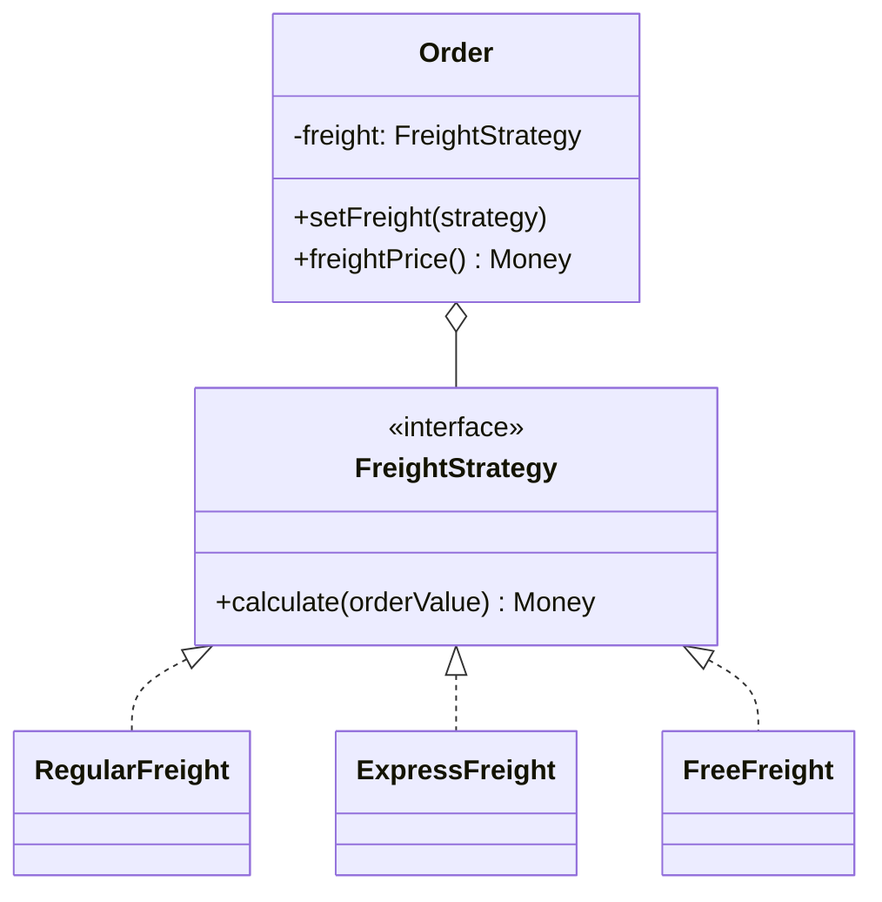

# Strategy

**Família:** comportamental

## Problema

Um e-commerce calcula frete **comum** (5% do valor) e **expresso** (10%). Começa simples, com dois métodos em `Order`. Depois a loja se divide em setores, e o setor de **móveis** não aceita frete expresso. Com herança:

```ts
abstract class Order {
  abstract regularFreight(): number
  abstract expressFreight(): number
}
class FurnitureOrder extends Order {
  regularFreight() { return this.value * 0.05 }
  expressFreight(): number { throw new Error('Unavailable') } // ⚠️ viola Liskov
}
```

O código de cálculo se repete nas subclasses, e uma subclasse precisa "recusar" um método herdado.

## Intenção

> Definir uma **família de algoritmos**, encapsular cada um e torná-los **intercambiáveis**. O algoritmo varia **independentemente** de quem o usa.

## Estrutura



| Papel | No exemplo |
|---|---|
| **Context** | `Order`: delega o cálculo |
| **Strategy** | `FreightStrategy`: a interface do algoritmo |
| **Concrete Strategy** | `RegularFreight`, `ExpressFreight`, `FreeFreight` |

## Exemplo 1: frete

```ts
interface FreightStrategy {
  calculate(orderValue: Money): Money
}

class RegularFreight implements FreightStrategy {
  calculate(value: Money) { return value.multiply(0.05) }
}

class ExpressFreight implements FreightStrategy {
  calculate(value: Money) { return value.multiply(0.1) }
}

class FreeFreight implements FreightStrategy {
  calculate() { return Money.zero() }
}

class Order {
  constructor(readonly value: Money, private freight: FreightStrategy) {}
  setFreight(freight: FreightStrategy) { this.freight = freight }
  freightPrice() { return this.freight.calculate(this.value) }
}

const order = new Order(Money.fromCents(10_000), new RegularFreight())
order.freightPrice().format() // 'R$ 5,00'
order.setFreight(new ExpressFreight())
order.freightPrice().format() // 'R$ 10,00'
```

E o setor de móveis? Simplesmente **não oferece** `ExpressFreight` na lista de opções dele. Nenhuma classe precisa recusar um método.

## Exemplo 2: estacionamento por local

Cada estacionamento cobra de um jeito: praia (R$ 5/h), aeroporto (R$ 10 pelas 3 primeiras horas e R$ 3 por hora extra), shopping (grátis entre 12h e 14h, senão R$ 3/h).

```ts
interface TicketCalculator {
  calculate(hours: number, checkin: Date, checkout: Date): number
}

const beach: TicketCalculator = { calculate: (hours) => hours * 5 }

const airport: TicketCalculator = {
  calculate: (hours) => 10 + Math.max(0, hours - 3) * 3,
}

const shopping: TicketCalculator = {
  calculate: (hours, checkin, checkout) =>
    checkin.getHours() >= 12 && checkout.getHours() <= 14 ? 0 : hours * 3,
}

class ParkingLot {
  private readonly tickets = new Map<string, Date>()
  constructor(readonly location: string, private readonly calculator: TicketCalculator) {}

  checkin(plate: string, at: Date) { this.tickets.set(plate, at) }

  checkout(plate: string, at: Date) {
    const checkin = this.tickets.get(plate)
    if (!checkin) throw new Error('Ticket not found')
    this.tickets.delete(plate)
    const hours = (at.getTime() - checkin.getTime()) / 3_600_000
    return { amount: this.calculator.calculate(hours, checkin, at) }
  }
}

const lot = new ParkingLot('Aeroporto', airport)
lot.checkin('ABC-1234', new Date('2026-03-01T10:00'))
lot.checkout('ABC-1234', new Date('2026-03-01T15:00')) // { amount: 16 }
```

> 💡 Note que as estratégias do exemplo 2 são **objetos literais**. Em TypeScript, uma estratégia sem estado pode ser **uma função**. Use classes quando houver estado, dependências ou vários métodos.

## Exemplo 3: Strategy num Domain Service

```ts
interface DistanceStrategy {
  distanceInKm(from: Geolocation, to: Geolocation): number
}

class FreightCalculator {
  constructor(private readonly distance: DistanceStrategy, private readonly pricePerKm: Money) {}
  calculate(from: Geolocation, to: Geolocation) {
    return this.pricePerKm.multiply(this.distance.distanceInKm(from, to))
  }
}

new FreightCalculator(new HaversineDistance(), Money.fromCents(250))      // linha reta
new FreightCalculator(new RoadTableDistance(table), Money.fromCents(250)) // tabela de rotas
```

## Quem escolhe a estratégia?

Normalmente uma **factory** ou o **main**, a partir de um dado:

```ts
const STRATEGIES: Record<FreightType, FreightStrategy> = {
  regular: new RegularFreight(),
  express: new ExpressFreight(),
  free: new FreeFreight(),
}
const strategy = STRATEGIES[input.freightType]
```

## Quando usar / evitar

| Use | Evite |
|---|---|
| Há **variantes de um algoritmo** | Só existe um algoritmo e não há previsão de outro |
| Você quer **remover condicionais** sobre "qual cálculo usar" | As variantes são triviais e nunca mudam |
| O algoritmo deve ser trocado em runtime ou por configuração | |
| Esconder detalhes do algoritmo do cliente | |

## Consequências

- ✅ Remove condicionais, segue OCP e "composição sobre herança".
- ✅ Algoritmos testáveis isoladamente.
- ✅ Troca em runtime.
- ⚠️ O cliente (ou uma factory) precisa conhecer as estratégias para escolher.
- ⚠️ Mais classes (ou funções).

## Relacionados

[State](state.md) (estrutura parecida; o estado troca a si mesmo) · [Template Method](template-method.md) (varia **passos** por herança; Strategy varia o **algoritmo inteiro** por composição) · [Factory Method](../criacionais/factory-method.md) (escolhe a estratégia) · [Bridge](../estruturais/bridge.md) · [Decorator](../estruturais/decorator.md) (muda a "casca"; Strategy muda o "miolo").

## Para fixar

1. Como o Strategy resolve o problema dos móveis sem frete expresso?
2. Quando uma função basta no lugar de uma classe Strategy?

<details>
<summary>Respostas</summary>

1. O setor de móveis simplesmente não oferece a estratégia expressa. Nenhuma classe precisa lançar "indisponível" num método herdado.
2. Quando a estratégia não tem estado nem dependências e tem uma única operação.

</details>
