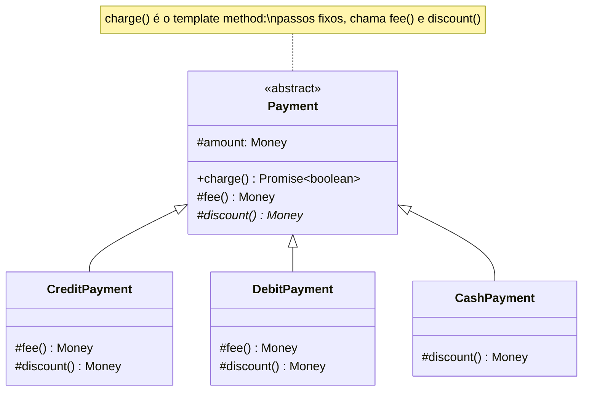

# Template Method

**Família:** comportamental

## Problema

Uma loja aceita três formas de pagamento:

| Forma | Taxa | Desconto |
|---|---|---|
| Crédito | 5% do valor | 2% se o valor > R$ 300 |
| Débito | R$ 4 fixos | 5% do valor |
| Dinheiro | nenhuma | 10% do valor |

Três classes `CreditPayment`, `DebitPayment`, `CashPayment`, cada uma com o **mesmo** método `charge()`: `valor + taxa − desconto` e envio ao gateway. O fluxo está copiado três vezes; uma mudança nele (registrar log, arredondar) precisa ser feita em todas.

## Intenção

> Definir o **esqueleto de um algoritmo** numa operação, deixando **alguns passos** para as subclasses. As subclasses redefinem passos **sem mudar a estrutura** do algoritmo.

## Estrutura



| Tipo de método | Papel | No exemplo |
|---|---|---|
| **Template method** | O esqueleto; **não deve** ser sobrescrito | `charge()` |
| **Abstrato** | Passo que **toda** subclasse implementa | `discount()` |
| **Hook** | Passo com implementação padrão, **opcional** de sobrescrever | `fee()` (padrão: zero) |

## Exemplo

```ts
interface Gateway {
  charge(amount: Money): Promise<boolean>
}

abstract class Payment {
  constructor(protected readonly amount: Money, private readonly gateway: Gateway) {}

  // TEMPLATE METHOD: a ordem e o cálculo são fixos
  async charge(): Promise<boolean> {
    const total = this.amount.add(this.fee()).subtract(this.discount())
    return this.gateway.charge(total)
  }

  // HOOK: padrão razoável, sobrescreva se precisar
  protected fee(): Money { return Money.zero() }

  // PASSO ABSTRATO: obrigatório
  protected abstract discount(): Money
}

class CreditPayment extends Payment {
  protected fee() { return this.amount.multiply(0.05) }
  protected discount() {
    return this.amount.isGreaterThan(Money.fromCents(30_000)) ? this.amount.multiply(0.02) : Money.zero()
  }
}

class DebitPayment extends Payment {
  protected fee() { return Money.fromCents(400) }
  protected discount() { return this.amount.multiply(0.05) }
}

class CashPayment extends Payment {
  protected discount() { return this.amount.multiply(0.1) } // usa o hook padrão: sem taxa
}

const value = Money.fromCents(100_000) // R$ 1.000
// Crédito:  1000 + 50 − 20  = R$ 1.030
// Débito:   1000 + 4  − 50  = R$ 954
// Dinheiro: 1000 + 0  − 100 = R$ 900
```

> ⚠️ TypeScript **não tem `final`**. Não há como impedir que uma subclasse sobrescreva `charge()`. Documente, revise no code review ou, se for crítico, prefira **Strategy** (composição), que não depende de herança.

## Template Method com hooks de ciclo de vida

Frameworks usam muito o padrão: o framework controla o fluxo e chama "ganchos" que você implementa.

```ts
abstract class ImportJob<Row> {
  async run(file: string) {        // template
    const rows = await this.read(file)
    const valid = rows.filter((row) => this.validate(row))
    await this.beforeSave(valid)     // hook
    await this.save(valid)
    await this.afterSave(valid)      // hook
  }
  protected abstract read(file: string): Promise<Row[]>
  protected abstract validate(row: Row): boolean
  protected abstract save(rows: Row[]): Promise<void>
  protected async beforeSave(_: Row[]) {}
  protected async afterSave(_: Row[]) {}
}
```

> 💡 **Princípio de Hollywood:** "Não nos chame, nós chamamos você." A superclasse chama os métodos da subclasse, e não o contrário.

## Template Method x Strategy

| | Template Method | Strategy |
|---|---|---|
| Mecanismo | **Herança** | **Composição** |
| O que varia | **Passos** de um algoritmo fixo | O **algoritmo inteiro** |
| Troca em runtime? | Não (decidido pela classe) | Sim |
| Acoplamento | Subclasse depende da superclasse | Contexto depende só da interface |
| Bom quando | O esqueleto é estável e as variações são pequenas | As variações são independentes ou combináveis |

## Quando usar / evitar

| Use | Evite |
|---|---|
| Algoritmos com **partes fixas e partes variáveis** | Quando as variações não compartilham estrutura |
| Eliminar fluxo duplicado entre classes parecidas | Hierarquias profundas (prefira Strategy) |
| Controlar **onde** as subclasses podem estender | |

## Consequências

- ✅ Reutilização: o fluxo fica num lugar só.
- ✅ Controle da sequência de execução.
- ✅ Hooks dão extensões opcionais.
- ⚠️ Acoplamento por herança; mudar a superclasse afeta todas as subclasses.
- ⚠️ Pode violar Liskov se uma subclasse "desligar" um passo esperado.

## Relacionados

[Strategy](strategy.md) · [Factory Method](../criacionais/factory-method.md) (é muitas vezes um passo de um template method) · [Hook](#template-method-com-hooks-de-ciclo-de-vida).

## Para fixar

1. Qual a diferença entre um método abstrato e um hook?
2. Por que, em TypeScript, Template Method exige cuidado extra?

<details>
<summary>Respostas</summary>

1. O abstrato é obrigatório para toda subclasse. O hook tem implementação padrão e só é sobrescrito se necessário.
2. Porque não há `final`: nada impede uma subclasse de sobrescrever o próprio template method e quebrar o algoritmo.

</details>
