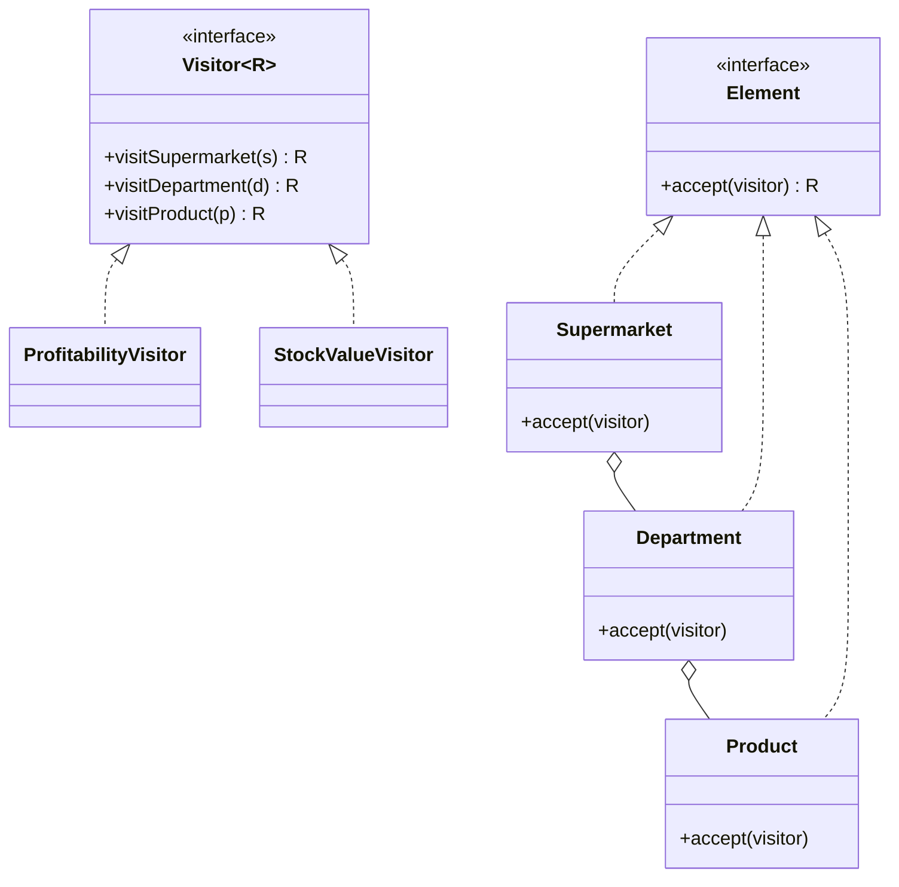
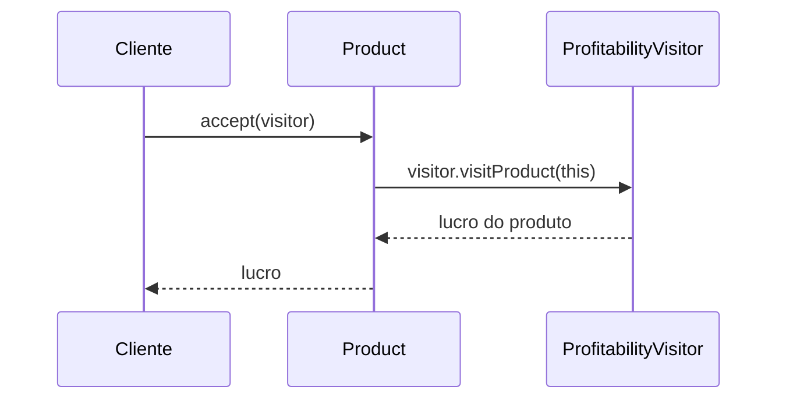

# Visitor

**Família:** comportamental

## Problema

Uma rede de supermercados tem a hierarquia **Supermercado → Departamentos → Produtos**. Hoje precisa calcular a **lucratividade**. Amanhã, o **estoque em valor**. Depois, um **relatório fiscal**. Colocar cada nova operação dentro de `Supermarket`, `Department` e `Product` polui essas classes com responsabilidades que não são delas e obriga a mexer nas três a cada operação nova.

## Intenção

> Representar uma **operação a ser executada sobre os elementos de uma estrutura de objetos**. O Visitor permite **definir novas operações sem mudar as classes** dos elementos.

## Estrutura



## Como funciona: double dispatch



O elemento "se apresenta" ao visitor (`visitProduct(this)`), e o visitor executa a versão certa da operação para aquele tipo. São **dois despachos**: um pelo tipo do elemento, outro pelo tipo do visitor.

## Exemplo

```ts
interface Visitor<R> {
  visitSupermarket(supermarket: Supermarket): R
  visitDepartment(department: Department): R
  visitProduct(product: Product): R
}

interface Element {
  accept<R>(visitor: Visitor<R>): R
}

class Product implements Element {
  constructor(
    readonly name: string,
    readonly price: number,
    readonly marginPercent: number,
    readonly stock = 0,
  ) {}
  accept<R>(visitor: Visitor<R>) { return visitor.visitProduct(this) }
}

class Department implements Element {
  readonly products: Product[] = []
  constructor(readonly name: string) {}
  add(...products: Product[]) { this.products.push(...products); return this }
  accept<R>(visitor: Visitor<R>) { return visitor.visitDepartment(this) }
}

class Supermarket implements Element {
  readonly departments: Department[] = []
  constructor(readonly name: string) {}
  add(...departments: Department[]) { this.departments.push(...departments); return this }
  accept<R>(visitor: Visitor<R>) { return visitor.visitSupermarket(this) }
}

// OPERAÇÃO 1: lucratividade
class ProfitabilityVisitor implements Visitor<number> {
  visitProduct(p: Product) { return (p.price * p.marginPercent) / 100 }
  visitDepartment(d: Department) { return d.products.reduce((sum, p) => sum + p.accept(this), 0) }
  visitSupermarket(s: Supermarket) { return s.departments.reduce((sum, d) => sum + d.accept(this), 0) }
}

// OPERAÇÃO 2: valor em estoque, sem tocar nas classes acima
class StockValueVisitor implements Visitor<number> {
  visitProduct(p: Product) { return p.price * p.stock }
  visitDepartment(d: Department) { return d.products.reduce((sum, p) => sum + p.accept(this), 0) }
  visitSupermarket(s: Supermarket) { return s.departments.reduce((sum, d) => sum + d.accept(this), 0) }
}

const store = new Supermarket('Mercado da Esquina').add(
  new Department('Alimentos').add(new Product('Arroz 5 kg', 18, 30, 40), new Product('Macarrão', 3.2, 15, 100)),
  new Department('Higiene').add(new Product('Papel higiênico', 11, 35, 60), new Product('Sabonete', 1.2, 10, 200)),
)

store.accept(new ProfitabilityVisitor()) // ≈ 9.85 (ponto flutuante: use Money em código real)
store.accept(new StockValueVisitor())    // 720 + 320 + 660 + 240 = 1940
```

Lucros: arroz 5,40 + macarrão 0,48 + papel 3,85 + sabonete 0,12 = **9,85**.

## A alternativa em TypeScript: união discriminada

Com tipos de dados simples, um `switch` exaustivo sobre uma **união discriminada** costuma ser mais direto que Visitor, e o compilador avisa quando falta um caso:

```ts
type Node =
  | { kind: 'product'; price: number; margin: number }
  | { kind: 'department'; products: Node[] }

function profit(node: Node): number {
  switch (node.kind) {
    case 'product': return (node.price * node.margin) / 100
    case 'department': return node.products.reduce((s, n) => s + profit(n), 0)
  }
}
```

📌 **Regra prática:** Visitor quando os elementos são **classes com comportamento** e você quer muitas operações externas; união discriminada quando são **dados**.

## Quando usar / evitar

| Use | Evite |
|---|---|
| A estrutura de classes é **estável**, mas **novas operações** aparecem com frequência | Os **tipos de elemento** mudam com frequência (cada novo tipo exige mudar **todos** os visitors) |
| Operações não relacionadas que poluiriam os elementos | Poucas operações simples |
| Percorrer um Composite (AST, árvore de documentos) aplicando operações variadas | |

## Consequências

- ✅ Novas operações = novos visitors, sem tocar nos elementos (OCP para operações).
- ✅ Operações relacionadas agrupadas num lugar.
- ⚠️ Novos **tipos** de elemento são caros: exige mudar todos os visitors.
- ⚠️ Pode quebrar o encapsulamento: os elementos precisam expor dados para o visitor.

## Relacionados

[Composite](../estruturais/composite.md) (Visitor costuma percorrer um Composite) · [Interpreter](interpreter.md) (visitors operam sobre a AST) · [Iterator](iterator.md).

## Para fixar

1. O que é double dispatch?
2. Quando Visitor é uma má ideia?

<details>
<summary>Respostas</summary>

1. A operação executada depende de dois tipos: o do elemento (que escolhe qual `visitX` chamar) e o do visitor (que define o que esse `visitX` faz).
2. Quando novos tipos de elemento aparecem com frequência: cada um obriga a mudar todos os visitors.

</details>
