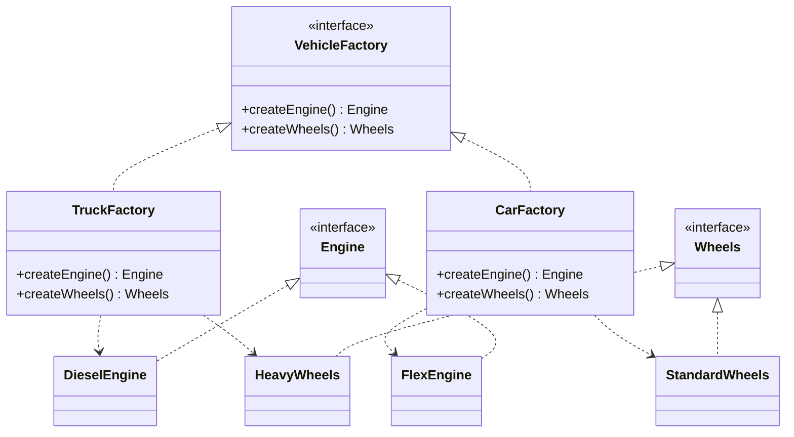
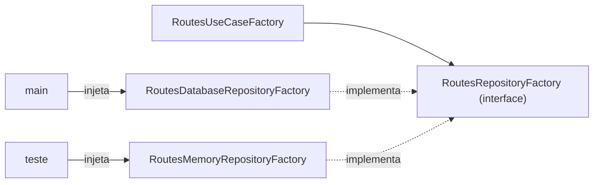

# Abstract Factory

**Família:** criacional

## Problema

Um sistema precisa rodar em dois "mundos": **produção** (Postgres, Kafka) e **teste** (memória). Se cada usecase escolhe sozinho qual repositório criar, alguém vai misturar um repositório de memória com um publisher de produção, e o teste passa a mandar mensagens reais.

## Intenção

> Fornecer uma **interface para criar famílias de objetos relacionados**, sem especificar as classes concretas, garantindo que os objetos criados sejam **compatíveis entre si**.

## Estrutura



Um caminhão nunca recebe rodas de carro: a **família** garante a compatibilidade.

## Exemplo clássico

```ts
interface Engine { start(): string }
interface Wheels { size(): number }

interface VehicleFactory {
  createEngine(): Engine
  createWheels(): Wheels
}

class TruckFactory implements VehicleFactory {
  createEngine() { return new DieselEngine() }
  createWheels() { return new HeavyWheels() }
}

class CarFactory implements VehicleFactory {
  createEngine() { return new FlexEngine() }
  createWheels() { return new StandardWheels() }
}

function assemble(factory: VehicleFactory) {
  const engine = factory.createEngine()
  const wheels = factory.createWheels()
  return `${engine.start()} on ${wheels.size()}" wheels`
}
```

## Exemplo arquitetural: famílias de infra e de usecases

É aqui que o padrão mais aparece no dia a dia.

```ts
// data/factories.ts — a "interface da família"
export interface RoutesRepositoryFactory {
  route(): RouteRepository
  zone(): ZoneRepository
}
```

```ts
// infra/factories/database.ts — família de produção
export class RoutesDatabaseRepositoryFactory implements RoutesRepositoryFactory {
  constructor(private readonly orm: Orm) {}
  route() { return new RoutePostgresRepository(this.orm) }
  zone() { return new ZonePostgresRepository(this.orm) }
}

// infra/factories/memory.ts — família de teste
export class RoutesMemoryRepositoryFactory implements RoutesRepositoryFactory {
  private readonly routes = new RouteMemoryRepository()
  private readonly zones = new ZoneMemoryRepository()
  route() { return this.routes }
  zone() { return this.zones }
}
```

```ts
// application/factories/usecases.ts — recebe uma família inteira
export class RoutesUseCaseFactory {
  constructor(private readonly repositories: RoutesRepositoryFactory) {}

  getRoute() { return new GetRouteUseCase(this.repositories.route()) }
  listRoutes() { return new ListRoutesUseCase(this.repositories.route()) }
  coverZone() { return new CoverZoneUseCase(this.repositories.route(), this.repositories.zone()) }
}
```

```ts
// main: produção
const usecases = new RoutesUseCaseFactory(new RoutesDatabaseRepositoryFactory(orm))

// teste: troca a família inteira com uma linha
const usecases = new RoutesUseCaseFactory(new RoutesMemoryRepositoryFactory())
```



## Quando usar / evitar

| Use | Evite |
|---|---|
| Há **famílias** de objetos que precisam combinar (produção x teste, AWS x GCP, tema claro x escuro) | Só existe um produto (use Factory Method) |
| Você quer trocar a família inteira de uma vez | Só existe uma família |
| Montagem de dependências **arquiteturais** (usecases, repositories, controllers) | |

## Consequências

- ✅ Garante **compatibilidade** entre os produtos.
- ✅ Troca a família inteira mudando **um** objeto.
- ✅ Isola o cliente das classes concretas.
- ⚠️ Adicionar um **novo tipo de produto** (`createSeats()`) exige mudar a interface e **todas** as fábricas.

## Relacionados

[Factory Method](factory-method.md) (cada método da Abstract Factory costuma ser um) · [Singleton](singleton.md) (uma fábrica concreta costuma ser única) · [Prototype](prototype.md).

## Para fixar

1. Qual problema a Abstract Factory evita entre produção e teste?
2. Qual o custo de adicionar um novo produto à família?

<details>
<summary>Respostas</summary>

1. Misturar peças de famílias diferentes, como um repositório de memória com um publisher real.
2. Alterar a interface da fábrica e todas as implementações concretas.

</details>
