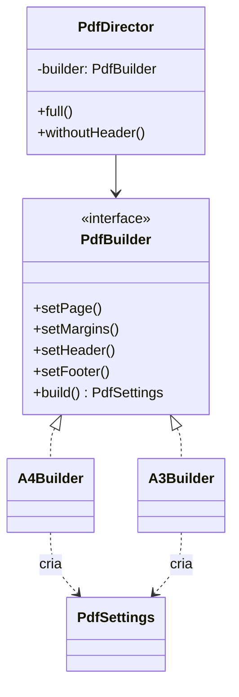

# Builder

**Família:** criacional

## Problema

```ts
new PdfGenerator('portrait', 'mm', 210, 297, 30, 20, 30, 20, true, 15, true, 15, '#ffffff', 'UTF-8')
```

Quatorze parâmetros posicionais. Qual é a margem esquerda? Qual é a altura do rodapé? Trocar dois números de lugar compila e gera um PDF errado. Usar setters resolve a leitura, mas permite um objeto **meio configurado**.

## Intenção

> Separar a **construção** de um objeto complexo da sua **representação**, permitindo que o **mesmo processo** de construção crie **representações diferentes**.

## Estrutura (GoF)



| Papel | Responsabilidade |
|---|---|
| **Builder** | Interface com os passos de construção |
| **Concrete Builder** | Implementa os passos para uma representação (A4, A3) |
| **Director** | Define **receitas**: a ordem dos passos para cada configuração |
| **Product** | O objeto final |

## Exemplo 1: GoF com Director (geração de PDF)

```ts
type PdfSettings = Readonly<{
  page: { width: number; height: number; orientation: 'portrait' | 'landscape'; unit: 'mm' }
  margins: { top: number; right: number; bottom: number; left: number }
  header: { height: number } | null
  footer: { height: number } | null
  color: string
  encoding: 'UTF-8'
}>

interface PdfBuilder {
  reset(): void
  setPage(): void
  setMargins(): void
  setHeader(): void
  setFooter(): void
  build(): PdfSettings
}

class A4Builder implements PdfBuilder {
  private draft: Partial<{ -readonly [K in keyof PdfSettings]: PdfSettings[K] }> = {}

  reset() { this.draft = { header: null, footer: null, color: '#ffffff', encoding: 'UTF-8' } }
  setPage() { this.draft.page = { width: 210, height: 297, orientation: 'portrait', unit: 'mm' } }
  setMargins() { this.draft.margins = { top: 30, right: 20, bottom: 30, left: 20 } }
  setHeader() { this.draft.header = { height: 15 } }
  setFooter() { this.draft.footer = { height: 15 } }

  build(): PdfSettings {
    const { page, margins } = this.draft
    if (!page || !margins) throw new Error('Page and margins are required')
    return Object.freeze({ ...this.draft, page, margins } as PdfSettings)
  }
}

// A3Builder é igual ao A4Builder, com página 297 × 420 e margens 60/40, sem cabeçalho e rodapé

class PdfDirector {
  constructor(private builder: PdfBuilder) {}

  use(builder: PdfBuilder) { this.builder = builder }

  full() {
    this.builder.reset()
    this.builder.setPage()
    this.builder.setMargins()
    this.builder.setHeader()
    this.builder.setFooter()
    return this.builder.build()
  }

  withoutHeader() {
    this.builder.reset()
    this.builder.setPage()
    this.builder.setMargins()
    this.builder.setFooter()
    return this.builder.build()
  }
}

const director = new PdfDirector(new A4Builder())
const a4 = director.full()
director.use(new A3Builder())
const a3 = director.full()
```

## Exemplo 2: Fluent Builder (o mais comum hoje)

Sem Director. O próprio cliente encadeia os passos e o `build()` valida.

```ts
class HttpRequestBuilder {
  #method: 'GET' | 'POST' = 'GET'
  #url = ''
  #headers: Record<string, string> = {}
  #body: unknown = undefined
  #timeoutMs = 5000

  url(url: string) { this.#url = url; return this }
  post(body: unknown) { this.#method = 'POST'; this.#body = body; return this }
  header(name: string, value: string) { this.#headers[name] = value; return this }
  timeout(ms: number) { this.#timeoutMs = ms; return this }

  build(): Readonly<HttpRequest> {
    if (!this.#url) throw new Error('URL is required')
    return Object.freeze({
      method: this.#method,
      url: this.#url,
      headers: { ...this.#headers },
      body: this.#body,
      timeoutMs: this.#timeoutMs,
    })
  }
}

const request = new HttpRequestBuilder()
  .url('/v1/quotes')
  .post({ from: '01310100', to: '20040002' })
  .header('Idempotency-Key', crypto.randomUUID())
  .timeout(3000)
  .build()
```

## Exemplo 3: Builder em testes (Test Data Builder)

Um dos usos mais valiosos: criar objetos de teste com **padrões razoáveis**, mudando só o que importa no caso.

```ts
class OrderBuilder {
  #id = 'order-1'
  #customerId = 'customer-1'
  #items: Array<[string, number, number]> = [['product-1', 1000, 1]]

  withId(id: string) { this.#id = id; return this }
  withoutItems() { this.#items = []; return this }
  withItem(productId: string, priceCents: number, qty = 1) { this.#items.push([productId, priceCents, qty]); return this }

  build() {
    const order = Order.create(this.#id, this.#customerId)
    for (const [productId, cents, qty] of this.#items) order.addItem(productId, Money.fromCents(cents), qty)
    return order
  }
}

test('cannot place an empty order', () => {
  const order = new OrderBuilder().withoutItems().build()
  expect(() => order.place(new Date())).toThrow('empty')
})
```

## Quando usar / evitar

| Use | Evite |
|---|---|
| Muitos parâmetros, vários opcionais | Objeto com 2 ou 3 campos (um construtor ou objeto de opções basta) |
| O mesmo processo deve gerar representações diferentes | Quando um objeto literal tipado já resolve |
| Construção em etapas com validação no fim | |
| Dados de teste legíveis | |

> 💡 Em TypeScript, um **objeto de opções nomeadas** (`new Pdf({ margins: {...}, header: {...} })`) resolve boa parte dos casos sem Builder. Use Builder quando há **etapas**, **receitas** ou **validação no final**.

## Consequências

- ✅ Leitura clara: cada passo tem nome.
- ✅ Produto pode ser **imutável** (só é entregue no `build()`).
- ✅ Isola a lógica de construção.
- ⚠️ Mais classes e código.

## Relacionados

[Factory Method](factory-method.md) (decide **qual**; Builder decide **como**) · [Composite](../estruturais/composite.md) (builders costumam montar árvores).

## Para fixar

1. Qual o papel do Director?
2. Por que um Test Data Builder melhora os testes?

<details>
<summary>Respostas</summary>

1. Define receitas: a ordem e a combinação de passos para cada configuração, reutilizáveis com builders diferentes.
2. Cada teste declara só o que importa para o caso; o resto vem de padrões razoáveis. O teste fica curto e a intenção fica visível.

</details>
