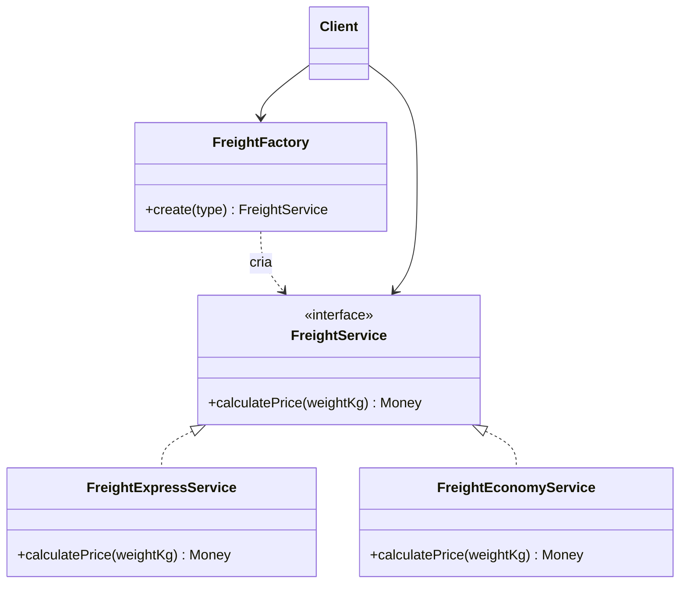

# Factory Method

**Família:** criacional

## Problema

```ts
function createVehicle(type: string) {
  if (type === 'TRUCK') return new Truck()
  if (type === 'VAN') return new Van()
  if (type === 'MOTORCYCLE') return new Motorcycle()
  throw new Error('Unknown')
}
```

Esse `if` aparece em vários lugares do código. Cada novo tipo exige caçar e editar todos. E o código que **usa** o veículo fica acoplado às classes concretas.

## Intenção

> Definir **um método responsável por criar** objetos, deixando a decisão sobre **qual classe concreta** instanciar centralizada (ou delegada a subclasses). O cliente depende só da **interface** do produto.

## Estrutura



## Exemplo: tipos de frete

```ts
// data/freight.ts
export type FreightType = 'express' | 'economy'

export interface FreightService {
  calculatePrice(weightKg: number): Money
}
```

```ts
// domain/services/freight-express.ts
export class FreightExpressService implements FreightService {
  calculatePrice(weightKg: number) { return Money.fromCents(Math.ceil(weightKg) * 2000) }
}

// domain/services/freight-economy.ts
export class FreightEconomyService implements FreightService {
  calculatePrice(weightKg: number) { return Money.fromCents(Math.ceil(weightKg) * 1000) }
}
```

```ts
// domain/factories/freight-factory.ts
export class FreightFactory {
  static create(type: FreightType): FreightService {
    switch (type) {
      case 'express': return new FreightExpressService()
      case 'economy': return new FreightEconomyService()
      default: {
        const exhaustive: never = type // erro de compilação se faltar um caso
        throw new Error(`Invalid freight type: ${exhaustive}`)
      }
    }
  }
}
```

```ts
const price = FreightFactory.create(input.type).calculatePrice(input.weightKg)
```

> 💡 O truque do `never`: se alguém adicionar `'same-day'` em `FreightType` e esquecer a factory, **o TypeScript acusa**.

### Variante com registro (fechada para modificação)

```ts
const registry = new Map<FreightType, () => FreightService>([
  ['express', () => new FreightExpressService()],
  ['economy', () => new FreightEconomyService()],
])

export const FreightFactory = {
  create(type: FreightType) {
    const make = registry.get(type)
    if (!make) throw new Error(`Invalid freight type: ${type}`)
    return make()
  },
  register(type: FreightType, make: () => FreightService) { registry.set(type, make) },
}
```

### A forma "clássica" do GoF (por herança)

No livro, o Factory Method é um método **abstrato** que subclasses sobrescrevem:

```ts
abstract class Logistics {
  abstract createTransport(): Transport   // o factory method
  planDelivery() {
    const transport = this.createTransport()
    return transport.deliver()
  }
}
class RoadLogistics extends Logistics { createTransport() { return new Truck() } }
class SeaLogistics extends Logistics { createTransport() { return new Ship() } }
```

Na prática moderna, a versão com `switch`/registro (às vezes chamada de **Simple Factory**) é a mais comum.

## Quando usar / evitar

| Use | Evite |
|---|---|
| A classe concreta depende de um **valor** (tipo, configuração, país) | Só existe uma implementação |
| Você quer **centralizar** a criação de uma família do negócio | Um `new` direto é claro e não se repete |
| O cliente deve depender só da interface | |

📌 **Neste curso:** Factory Method para **famílias do negócio** que fogem de nomes arquiteturais (tipos de frete, de pagamento, de documento). Para famílias **arquiteturais** (usecases, repositories), use [Abstract Factory](abstract-factory.md).

## Variantes de factory

| Variante | Ideia |
|---|---|
| **Simple Factory** | Uma função/classe com `switch` que centraliza a criação |
| **Factory Method** | Método (às vezes abstrato) que decide a classe concreta |
| **Static Factory** | Métodos estáticos com nomes claros no lugar de construtores (`Money.fromCents`) |
| **Abstract Factory** | Interface que cria **famílias** de produtos compatíveis |
| **Builder** | Construção passo a passo (página própria) |

## Consequências

- ✅ Cliente desacoplado das classes concretas (DIP).
- ✅ Novo tipo = nova classe + uma linha na factory (OCP, quase).
- ✅ Facilita testes: a factory pode devolver um dublê.
- ⚠️ Mais uma indireção para ler.

## Relacionados

[Abstract Factory](abstract-factory.md) (várias factory methods juntas) · [Strategy](../comportamentais/strategy.md) (a factory costuma escolher qual estratégia usar) · [Prototype](prototype.md) (alternativa: clonar em vez de instanciar).

## Para fixar

1. Para que serve o `const exhaustive: never` no `default`?
2. Qual a diferença entre Factory Method e Abstract Factory?

<details>
<summary>Respostas</summary>

1. Faz o compilador acusar erro quando um novo valor é adicionado ao tipo e a factory não o trata.
2. Factory Method cria **um** produto, escolhendo a classe. Abstract Factory agrupa a criação de uma **família** de produtos que precisam ser compatíveis.

</details>
